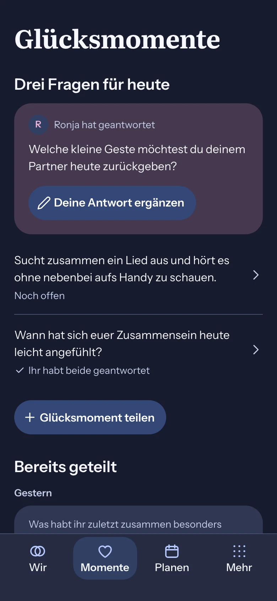
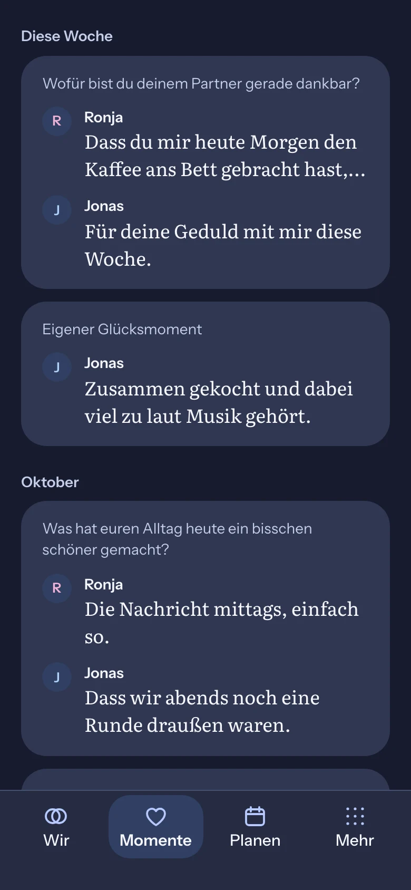
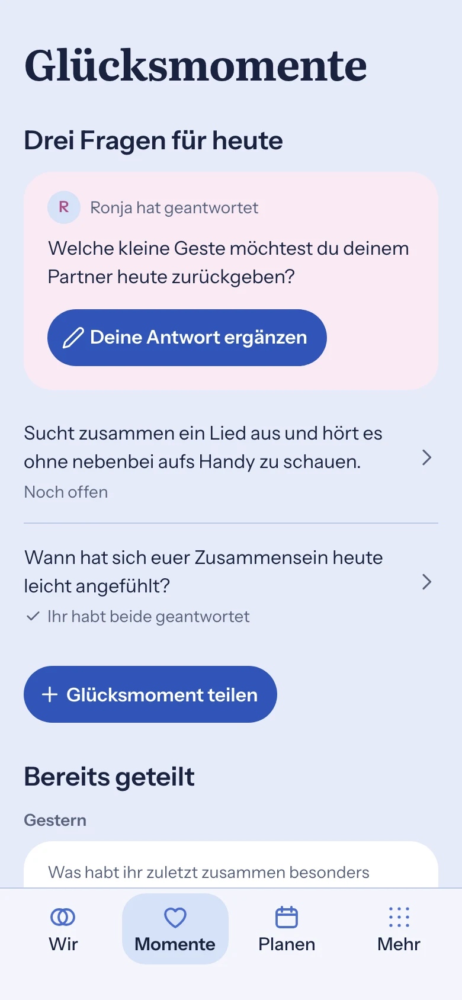
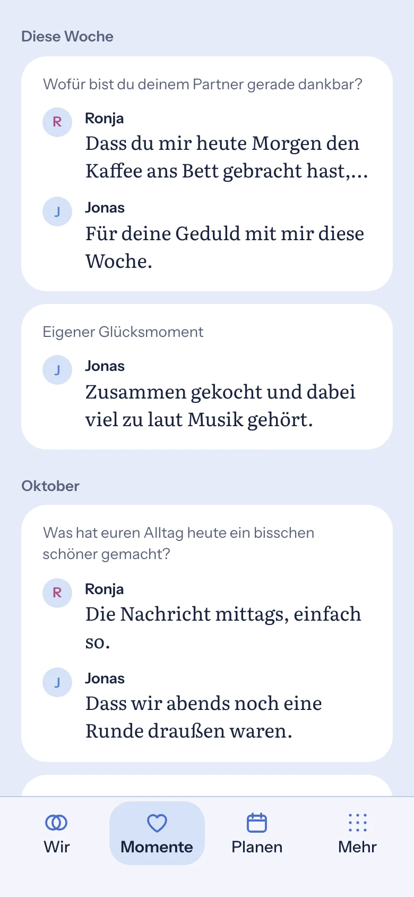

# Happiness overview — composition reference

Owner: [#1775](https://github.com/baerenmarke90/eimir/issues/1775). Produced before UI implementation on 2026-11-12.

Baseline: main `b065e264051858529eded654850a5c1938e02761` and a Product Owner device screenshot of the current Dark `/happiness` page.

| Today | History |
| --- | --- |
|  |  |
|  |  |

## How the images were produced

Static HTML rendered with Playwright at 390×844 CSS px and device scale factor 2. It uses the repository font files from `web/public/fonts`, the Light and Dark token values from `web/src/theme.css`, `web/src/design/product-roles.css` and `web/src/design/identity-roles.css`, the `AddAction` pill contract and `EimirIcon` outline paths. Navigation reproduces the existing four-destination Compact bar.

## What the reference communicates

- The question the partner already answered leads the `coupleExperiences.questionsTitle` section on `--color-brand-surface` with the partner identity and the filled `coupleExperiences.addOwnAnswer` action.
- The remaining questions keep the separator-row pattern and gain a supporting-copy state line.
- `coupleExperiences.create.happiness` stays a filled pill below the questions.
- The `coupleExperiences.history` section is grouped by localized time headings. Each entry is one raised surface: the question as supporting copy, each answer with avatar, author name once and a 2-line Literata preview. Missing own answers show an inline `addOwnAnswer` link.

## Not implementation requirements

Initial avatars, sample names, sample answers and the exact state-line wording are illustrative. Runtime uses the actual shell, localized copy, avatar/nickname resolution and component primitives. The image guides hierarchy and density; it is not a pixel lock.
