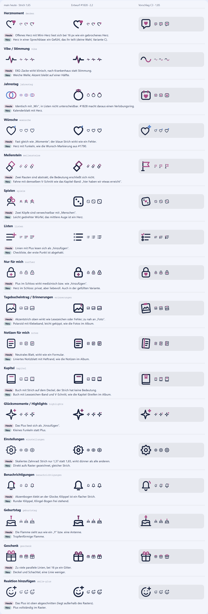

# Icons: legibility and presentation (#1907 C3)

Generated visual reference for the Product Owner approval of 2026-11-16 on slice C3 of #1907. The slice changes
icon **shapes** only; fills, gradients, two-tone and palette belong to C2. Baseline `main` `fd2d2e5f2`. Every glyph of
`web/src/components/EimirIcon.tsx` was reviewed at 16/20/24/32 px in Light and Dark next to the draft #1828, and the
destination screens Wir, Momente (Album and the create menu), Planen (plan editor) and Mehr were captured at 390 px
from the local demo instance with only the icons swapped.

| File | Content |
| --- | --- |
| `c3-icon-sheet-light.png`, `c3-icon-sheet-dark.png` | Each redrawn glyph: today (stroke 1.65), draft #1828 (2.2), approved drawing (1.85), large and at 16/20/24 px |
| `c3-album-family.png` | The Momente Album next to the icons derived from it |
| `c3-compact-*.png` | 390 px before/after: More list and top, Momente create menu (Light and Dark), plan editor tool bar |

## Product decisions

- **One stroke for every icon: 1.85** on the 24 px grid with a 2 px safe area. It replaces the 1.65 base and the
  local overrides between 1.5 and 2.2. Designs keep their bounded `icon.stroke` choice (#1907 C1).
- **One language with the Momente Album.** Paper keepsakes look like their Album counterparts and tilt slightly
  (−6° to +4°): the diary entry is a Polaroid with washi tape, private notes are a lined sheet with a margin line, a
  chapter is a book with the V-cut ribbon of the Album chapter strips, the milestone flag repeats that V-cut. Tools and
  controls (search, close, check, lock, eye, arrows, trash) stay upright and unchanged.
- **Accent** marks only the one meaningful detail (tape, ribbon, heart, check); colours stay as they are.
- **17 redrawn glyphs:** `denken` (Heart Moment: a heart in a speech bubble, Product Owner choice C), `vibe` (soft
  wave instead of an ECG), `jahrestag` (calendar with a heart; no longer identical to `wir`), `wuensche` (heart with a
  sparkle), `meilensteine` (flag), `spiele` (tilted dice with a heart pip), `listen` (checklist), `nurfuer` (lock with a
  heart, including the filled and duotone shapes), `erinnerungen` (Polaroid), `notes`, `kapitel`, `highlights`
  (sparkle instead of a plus), `einstellungen` (gear drawn on the grid), `benachrichtigungen`, `geburtstag` (drop
  flame), `geschenk` (lid and box) and `smile-plus` (plus no longer clipped).
- Navigation (Wir, Momente, Planen, Mehr) keeps its shapes; a 2×2 tile "Mehr" was tried and rejected. Unused glyphs
  (`geteilt`, `ziele`, `neu`, `reisen`) are unchanged.
- **Inline icons** drawn directly in components use the same stroke token; their shapes stay.
- The draft #1828 is superseded; only its checklist and dice ideas survive, redrawn.

The captures guide Product Acceptance; Product Reference v1, accessibility and the privacy contracts govern details.

## Evidence

`evidence/` holds captures of the implemented icons from the local demo instance with reduced motion: More (top
and destination list) and the Momente create menu at 390 px Light and Dark, at 390 px Light with 200 % root text,
and at 1280 px Light (Expanded create dialog). Accessible names come from the visible labels; every icon stays
`aria-hidden`. Device verification on the Pixel is still open.
