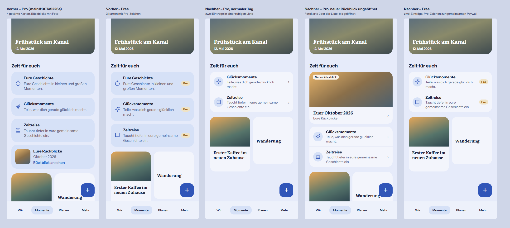
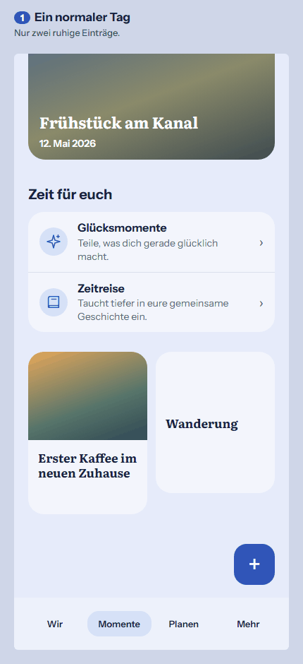

# #1907 F4: Discover "time for you" group

Generated visual reference for the Momente Discover group (`coupleExperiences.title`),
approved by the Product Owner on 2026-11-15. Baseline reviewed: `main` `007a9226e`
(the Discover sources are unchanged on `5854be4dd`). DOM-only board at 390 px, Light,
with synthetic titles and gradient stand-ins for photos; hero, tapestry, create
action and navigation are kept as they are on the real `/story` Discover panel.

## Before

`CoupleExperienceLinks` renders four tinted cards for a Premium Space: the story
overview (`relationshipReflections.passport.title`, added by #1863), the happiness
and time-travel experiences (`coupleExperiences.entries.*`, #1562) and the recap
entry from `RecapEntryLink` (#1794). Only the recap entry shows a 64 px cover photo,
a third action line (`recaps.entryAction`) and spans both Expanded columns; its
fallback icon (`highlights`) duplicates the happiness entry. A Free Space sees the
first three cards, each with a Pro mark.

## Decision

- **Consistent anatomy:** one grouped list instead of separate cards. Every row is
  an `EimirIcon` in a tinted round badge, a title, one supporting line and a
  trailing chevron, or the `ProMark` for Free. No photos inside rows.
- **Permanent rows:** happiness and time travel only.
- **Story overview leaves Discover.** It stays reachable from the Wir heart line,
  the shared-album title link and More. No quiet text line in Discover (the
  Product Owner rejected that variant).
- **Recaps are contextual:** no permanent row. While the newest monthly edition is
  `READY`, has an available source and has not been opened, a photo lead card sits
  above the list. It disappears once opened, and at the latest on the 4th of the
  following month, like `MonthlyRecapInvitation` on Wir. The recap library stays
  reachable from the story overview page.
- **Free:** two rows with Pro marks leading to the shared paywall; no recap card
  because Free Spaces have no composed editions. No tier change.

## Motion

The lead card grows in (height and opacity, `--duration-context`,
`--easing-enter`) and fades out when the user returns after opening it. Reduced
motion: the card appears and disappears without movement.

## Implementation notes (not yet approved code decisions)

- Reuse `useAttentionReceipt` with the recap receipt id used on Wir, so opening
  the recap from either surface clears both.
- Expanded keeps one list in the Discover reading column instead of the
  two-column grid.
