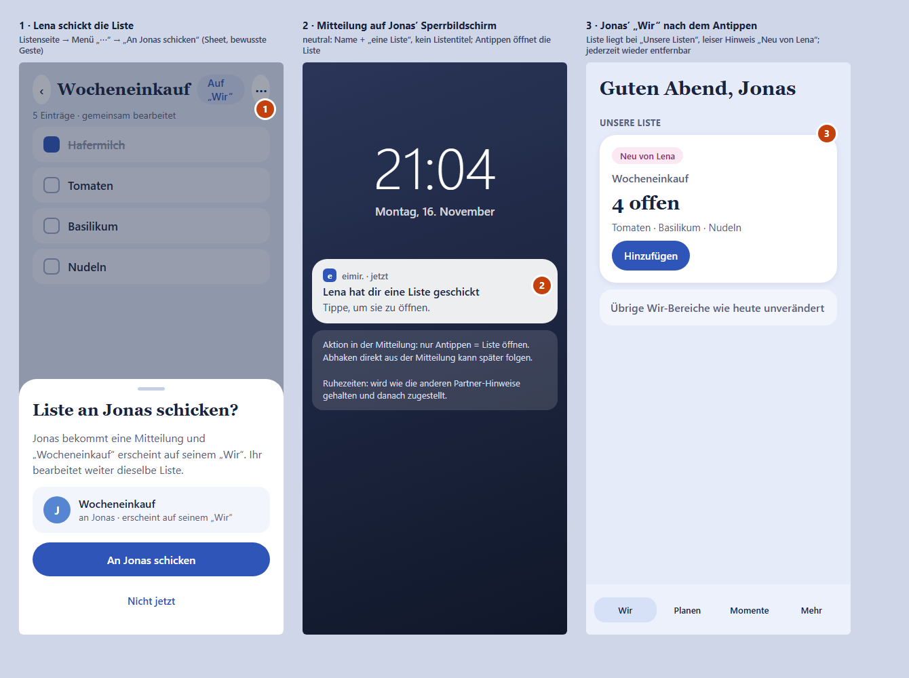

# Send a shared list to the partner (#1907 E2)

Generated visual reference for the Product Owner decisions of 2026-11-16 on slice E2 of #1907. Baseline
`main` `1ccac0407`; the list page (`CollectionProductPage`), the Wir list tiles (`WirLists`), the notification
settings and the notification preview catalog were reviewed and are unchanged on `f1ef9074d`.

| # | Screen |
| --- | --- |
| 1 | The list menu offers a second action next to sorting (`m5s3.collection.menu.send`). It opens a short confirmation in the same sheet (`m5s3.collection.menu.sendTitle`) with one filled action and a quiet way out |
| 2 | Lock screen of the partner: their name and "a list", never the list title (a list may be a gift surprise). Tapping opens the list; ticking from the notification is not part of this slice |
| 3 | The partner's Wir shows the list at the end of "Unsere Listen"; they can remove it as any pinned list |

The board was rendered from an HTML sketch that uses the light identity roles of
`web/src/design/identity-roles.css`; names and list content are prototype aids. The composition guides
Product Acceptance; Product Reference v1, accessibility and the privacy contracts govern details.

## Product decisions

- **Trigger:** a deliberate send from the list menu. Personal pinning to Wir stays private and silent.
- **Action in the notification:** open the list.
- **Setting:** its own switch, `notificationSettings.collectionSent`, among the partner notices. Free/Core. Quiet Hours hold it. No email choice.
- **Preview:** neutral, no list title.

## Mobile Interaction Contract

- Smartphone first. Reach: the menu trigger sits in the page header; the confirmation is a bottom sheet whose
  primary action is reachable with the thumb. A filled action sends; the quiet action closes without effect.
- The first tap never sends. A failed send shows the shared problem state with a retry and keeps the list;
  nothing is queued offline.
- Success is a calm status line under the title (`m5s3.collection.menu.sendDone`), announced politely, no
  motion beyond the existing sheet transition; reduced motion is honoured by the sheet.
- The menu appears only when a partner is known; without a partner there is nothing to send to.

## Evidence

`evidence/` holds browser captures of the shipped sheet and the confirmation at 390 px Light, 360 px Dark and
430 px Light with reduced motion, from the journey in `web/e2e/tests/today-pinned-collection.spec.ts`.
The lock-screen text and the native action label are covered by the push preview fixtures; the real device
check (notification on the Pixel, tap opens the list) stays open in #515, #565 and #1577.
