# #1907 G1: Edit a photo before upload

Visual reference and decision for the photo edit step, approved by the Product
Owner on 2026-11-16 after three clickable prototypes in the real app ("Ja, so
ausbauen"). Baseline reviewed: `main` `b67ddff0d`; rebased onto `a33e9cfa8`
without changes to the reviewed screens. The images are captured from the real
Web app (mocked API, synthetic lake photo) at 390 px, so they show the shipped
composer, sheet, navigation and existing photo actions as they are.

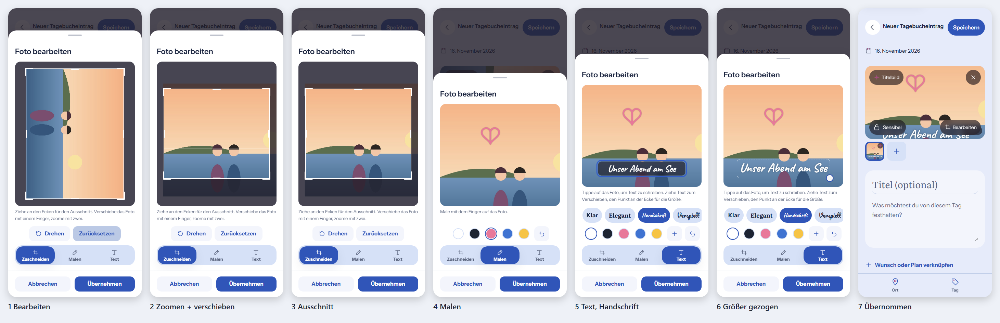

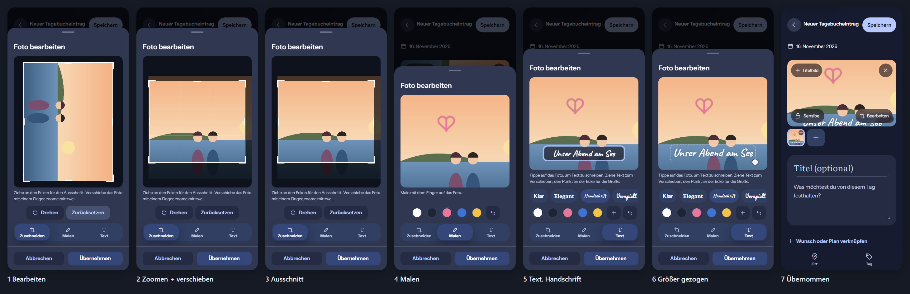

## Reviewed baseline

- Memory, Plan and HeartMoment photos are added in the composer stage
  (`AttachmentDraftPicker`, `PhotoDraftGallery`) with cover, sensitive, remove
  and order actions; the selected file uploads in the background with
  preserved metadata so the capture date and place enrich the moment (#1459).
- The own profile photo passes the round `PhotoCropTask` (#1854). A related
  person's avatar had no crop step, against contract 10.1a.
- No image could be turned, cropped or written on.

## Decision

- **Edit at upload, keep the metadata.** The Product Owner asked to edit
  directly when the photo is added, before saving, and for date and place to
  stay. The edit is rendered on the device and replaces the selected photo; a
  JPEG keeps its EXIF block (orientation set upright, pixel size updated, old
  thumbnail link dropped). No second copy of the original is stored on the
  server; the original stays on the device (confirmed by the Product Owner
  on 2026-11-16 in #1957).
- **Only the needed tools**, like a phone's photo app: Zuschneiden, Malen and
  Text. No aspect-ratio buttons (withdrawn after the first prototype).
- **Cropping as in photo apps.** The frame stays, the photo moves under it with
  one finger and zooms with two; corners and edges change the frame and the
  new section re-centres on release. `Drehen` turns a quarter to the left.
- **Text** can be moved, resized from a corner grip and set in six free
  typefaces: Klar (Instrument Sans), Elegant (Literata), Handschrift (Caveat),
  Verspielt (Pacifico), Plakat (Bebas Neue), Schreibmaschine (Courier Prime).
- **Five mark colours** for pen and text (`photoMark` tokens): white, black,
  rose, blue, yellow. They are photo content and stay the same in Dark.
- **Surfaces:** every place a photo is added to a Memory (create and edit),
  Plan (create and edit) or HeartMoment, through the `Bearbeiten` overlay on a
  selected, not yet saved photo. Avatars (own profile and related People, from
  the device or a connected source) keep the round crop step and gain
  `Drehen`. Once-messages stay out (end-to-end encrypted inline media).
- **Tier:** Free/Core within "Image attachment upload & storage"; on-device
  processing, no provider, Self-Hosted equals Cloud (confirmed by the
  Product Owner on 2026-11-16 in #1957).

## Mobile Interaction Contract

| Aspect | Contract |
| --- | --- |
| Focal point | The photo, as large as the sheet allows (at most half the viewport height). |
| Entry | `Bearbeiten` overlay on the composer stage of a selected, not yet saved photo (not for videos or photos the device cannot decode). |
| Primary action | `Übernehmen` in the sheet footer; `Abbrechen`, Escape, Back and dismissal keep the photo unchanged. |
| Tools | Icon-over-label radios at the bottom: Zuschneiden, Malen, Text. Each tool shows one help line and its own context row. |
| Crop gestures | One finger pans, two fingers pinch-zoom, mouse drag and wheel do the same; handles resize the frame; release re-centres. Thirds appear while moving. |
| Draw | Finger or mouse draws smoothed strokes in the chosen colour; `Rückgängig` removes the last mark. |
| Text | Tap places and opens a text field; Enter finishes; drag moves; the corner grip resizes; font chips and colours apply to the selected text. A tap beside it lets go first. |
| Keyboard | Frame: arrows pan, plus/minus zoom. Handles: arrows move their edges. Text grip: arrows resize. `+` button adds a text in the centre. |
| Result | The edited photo replaces the draft in place (same position, cover and sensitivity) and uploads again; the composer shows it at once. |
| Avatars | Round frame, zoom slider and `Drehen`; the saved square carries no metadata. |
| Compact / Expanded | Bottom sheet on Compact; a centred dialog of the same content on Expanded. |
| States | Loading: `photoEdit.confirming` on the footer action while rendering. Error: an undecodable photo shows `photoEdit.unavailable` and stays as selected; a failed render keeps the selected photo. Offline: editing is local; the upload follows the composer's existing retry. |
| Motion | The frame and photo re-centre with `--duration-transition` and `--easing-standard`; no motion while the finger moves; reduced motion jumps. |
| Privacy | Nothing leaves the device before `Übernehmen`; metadata handling is unchanged from today's upload (kept for moments, stripped for avatars). |

## Evidence

Captured by `web/e2e/tests/photo-edit.spec.ts`,
`web/e2e/tests/profile-photo-crop.spec.ts` and
`web/e2e/tests/polish-people-photo-sources.spec.ts` (mocked API, synthetic
content):

| State | Image |
| --- | --- |
| Crop frame after resizing, 360 Light | 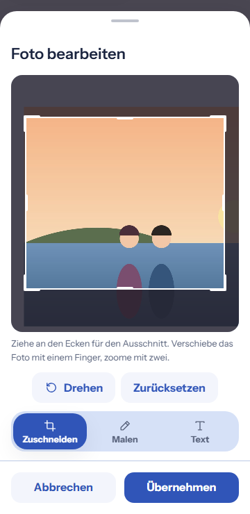 |
| Moving the photo under the frame, 390 Dark | 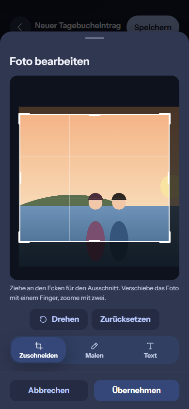 |
| Drawing, 430 Dark, reduced motion | 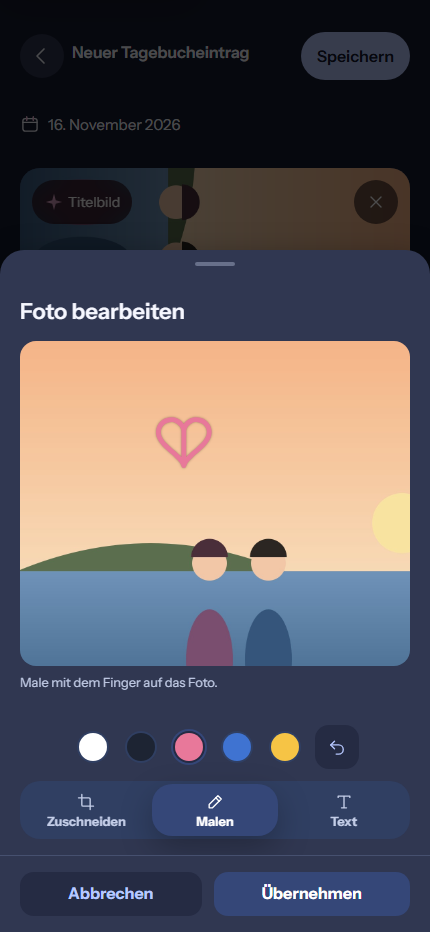 |
| Text in Handschrift, enlarged, 390 Light | 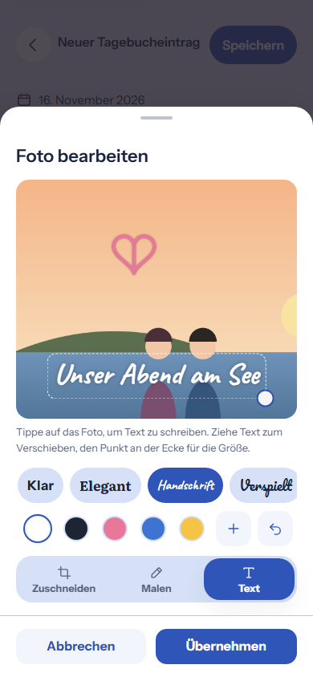 |
| Text tool on Expanded, 1280 Light | 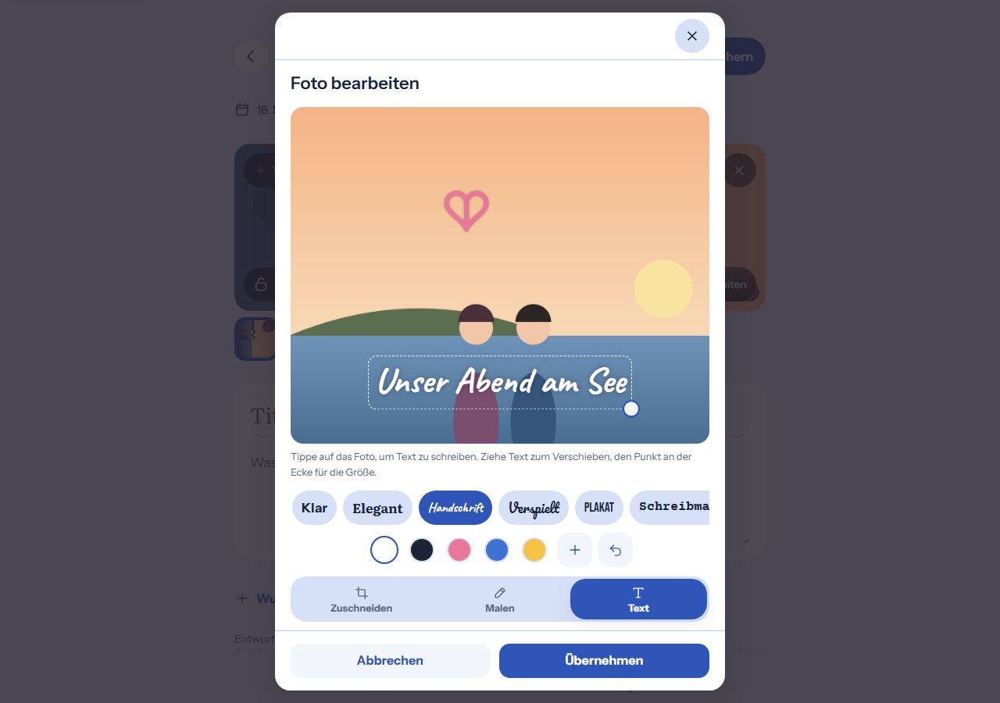 |
| Edited photo in the composer, 390 Light | 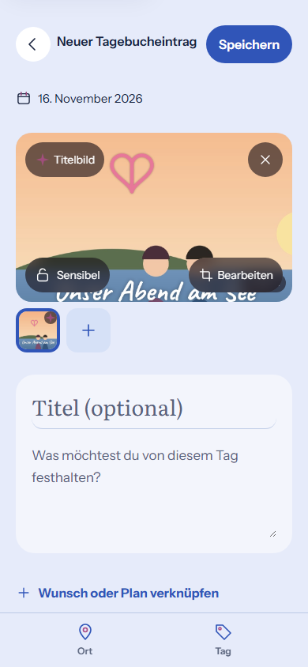 |
| Profile photo turned before cropping, 390 Light | 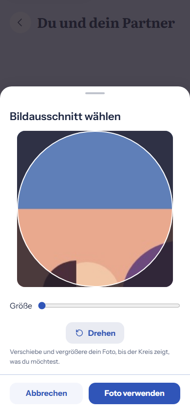 |
| Person avatar from Immich after the crop step, 390 Dark | 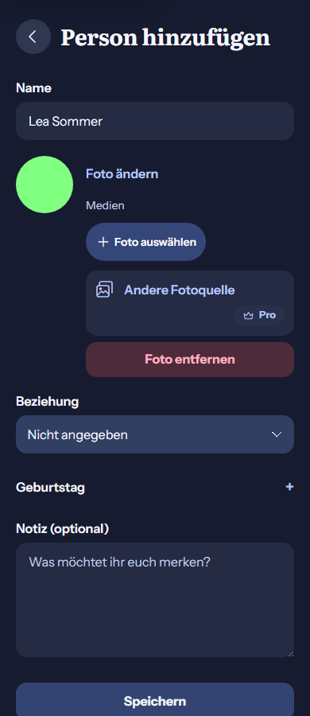 |

## Follow-up: editing saved photos

Product Owner decisions (2026-11-16), after the first slice was merged:
editing photos that are already saved is approved, but only after the whole
entry has been opened with its own edit action. Confirmed choices:
the edit replaces the saved photo (no server copy), the same people who may
remove a photo may edit it, photo reactions move to the edited photo, and the
edited photo adds no second Place.

| Aspect | Contract |
| --- | --- |
| Entry | Only in the entry's own edit mode (Memory, Plan, HeartMoment `Bearbeiten`): the `Bearbeiten` overlay on a saved image the viewer may remove. Reading an entry never offers it. |
| Sheet | The same edit step with one line: `photoEdit.replacesSaved`. |
| Result | The edited photo takes the original's place, cover and sensitivity in the editor at once; nothing is written until the entry is saved. Cancelling the entry edit keeps the saved photo. |
| Save | The gallery write sends the new photo with `replacesAttachmentId`; the server deletes the original like a removed photo, moves photo reactions and consumes the edited photo's location without a second Place. |
| Errors | A saved original the device cannot decode (for example HEIC) shows `photoEdit.unavailable`; a failed upload uses the composer's retry. |

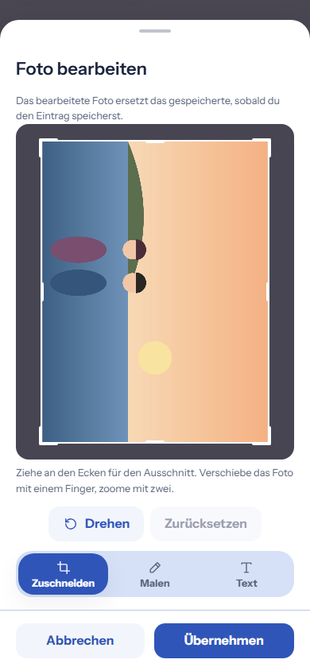
