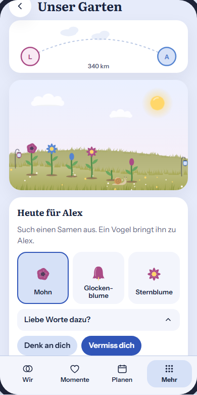
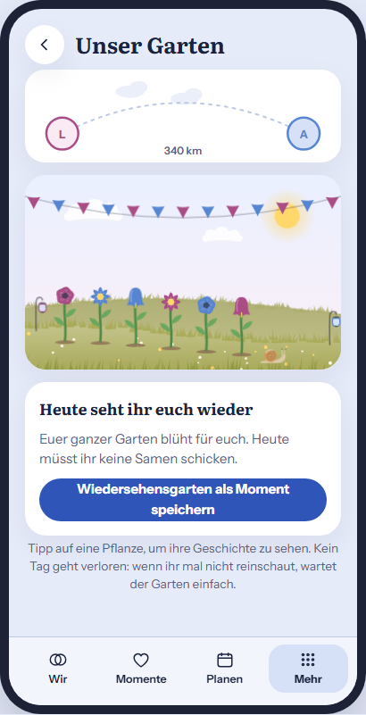
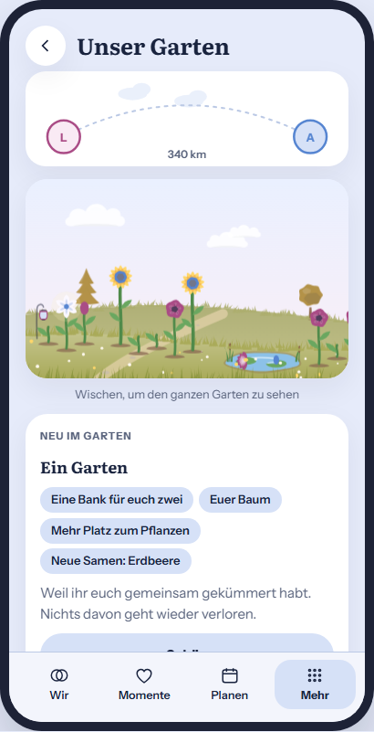

# Our garden (#1907 H3, concept A)

## Product Owner decision and baseline

On 2026-11-16 the Product Owner approved concept A of the apart-game proposal,
"Unser Garten", after several rounds in a clickable prototype ("Ja, freigeben").
The approved scope, the PR split and the quoted decisions are recorded in the
#1907 H3 sub-bullet. Decisions that shape this reference:

- Premium under the existing `games.couple`; one new notification kind (a seed
  arrived); delivery in three PRs (core, presentation, growth and life).
- Optional words on a seed are called `liebe Worte` ("Liebe Worte passt"), are
  offered only when the partners are further apart than `NEARBY` or distance is
  not shared, are collapsed for the sender without a "Freiwillig" label, and
  arrive as a folded card.
- A pause of both lets the garden sleep and wake up gently; nothing is lost
  (the Product Owner approved the proposal enthusiastically). Delivered in PR 2.
- The garden stays continuously animated while it is open ("so bleibt er
  lebhaft"): a deliberate, Product Owner approved exception to the default of
  one-shot motion. Reduced motion stops all of it.
- Organic illustrations without bare circles or corners.

Reviewed baseline: `main` `4097cecad`. Reviewed owner: the Games shelf under
More (`GamesProductArea` with `games.entries.moments`, `games.entries.wishes`,
`games.entries.perspective`) and the existing game pages. The garden joins the
shelf as one more entry with the same card grammar, status chip and Premium
behaviour; the existing entries are unchanged. The sibling H3 games (picture
ping-pong, heart hide-and-seek) add their own entries in their own PRs.

## Visual reference

Compact 390 px captures of the approved prototype, Light and Dark, with reduced
motion so the frames are stable:

| State | Light | Dark |
| --- | --- | --- |
| Choosing a seed with `liebe Worte` | [send](compact-390-light-1-send.png) | [send](compact-390-dark-1-send.png) |
| A seed arrives with a folded card | [receive](compact-390-light-2-receive.png) | [receive](compact-390-dark-2-receive.png) |
| Both were there today; a plant's story | [shared day](compact-390-light-3-shared-day.png) | [shared day](compact-390-dark-3-shared-day.png) |

The captures show the full vision. PR 1 (core) delivers the seed exchange, the
messenger flight, `liebe Worte`, planting, shared-day growth, a plant's story and
watering on the base meadow; lanterns, seasons, reunion and the sleeping garden
follow in PR 2, stages, more plants, unlocks, the garden book, bouquets, animals,
trees and the plane in PR 3.

## Mobile Interaction Contract

1. **Goal:** partners who are apart share a tiny daily ritual that makes their
   distance feel smaller: each sends the other a seed, and a garden grows from
   the days they were both there.
2. **Emotional value:** "you thought of me today"; a calm, living place that
   belongs to both. No score, no streak, nothing withers.
3. **Primary Compact state:** page title, the two partners with the messenger arc
   between them, the garden scene (focal point), one card with today's step.
4. **Dominant action:** one filled button per state: `Samen losschicken`,
   `Einpflanzen`. Watering is a tonal secondary action below the card.
5. **Hierarchy:** garden scene, today's card (seed choice or arrival), secondary
   actions, quiet footnote.
6. **Disclosure:** `Liebe Worte dazu?` is collapsed and opens five fixed phrases;
   the receiver's card is folded and opens on tap. Tapping a plant opens its
   story inline; the same tap closes it.
7. **Pattern:** one page under Games (like the other games); no sheet.
8. **Loading / Empty / Error / Offline:** a calm loading state; an empty garden
   explains the first step with the same seed card; failures use the shared
   problem state with retry; a second send on the same day (409) reloads and
   says so; nothing is queued offline.
9. **Success:** the messenger flies the seed along the arc; the card turns into
   the waiting state (`games.garden.waitingTitle`); a received seed drops into the soil; on a shared day
   every plant grows one stage once, with a short sun-and-pollen moment and a
   butterfly.
10. **Privacy / relationship state:** only the two partners of the Space. The
    garden stores species, fixed phrase codes, dates, stages, slots and who sent
    or watered; never a location or a distance. The messenger is chosen on the
    reading device from the existing Premium distance band; without sharing it
    is always the bird, with no label and no hint. The notification preview is
    generic and never shows the words.
11. **Large text / narrow:** cards and chips wrap, targets are at least 44 px,
    no horizontal page overflow at 320/360/390/430 px and 200 % text; a garden
    wider than the screen pans inside its own frame.
12. **Motion:** while the page is open the meadow sways, clouds drift and stars
    twinkle (Product Owner decision); the messenger flight, the seed drop, the
    growth and the shared-day moment are one-shot. Durations use the motion
    tokens. Reduced motion shows the same states without movement.
13. **Expanded:** one bounded centred column (like the other games); the scene
    keeps its aspect ratio.
14. **Typing:** none.
15. **Platform patterns:** native buttons; plants are buttons with names; system
    Back leaves the page.
16. **Table/list justification:** none used.
17. **Visual acceptance:** these captures, runtime captures in the PR and the
    browser journey `garden-game.spec.ts`.

## PR 2: presentation (seasons, lanterns, reunion, sleeping garden)

### Decisions

- Scope from the #1907 H3 sub-bullet: seasons from the calendar, two lanterns
  ("today in the garden"), the reunion from an existing Plan (a gate with the
  date; on the day everything blooms) and the sleeping garden after a pause of
  both (the Product Owner approved the proposal enthusiastically).
- Reunion signal (Product Owner, 2026-11-16, asked before building because
  Plans have no dedicated "meeting" marker): the next upcoming Plan with the
  existing anticipation highlight (#504 countdown, "Vorfreude") is the
  reunion. No new Plan setting and no new storage.
- Reviewed baseline: PR 1 branch `claude/1907-h3-garden-core` `0849801db`
  (on `main` `06af723f2`): `GardenGamePage` with the flight band, the scene,
  today's card, the plant story, watering and the footnote. PR 2 keeps all of
  them and adds layers to the same scene and calm cards around today's card.

### Visual reference

Compact 390 px captures of the approved prototype, Light and Dark. The
prototype's bunting needed a one-line fix to render (`Array.from` passes no
third argument); nothing else was changed. The prototype also shows PR 3
content (animals, trees, plane), which is not part of this PR.

| State | Light | Dark |
| --- | --- | --- |
| Autumn, lanterns, reunion gate and card | [soon](compact-390-light-4-autumn-reunion-soon.png) | [soon](compact-390-dark-4-autumn-reunion-soon.png) |
| Reunion day: everything blooms, bunting | [day](compact-390-light-5-reunion-day.png) | [day](compact-390-dark-5-reunion-day.png) |
| Winter: snow on the hills | [winter](compact-390-light-6-winter.png) | [winter](compact-390-dark-6-winter.png) |
| Spring blossoms | [spring](compact-390-light-7-spring.png) | [spring](compact-390-dark-7-spring.png) |
| Sleeping garden | [asleep](compact-390-light-8-sleeping.png) | [asleep](compact-390-dark-8-sleeping.png) |
| Woken garden | [awake](compact-390-light-9-woke.png) | [awake](compact-390-dark-9-woke.png) |

Runtime captures of the implementation from `garden-game.spec.ts` are in
[`evidence/`](evidence/) (`garden-sleeping-*`, `garden-woke-reunion-soon-*`,
`garden-reunion-day-*`, `garden-season-*`).

### Contract deltas

- **States.** *Season* from the month of the couple's calendar day: spring
  (March to May) blossoms on the meadow, summer a richer green, autumn golden
  greens with a one-shot moment of falling leaves on open, winter snow on the
  hills and snow-white meadow dots. Nothing withers in any season. *Lanterns*:
  one per partner at the garden edges (own on the left, partner on the right,
  like the avatars), outlined in the person colour; a lantern glows when that
  person sent today's seed, never a time. *Reunion soon*: a small gate at the
  right edge and a calm card (`games.garden.reunion.eyebrow`,
  `games.garden.reunion.soonTitle` with the date) above today's card. *Reunion day*: every plant is shown in bloom (the real stages
  are unchanged), bunting in both person colours, a card
  (`games.garden.reunion.todayTitle`) instead of the seed card; no seed is needed and watering is hidden;
  a seed that arrived can still be planted. The save action
  (`games.garden.reunion.save`) stores a still of the garden as a photo Moment on explicit tap
  only, through the existing media path, and then links to it. *Sleeping*:
  after four full days in which neither partner sent a seed or watered, the
  garden opens under mist with closed blossoms (buds) and dark lanterns and the
  card `games.garden.sleep.title`; it then wakes: the mist lifts, blossoms open and the
  welcome (`games.garden.sleep.wokeTitle`, `games.garden.sleep.wokeBody`)
  appears with a quiet secondary button to close it. Today's seed card stays available throughout.
  It never sleeps on a reunion day. Visitors added in PR 3 must stay away
  while it sleeps (the `sleep` phase of `useGardenPresentation`).
- **Hierarchy.** The scene stays the focal point; the sleep/welcome card sits
  directly below it, the reunion card above today's card. On the reunion day
  the save button is the single primary action.
- **Motion.** Lit lanterns flicker gently while the garden is lively (part of
  the approved continuous motion); falling leaves, the mist lifting, the
  blossoms opening on waking and on the reunion day, and the bunting popping in
  are one-shot. **Reduced motion** shows the same states without movement:
  no falling leaves, no flicker, and the garden is shown awake at once with the
  welcome card.
- **Privacy and relationship state.** The server derives `sleeping`,
  `reunionOn` (a day) and `reunionToday` from existing seed, watering and Plan
  data; nothing new is stored. The Plan's title never reaches the garden, so
  discreet Plans stay concealed. The sleeping garden is only a pause of both,
  never attributed to one person, and sends no notification. The saved Moment
  contains the drawn garden only (species, colours, decoration), no location.
- **Large text / narrow.** Cards wrap; the new layers live inside the scene,
  which keeps its aspect ratio; no horizontal overflow at 360/390 px.

## PR 3: growth and life

Scope: the "PR 3, growth and life" bullet of the #1907 H3 garden sub-bullet.
Reviewed baseline: the PR 1 garden on `claude/1907-h3-garden-core` `0849801db`
(its page, scene, art, cards, tokens and journey) and `main` `06af723f2` for
the Games shelf, Momente's Memory/media path and the annual recap (#497). The
existing garden stays as it is; growth adds to the same scene and card stack.

### Prototype captures (approved prototype, 390 px, reduced motion)

| State | Light | Dark |
| --- | --- | --- |
| 12 shared days: a meadow with the path and the pond, and the news card | [12](growth/growth-390-light-12-days.png) | [12](growth/growth-390-dark-12-days.png) |
| 30 shared days: the couple's tree, the bench, more room | [30](growth/growth-390-light-30-days.png) | [30](growth/growth-390-dark-30-days.png) |
| 60 shared days: the little paradise | [60](growth/growth-390-light-60-days.png) | [60](growth/growth-390-dark-60-days.png) |
| A visitor reacts to a tap | [tap](growth/growth-390-light-animal-tap.png) | [tap](growth/growth-390-dark-animal-tap.png) |
| Binding a bouquet | [bind](growth/growth-390-light-bouquet-bind.png) | [bind](growth/growth-390-dark-bouquet-bind.png) |
| A bouquet arrives | [bouquet](growth/growth-390-light-bouquet-received.png) | [bouquet](growth/growth-390-dark-bouquet-received.png) |
| The garden book | [book](growth/growth-390-light-garden-book.png) | [book](growth/growth-390-dark-garden-book.png) |

Runtime captures of the implementation from `garden-game.spec.ts` (390 px Light
with motion, 360 px Dark with reduced motion) are in [`evidence/`](evidence/):
`garden-growth-news-*`, `garden-growth-bouquet-*`, `garden-growth-bind-*` and
`garden-growth-book-*`.

### What grows

- **Shared days** are the days on which both partners sent a seed. The server
  derives the count from the seeds; it is never reset, gaps cost nothing and
  it is never shown as a number.
- **Forms and quiet unlocks** (prototype thresholds): path 5; pond with water
  lilies, sunflower, tulip bulb and water lily seeds 10 (the meadow); bench 18;
  the couple's tree, more room and strawberry seeds 25 (the garden); birdhouse
  35; rose arch, swing, little stream, fireflies and even more room 50 (the
  little paradise). Each unlock is announced once per person with a news card
  (`games.garden.growth.newsEyebrow`) and pops into the scene; nothing shows
  how far away the rest is.
- **Seeds:** three per day, rotating through the unlocked pool by calendar
  day. From the meadow on, every other day the last choice is a wrapped
  surprise that is shown as a parcel until it first blooms as a moonflower
  (it glows at night). A water lily is planted into one of six pond places and
  leaves the offer while the pond is full. A tulip bulb sprouts and then rests
  until spring; seasons follow the calendar month (March to May) until the
  PR 2 season helper exists.
- **Places:** the pond and rose-arch places are kept free of plants from the
  first day, so nothing moves when they appear. The garden is as wide as its
  unlocks allow (340, 520, 700) and still widens further when plants need room.
- **Bouquets:** up to three blooming flowers (not pond lilies, not a resting
  tulip), one bouquet per person and day. A seed stays in each place and grows
  again; the flower keeps its own story. The partner gets a bouquet card with
  `Danke` and `In Momente legen`; only that explicit tap renders the bouquet
  and saves it as a photo Memory through the existing Memory/media path.
- **Garden book:** the garden's name (up to 40 characters, either partner can
  rename it, empty restores `Unser Garten`; it is the page title), its form,
  discovered plants and finds; the rest are placeholders
  (`games.garden.growth.undiscovered`, `games.garden.growth.secret`) with
  tinted fill, never outlines.
- **Life:** visitors by stage (snail; rabbit from 5 shared days; hedgehog from
  10; a duck pair in the pond with one wing in each person colour; a squirrel
  at the couple's tree; a deer in the paradise), one to three at a time. They
  wander while the page is open and react to a tap (snail hides, rabbit hops
  away, hedgehog curls up, ducks quack, squirrel runs up the tree, deer
  startles and leaps away). Background trees appear and keep growing with
  shared days. A small plane crosses now and then.
- **`liebe Worte` by plane:** for about two in five seeds (decided per seed,
  so it never flickers) the words arrive as `Liebe Worte kommen per Luftpost`;
  `Ansehen` flies the plane with the banner, then the words open. With reduced
  motion the folded card is used instead.
- **Garden of the year (#497):** in December, once at least three flowers
  bloom, a card offers to keep the garden as a picture in Momente; only on
  tap. The annual recap then treats it like any other photo Memory, so no new
  recap source is needed. Open for Product Owner confirmation.

### Contract deltas

- **States:** news card (once per person, `Schön` records it); bouquet card
  (thanks or keep); binding replaces today's card like watering does, with
  `Abbrechen` and `An <Name> schenken`; book and year cards below the tools.
  Loading, error, 409 reload and offline stay as in PR 1; nothing is queued.
- **Hierarchy:** one filled action per card (`Samen losschicken`,
  `Einpflanzen`, `In Momente legen`, `An <Name> schenken`, `Speichern`); the
  tools row (`games.garden.water`, `games.garden.growth.bind`,
  `games.garden.growth.book`) is tonal.
- **Motion:** visitors wander, ripples move, the stream flows and fireflies
  glow while the page is open (the approved continuous-motion exception);
  each new find popping in, the bouquet flight and each plane crossing run
  once. With reduced motion visitors stand still, a tap changes the pose without movement, no
  plane, words fall back to the folded card, nothing pops.
- **Privacy:** the server stores closed species and unlock codes, dates, the
  short garden name, who saw which news and bouquet rows (closed codes and the
  two partners); never a location or a distance. A bouquet notice is neutral
  (`coupleExperiences.notifications.GARDEN_BOUQUET`) and reuses
  `GARDEN_SEED_ARRIVED` with the target `GARDEN_BOUQUET`; at most one garden notice per person and local day.
  Images exist only after an explicit save to Momente.
- **Accessibility:** visitors are named buttons (`<Tier> antippen`) placed
  under the plants, so a plant always wins where they overlap; a reaction is
  announced in the polite status line. Pond lilies and plants keep names; in
  binding mode a plant is named by `games.garden.growth.bindPlantLabel` and
  shows a dashed selection outline. The scene label names the garden and its form. 44 px
  targets, no horizontal page overflow; the wider garden pans in its frame.
- **No numbers:** news, book and scene never show a count of days or a
  distance to the next unlock (#866). The only number is the picked-flower
  count while binding (`games.garden.growth.bindCount`), as in the prototype.
