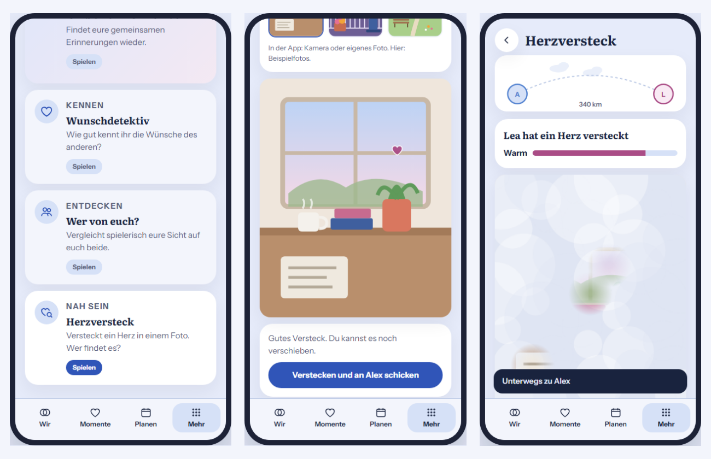
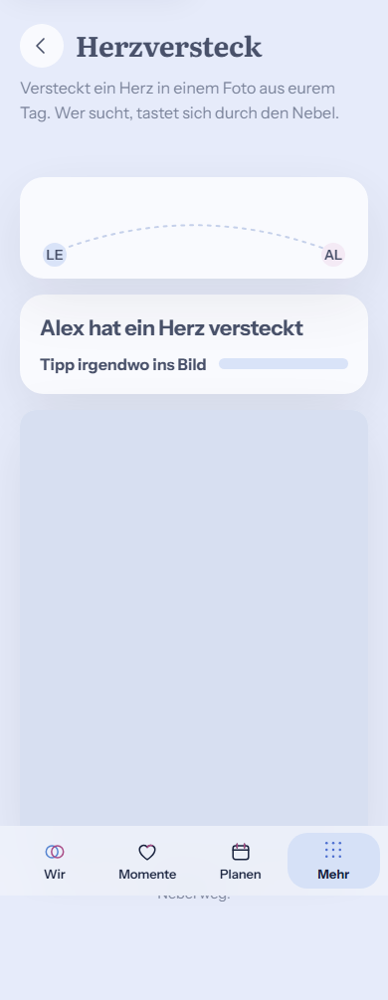
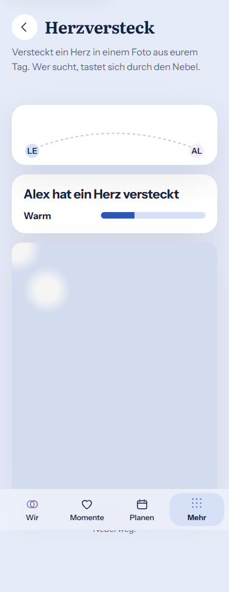
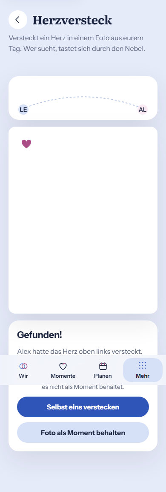
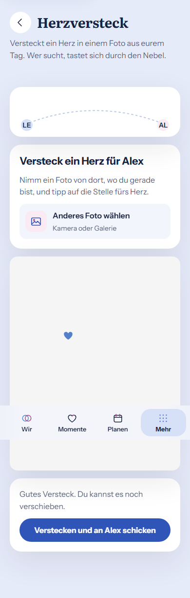
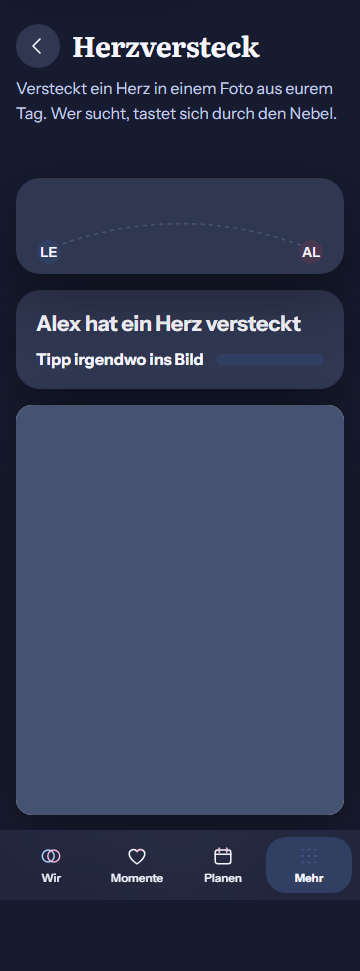
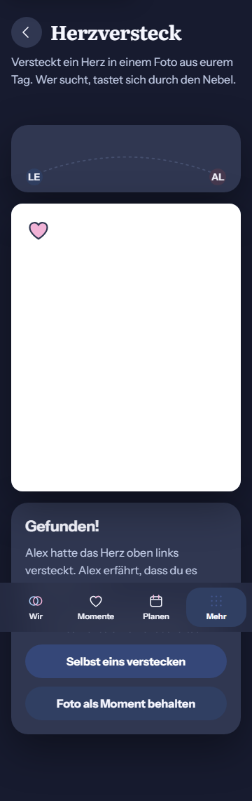

# #1907 H3: Herzversteck

Visual reference and Mobile Interaction Contract for the "Herzversteck" game, a
cute, time-shifted mini-game for partners who are apart. Approved by the
Product Owner on 2026-11-16 as shown in the clickable prototype ("approve the other two as new sessions, they can stay as they are"). The prototype also
showed two siblings (Unser Garten, Bild-Pingpong) that ship in their own PRs.

Baseline reviewed: `main` `f1ef9074d`. The existing Games shelf at `/games`
(Mehr, Play together: Our moments, Wish detective, Which of you), the
secondary-page header, the Premium status chip, `games.couple` gating and the
Wir/map distance words from #1907 H4 were reviewed and are kept as they are.
The new entry is one more shelf row and a new `/games/heart-hunt` page.

The reference image is the generated prototype rendered at 390 px. The images
in `evidence/` are captured from the implemented Web app (mocked API,
synthetic one-pixel photo) at 390 px Light and 360 px Dark.

| State | Image |
| --- | --- |
| Searching under fog, 390 Light |  |
| Warm after two taps, 390 Light |  |
| Found, fog lifted, 390 Light |  |
| Hiding: photo and heart placed, 390 Light |  |
| Searching, 360 Dark |  |
| Found, 360 Dark |  |

## Decisions

- **Rules of the round.** One partner takes or picks a photo, taps where a
  small heart hides (it can be moved before sending) and sends it. The other
  partner sees the photo under fog; each tap clears a soft circle and a warmth
  line with a meter answers with four words (`games.heartHunt.warmth.*`). No time
  limit, no tap limit, no score. On the find the fog lifts, the heart pops
  once, the found title names roughly where it was (nine soft areas, never a
  coordinate) and the hider is told. the swap action starts the other direction.
- **The secret stays on the server.** The heart is a per-mille position held
  by the server. A tap is sent as a position and answered with a coarse
  warmth word, a meter in steps of five and a found flag; the seeker's client
  never receives the position before the round is found, and the heart is not
  part of the photo's pixels.
- **Moments.** Keeping the photo (`games.heartHunt.found.keep`) is an explicit tap. The client
  composes the 4:5 photo with the heart, uploads it as the keeper's own
  attachment and saves an ordinary shared Memory, then marks the round kept.
  Otherwise the round's photo is deleted 14 days after it was found. An
  unfound round and its photo expire 30 days after it was hidden (proposed
  value, to be confirmed by the Product Owner). A hider has at most one open
  round, which bounds the managed storage.
- **Distance.** The heart flies along an arc between the two avatars when sent.
  Arc height and duration follow the existing server distance band and the
  caption uses the H4 short words. Without sharing (or Pro `presence.location`)
  it is the same medium flight without caption and without any hint to share
  (H1 rule). The game stores no location; the photo's location metadata is
  stripped like every upload and the heart position is a frame share.
- **Notifications.** the two notice texts `coupleExperiences.notifications.HEART_HUNT_HIDDEN` and `HEART_HUNT_FOUND` (partner named, no photo), approved with the concept. In-app and Push follow the
  shared-activity preference and Quiet Hours; push text stays the existing
  generic or encrypted sender preview and never shows the photo.
- **Tier.** Premium under the existing `games.couple`, enforced by the
  backend on every gameplay seam; no new capability or per-game limit.

## Mobile Interaction Contract

| Aspect | Contract |
| --- | --- |
| Goal / value | A small, playful look into the partner's day and a reason to be in touch while apart; nothing to win or lose. |
| Compact screen | Secondary page `/games/heart-hunt`: header row (Back, title), the flight band between the two avatars, then one state card and the 4:5 photo. |
| Dominant action | Hide: send (`games.heartHunt.hide.send`). Search: tapping the photo. Found: swap roles (`games.heartHunt.found.swap`). One filled primary action per state. |
| Hierarchy | The photo is the focal point; the band is context; the warmth line is the only feedback while searching. |
| Progressive disclosure | Placing the heart and the send button appear only after a photo exists; keep/delete note only after the find. |
| Interaction pattern | Page with an inline 2D tap target (no sheet, no keyboard). The device picker is the existing media intake (camera or gallery via the platform). |
| Loading | Shared loading state while the round state loads; the photo shows a quiet placeholder until its authorized bytes arrive. |
| Empty | No open round: the hide step with one photo action. |
| Error | Shared problem state with retry for loads; inline calm status text for a failed upload, send or tap; `games.heartHunt.hide.roundOpen` when a second heart is sent. |
| Offline | Taps and sends need the server (the server decides); failures leave the state unchanged and can be repeated. |
| Success | The heart pop and "Gefunden!"; sending ends with the flight and the waiting card. |
| Privacy / relationship state | Only the two partners can read the photo; the photo is never persisted on the device by the client; the seeker never receives the heart early; no hint to share location. |
| Large text / narrow | Single column, the photo frame scales with the width (max 26 rem); cards reflow; checked down to 360 px. |
| Motion | One-shot flight (token durations scaled by band), fog circles appear at the tap, fog fades on the find, one heart pop. Reduced motion: the heart arrives after a short hold, fog lifts and the heart appears without animation. |
| Expanded | The same column centred with bounded width; the photo does not grow past 26 rem. |
| Conventional list/table | Not used. |
| Reused patterns | PageHeader, secondary-page back, `MediaIntakeButton` + `DeviceMediaPicker`, `UiState`/`ProblemState`, person colours, H4 distance words, shared motion tokens. |
| Typing | None: the only inputs are a photo and taps. |
| Keyboard | The frame is one focusable control: arrow keys move a visible reticle, Enter or Space taps it. |
| Visual acceptance | Compact 360/390 Light/Dark and reduced motion in `web/e2e/tests/heart-hunt.spec.ts`; Pixel check by the Product Owner. |
