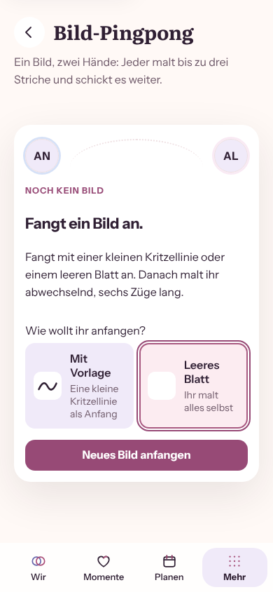
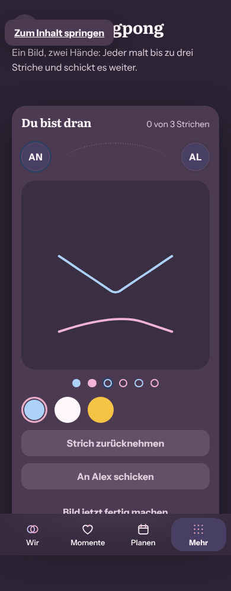

# Live partner sync for the apart games (#1907 H3)

## Product Owner request and baseline

On 2026-11-17 the Product Owner asked (translated from German): Herzversteck,
picture ping-pong and the garden must sync to the partner in real time, for
example when the partner is already or still in the game. Picture ping-pong
must let the opener choose whether to start with a template or not.

Reviewed baseline: `main` `61382d0`. Reviewed surfaces: `/games/heart-hunt`
(`HeartHuntGamePage`), `/games/picture-ping-pong` (`PicturePingPongPage`) and
`/games/garden` (`GardenGamePage`) with their existing states, actions,
motion and notices. Before this change the three pages read their state on
open and on window focus only (picture ping-pong additionally every 20 s while
waiting for the partner), so a move by a partner who was in the game at the
same time stayed invisible until the page was left or refocused.

## Acceptance criteria

1. While a game page is open and visible, a move by the partner appears
   without leaving, reloading or refocusing the page:
   - Herzversteck: a heart hidden for me, the partner's search (tap count) and
     the moment my heart is found;
   - picture ping-pong: a handed-over turn (with the existing incoming flight),
     an early finish and a new picture started by the partner, each named once;
   - garden: an arriving seed (with the existing incoming flight), plantings,
     waterings, bouquets and the shared day, staged with the same growth
     motion as an own action.
2. Live updates never destroy local work: a started hiding place stays on
   screen when the partner's heart arrives (a quiet note says a search is
   waiting), a ping-pong draft stays per picture and turn, and an older read
   cannot replace the answer of an own write.
3. A failed live read keeps the current game on screen; only a first read that
   never arrived shows the problem state with retry.
4. Picture ping-pong offers two starting choices before a new picture, "With a
   starter" (the seed squiggle, default as before) and "Blank page", both in
   the empty state and after a finished picture.

## Live sync contract

- **Transport.** Bounded polling of each game's existing authorized read
  (`GET .../games/heart-hunt`, `.../picture-ping-pong`, `.../garden`) through
  TanStack Query, shared by `web/src/client/liveGameSync.ts`: every 2.5 s while
  the page is open, relaxed to 10 s after ten minutes without any change; any
  change, focus or reconnect returns to the live cadence at once.
- **Pauses.** No reads while the document is hidden or the device is offline
  (TanStack defaults kept explicit), while an own write is in flight, during
  the outgoing garden flight and during the Herzversteck fog lift. An own
  write cancels a read that started before it.
- **No presence signal.** The sync shows what the partner did, not whether
  the partner is currently looking. Partner presence remains product-gated
  (`PARTNER_PRESENCE_PRODUCT_ENABLED = false`); this change adds no presence
  data, heartbeat or "is online" indicator.
- **Motion.** Arrivals reuse the existing one-shot flights and growth staging;
  reduced motion keeps the same status lines and notes without movement. Text
  changes use the existing `role="status"`/`aria-live="polite"` regions.

## Starting choice (picture ping-pong)

Mobile Interaction Contract delta for
[picture ping-pong](../1907-h3-picture-ping-pong/README.md):

- **Empty state:** below the explanation, one radio group
  (`games.pingPong.starterLegend`) with two tap targets: `starterSquiggle`
  (small squiggle preview, preselected) and `starterBlank` (empty paper
  preview); the single filled primary action `games.pingPong.newPicture`
  starts the picture with the chosen option.
- **After a finished picture:** the secondary `newPicture` action opens the
  same choice inline with the secondary `startAction` and the quiet
  `starterCancel`; saving to Momente stays the only primary action.
- **Server:** `POST .../picture-ping-pong` accepts an optional
  `{"starter": "SQUIGGLE" | "BLANK"}` body. Without a body the picture starts
  with the squiggle as before, so older clients keep their behaviour. A blank
  picture has no turn-0 stroke; turn order, limits and finishing are unchanged.
- **Compact/Expanded:** the two tiles share one row from about 20 rem and
  stack below that or at large text sizes; the page keeps the bounded column.

| State | Image |
| --- | --- |
| Starting choice, blank page selected, 390 Light |  |
| Partner's turn arrived live on a blank start, 390 Dark |  |

These are runtime captures of the implemented page from
`web/e2e/tests/picture-ping-pong.spec.ts`; the change adds no new screen or
navigation, so no separate generated composition was produced.

## Reuse review

| Option | Finding |
| --- | --- |
| Server-sent events / WebSocket | Lowest latency, but the product has no realtime transport; it needs long-lived connections through every Self-Hosted reverse proxy and the Capacitor WebView, reconnect/auth renewal and a fan-out source. Not justified for three turn-based games (see the 1211 review). |
| Push notification handoff | Already delivers the hand-over, hidden-heart and seed notices while the app is closed; it is not a foreground state transport and is subject to Quiet Hours. Kept unchanged. |
| Bounded polling of the existing read (selected) | Reuses the authorized endpoints, entitlement checks, Query cache, structural sharing, focus/online managers and existing tests; no dependency, provider, schema or operator setting. Latency of a few seconds fits the turn-based games. |

## Business/freemium impact reviewed

The three games stay part of the Premium `games.couple` row in
`docs/FREEMIUM-FEATURE-MATRIX.md`; the starting choice is not a separate
capability and is not paywalled beyond the game itself. Self-Hosted and
eimir. Cloud behave identically. Managed cost: one small authenticated read
per open, visible game page every 2.5 s (10 s after a quiet stretch), none in
the background; responses are bounded (at most six heart rounds, one picture of
at most 6 x 3 strokes, one garden). No storage, quota, retention, downgrade or
data semantics change; the matrix needs no update.

## Cross-cutting review

- **Security/authorization:** unchanged endpoints and checks; every live read
  repeats authentication, Space membership and the entitlement check. The new
  request body is strict (`extra="forbid"`, enum only).
- **Privacy:** no new data. The hider already received the seeker's taps; the
  page now shows only their count. Nothing is logged beyond the existing
  access log lines.
- **Concurrency:** writes keep their server-side version/turn checks (409
  reloads as before); the client cancels older reads before applying an own
  answer and pauses reads during writes and one-shot transitions.
- **Resilience/offline:** reads pause offline and resume on reconnect; a
  failed live read is silent while data is shown.
- **i18n/accessibility:** new strings in German and English with plural forms
  for the tap count; native radios with visible focus, 44 px targets, polite
  live regions.
- **Performance:** structural sharing avoids re-rendering unchanged answers;
  the quiet cadence bounds long idle sessions.
- **API/migration:** additive optional body; regenerated Web client; no
  database migration.
- **Testing:** backend integration tests for both starters and invalid input;
  unit tests for the cadence, live arrival in all three games, draft
  protection, quiet failures and own-versus-partner notes (each live test
  fails with polling disabled); the picture ping-pong browser journey covers
  the blank start and a live hand-over in Compact Light/Dark with axe.
