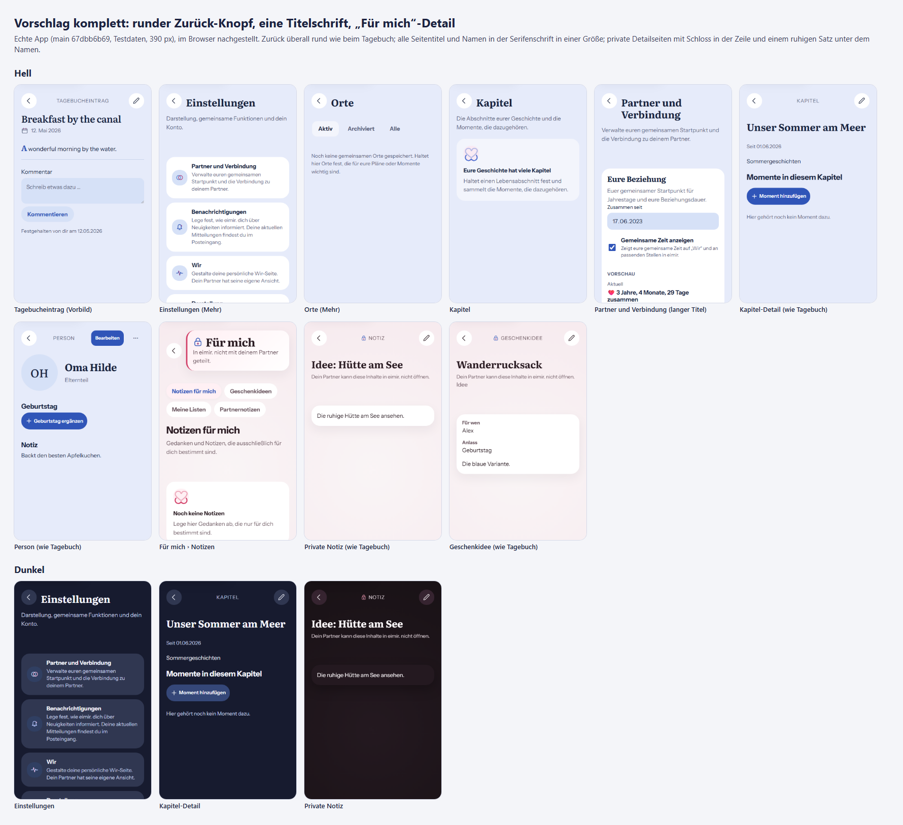
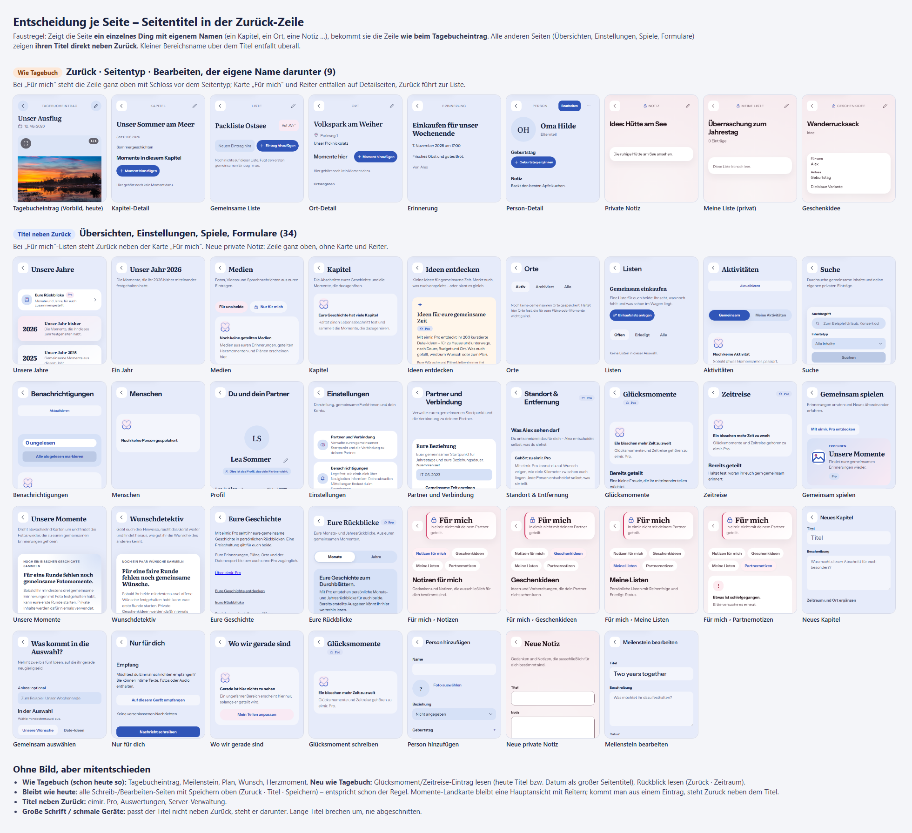

# #1907 C4: Secondary-page header

Generated visual reference for one header row on every secondary page, approved by
the Product Owner on 2026-11-15 during the J1 Wishes review and the follow-up
decisions the same day. Baseline reviewed: `main` `67dbb6b69`; the header,
`PageHeader`, `SubpageNavigation` and `TaskBackButton` sources are unchanged on
`a455904ca`. Captured from the real Web build in the mocked browser harness at
390 px; the proposed states are live DOM/CSS edits of those screens, not an
implementation.

## Before

`SubpageNavigation` renders Back in its own row (`.subpage-back-slot`) above the
page. On Expanded that row sits at the window edge while the title sits in the
content column. Only the composer-detail readers (diary Memory, Milestone, Plan,
Wish, HeartMoment) and the quiet composers already share one row between Back and
their heading. About 25 shell-default pages and 15 pages with a page-owned Back
stack Back, an optional eyebrow and the title vertically. Back appears as a raised
rounded square on most pages and as a subtle circle on the readers. Secondary titles
use three different faces and sizes; More pages override the display face.

## Decisions

- **One header row.** Back never sits alone above a visible page title.
- **One named item** (Memory, HeartMoment, Milestone, Plan, Wish, Chapter, shared
  List, Place, Reminder, Person, private note, private List, gift idea, an
  experience answer, a recap): Back, the centered localized type label and the
  item's edit action share the row; the item's name follows as the page heading.
- **All other secondary pages** (overviews, settings, games, task and composer
  pages): Back and the page title share the row, start-aligned, with at most one
  header action at the end.
- **No eyebrow** above secondary titles; the active navigation item carries the area.
- **Reflow:** long titles wrap beside Back and are never truncated; when the title
  cannot fit beside Back (320 px, 200 % text) it moves below Back.
- **Private area:** list pages place Back beside the area card. Detail and editor
  pages put the row at the very top with the lock icon in the type label and the
  existing `privateArea.entry.privacy` sentence below the name; the area card and
  section tabs are omitted there and Back returns to the list.
- **One control:** Back and the trailing icon action are round 44 CSS px buttons on
  `--color-surface-raised` (visible on the blue, private and dark surfaces).
- **One title style:** every secondary title and named-item heading uses
  `--font-subpage-title` (display face, 700, 1.75rem/1.2), including More and the
  private area.

## Mobile Interaction Contract

Product Reference v1 R1/R2/R5; Screen Templates 2/4/8/9/11. The human goal is
recognizing where one is and getting back without hunting. Content stays the focal
point; the header gives one line of orientation. Compact keeps safe-area gutters, a
44 px Back target in the upper-left corner, one vertical reading flow and no
horizontal scrolling at 320 px/200 %. Expanded places the same row in the content
column. Loading, empty, error, offline and permission states keep the row with
Back; pages without a visible title keep Back alone. Existing pending/dirty guards,
task-origin return, modified-click link semantics and canonical-parent fallbacks are
unchanged. No new motion: the row is static chrome; route and sheet transitions keep
their reduced-motion behavior.

## Reuse and business model

Reuses `PageHeader`, `TaskBackButton`/`TaskBackLink`, the existing slot/portal
registration in `SubpageNavigation`, the composer-detail grid and semantic tokens;
no new dependency or provider. **No business/freemium impact:** navigation chrome
applies to all tiers and to Cloud and Self-Hosted alike.
