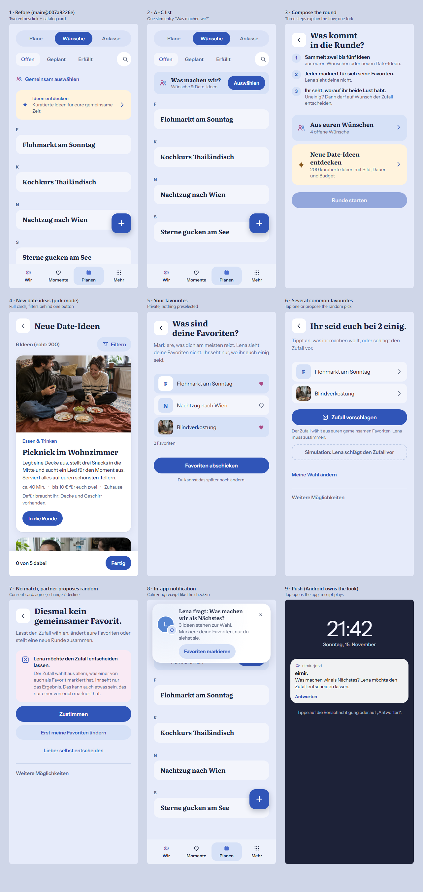

# Planen › Wünsche: one entry for "what do we do next" (#1907 J1)

Generated visual reference for the Product Owner decision of 2026-11-15 (variant "A+C"). Baseline
`main` `007a9226e`; the affected sources (`SharedPlanningOverviewPage`, `WishSelection*`, `DateIdea*`,
`PartnerGestureReceipt*`, the wish-selection backend and `docs/product/notification-workflow.md`) are
unchanged on `76c68d9a4`.

The board was rendered from a clickable HTML prototype that uses the light identity roles from
`web/src/design/identity-roles.css`, Literata and Instrument Sans. It shows six real ideas from the bundled
catalog (`backend/pro/src/eimir_pro/date_ideas/data`, catalog 1.0.0, `de`) with their AI-generated project images
(see `images.json` for provenance). Wish titles, the partner names `Alex` and `Lena`, and the dashed
"Simulation" buttons are prototype aids, not product UI. The composition is the reference; Product Reference
v1, accessibility and the contracts in this folder's issue govern details.

| # | Screen |
| --- | --- |
| 1 | Today: `WishSelectionEntry` link and `DateIdeasEntry` card above the Wish list |
| 2 | One slim entry row with a filled action instead of both |
| 3 | Composing a round: three short steps while empty, one fork into Wishes or date ideas, no segmented switch |
| 4 | Date ideas in pick mode: full catalog cards, filters behind one button, one action per card, sticky count |
| 5 | Private favourites: heart toggles, nothing preselected |
| 6 | Two or more common favourites: tap one, or propose the random pick |
| 7 | No common favourite: the partner's random-pick request with agree, change favourites, decline |
| 8 | In-app notification in the calm-ring receipt style of the partner check-in |
| 9 | Android push on the lock screen; tapping opens the app and plays the receipt |

The detailed decisions, copy, notification table and open questions are recorded in issue #1907, slice J1.
