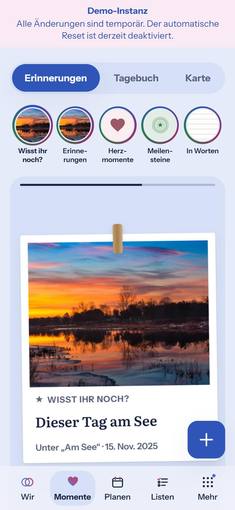
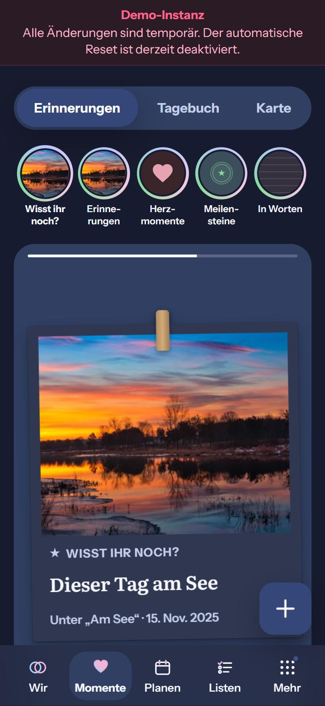
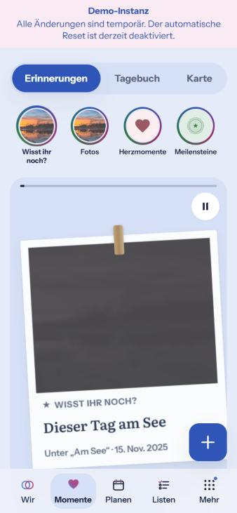
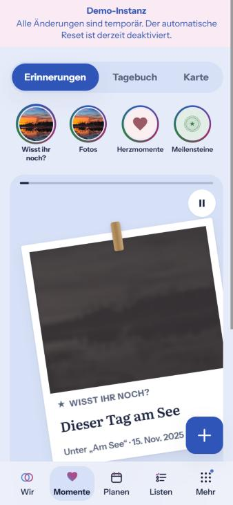
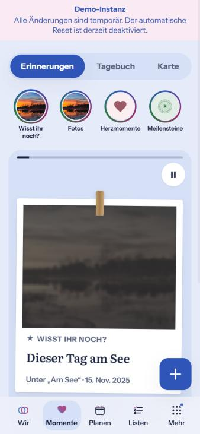
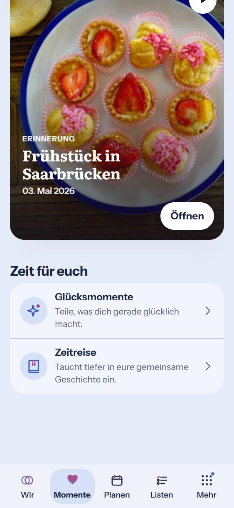
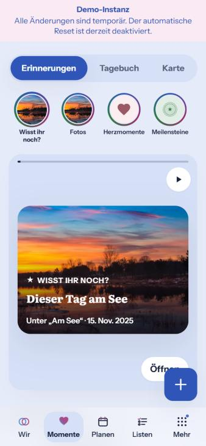
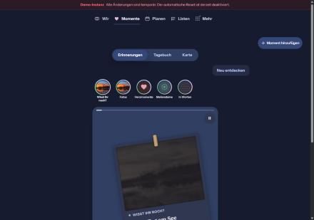
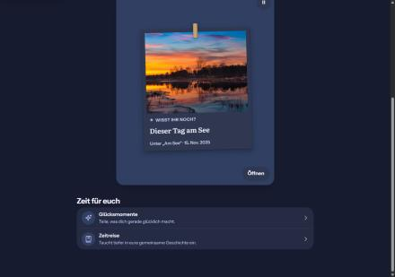

# #2192: the rediscovery lead as the first Fotostory slide

Visual reference for [#2192](https://github.com/baerenmarke90/eimir/issues/2192). The Product Owner reviewed an in-app prototype on 2026-11-22 and approved the direction. The prototype is the implementation on this branch, captured in the real app.

**Capture:** local demo Space (joined as Lea), Web client on `main` `e7b8aec8f` plus this change, in the in-app browser pane at 375 × 812 CSS px. Expanded is 1280 × 900. The story was paused for the still images.

## Before

Discover showed three stacked blocks: the rediscovery lead (`story.featuredKicker`) as a polaroid card, the "time for you" group (`coupleExperiences.title`), and then the Fotostory (theme bubbles and one viewer).

## Decision

One block. The lead plays as the first slide of the Fotostory, in a theme bubble of its own (`discoverStory.theme.remember`). Its photo develops like instant film. The curated themes follow. Below the story, only the "time for you" group remains.

The theme bubbles keep one row and hyphenate their long labels (`discoverStory.theme.*` carries soft hyphens). On 320 px, the fifth bubble moves to a second row. The photos theme is labelled `discoverStory.theme.photos` ("Erinnerungen", "Memories"). While the story plays, the pause and open controls fade after `CONTROLS_QUIET_MS` (3 s), as in the media viewer. A touch, the pointer entering or focus brings them back, and they stay while the story is paused.

| | | |
|---|---|---|
|  |  |  |

**Develop sequence** (Light, Album): first the undeveloped film, then a dark, colourless, soft print, and finally the photo. The develop takes `--duration-story-develop` (3.2 s).

| | | | |
|---|---|---|---|
|  |  |  |  |

**Below the story:** only the "time for you" group. In this capture, the story has moved on to the Fotos theme.

**List layout:** the lead keeps its photo card with rounded corners.

**Expanded:** the story stays centred at its maximum width, with the renew action (`story.discoverRenew`) above it and the "time for you" group below.

| | |
|---|---|
|  |  |

Images 03 to 09 were captured before two follow-up changes from the Product Owner: the photos theme renamed from "Fotos", and the resting controls. They still show the old label and the controls.

## Not covered here

- No video of the motion.
- Reduced motion, large text and 360/430 px are covered by the browser specs, not by these images.
- Device acceptance on the Pixel is open.
