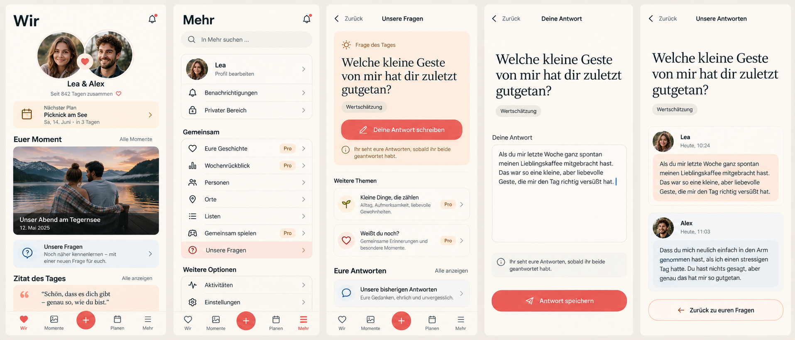

# Our questions: implementation preflight

Owning issue: #444. Reviewed main `850ab01c81fb9f2bed57bc54d8a8cf794508ffea`,
`MoreOverviewPage`, `TodayPage`, Dashboard preferences, Space configuration,
the existing editor lifecycle and the complete original #1553 bilingual catalog.

Generated with the built-in Imagegen tool before UI implementation. Prompt:
repository-aware five-screen Compact composition showing the whole current
Wir and More destinations, Questions home, focused answer composition and
mutual reveal. Preserve the hero, Vibe, keepsake, Plans, quote, lists, utilities
and four root destinations; content-sized question, one explicit save action,
calm reveal, cream/coral semantic palette and existing typography roles.

The image guides hierarchy; it is not evidence of implemented behavior. Its
invented quote, bells, chevrons, return wording and timestamps do not override
current product decisions. Reuse the actual current shell, common headings,
source-verified quote catalog and plain Back. No additional header bell, root
destination, private answer status or auto-focused keyboard is introduced.

## Mobile Interaction Contract

Product Reference v1 R4/R5 and Today, Detail and Create/Edit templates apply.
Questions live at `/more/questions`; More's shared destinations retain all
existing entries. A contextual, personally reorderable/hideable Wir entry
appears only while the shared module is enabled and a daily question is relevant;
it is support content, below the hero/keepsake/Plans by default, and disappears
after personal dismissal. Personal hiding never disables the shared feature.

Open → select daily question or Pro topic → read → deliberately enter answer
composition → explicitly save → read confirmed own/revealed result → return.
One person can save and revisit independently. Both submissions are required
only for mutual reveal. Skip is personal and never fabricates an answer.
One- and three-question Pro rounds are untimed, individually revealable and
continuable; no quota, streak, pressure, score or partner participation metadata.

Reuse PageHeader, native semantic buttons/fields, safe task/draft lifecycle,
confirmation/error/loading primitives, route ownership, scoped query cache and
semantic colors/space/type/motion. Compact 320/360/390/430 wraps all content;
Expanded retains a bounded reading width, with no permanent management pane.
Keyboard-safe actions stay in normal flow; root navigation recedes during
composition. Dirty Back offers keep/discard; failures preserve text; late
completions cannot overwrite newer text or another account/Space. Normal and
reduced motion share focus and result semantics.

Loading has a stable content skeleton; failed/offline reads are distinguished
from empty. Writes never claim offline persistence. Disabled module retains
authorized history/export/withdrawal but blocks issuance and new answers. A
missing active pair explains the prerequisite. Expiry stops new paid issuance,
while already granted questions and history remain accessible. Conflict requires
reconciliation instead of silently overwriting the draft.

## Reuse, business and cross-cutting decisions

Keep one first-party assignment/answer/reveal domain using the original static
catalog, ProtectedPayload, existing Membership lifecycle barriers, authoritative
Space day, Problem Details, optimistic concurrency, pagination and generated
OpenAPI client. Client-only reveal would leak content; external AI/decks add
unnecessary data transfer, provenance and cost; the sofa game has incompatible
ephemeral semantics. No new provider or runtime dependency.

Business/freemium impact reviewed: Mixed daily questions remain Free/Core;
new `question.curated_packs` gates only new Pro issuance per Space. Already issued
content can be completed after expiry. Essential export/deletion/withdrawal and
privacy never require Pro. Cloud and Self-Hosted share behavior; bounded static
content and text storage add no inference, media or third-party cost.

Pin prompt revisions and both participant Membership IDs. Server DTOs, exports
and caches include only own answers or mutually revealed content, with no hidden
partner fields/count/timestamp. Use existing lock order to serialize reveal,
offboarding, disable, withdrawal and timezone changes. No answer text enters
events, notifications, logs, search, scoring or recap/AI. Keep data rights and
account/Space deletion with the domain. Validate negative privacy, concurrency,
downgrade, disabled-module, timezone/DST and two-account journeys, plus actual
Light/Dark/reflow/reduced-motion UI. This preflight is not Product Acceptance.
