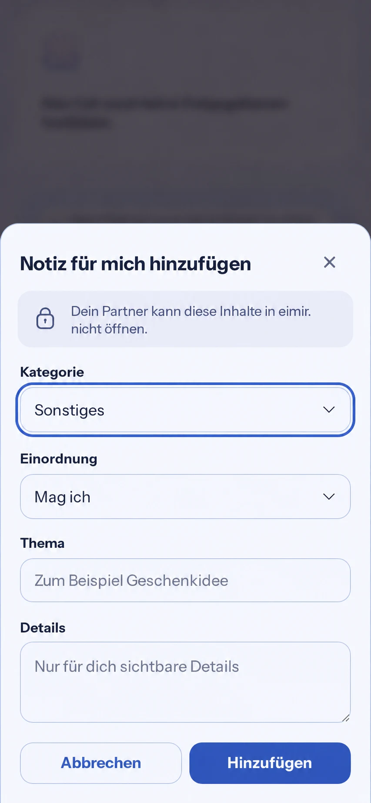

# Private profile-note editor privacy context (#503)

## Pre-implementation baseline and finding

Reviewed `main@b675ec517edf9a14b131de04af7c33b5ecf7faac`, issue #503 and all its comments, delivered #1419/#1420, current open PRs, required governance/design sources, the privacy model and Profile authorization contract.

Route: `/more/profile`. `PrivatePartnerNotesSection` shows the shared `privateArea.entry.privacy` notice outside `PreferenceDialog`. The modal has its own title and focus boundary, but no privacy explanation or accessible description inside it. The same dialog also edits `SELF_PROFILE` preferences, which are shared. Private create/edit must retain their actual audience at the point of entry without applying an owner-only claim to shared preferences.

The source-level regression is characterized before runtime changes: both private create/edit description checks fail on unchanged main; shared create/edit and existing dialog controls pass (11 controls). This is a UI/accessibility gap, not evidence of an authorization bypass.

## Generated visual reference

Generated with the built-in imagegen skill before UI implementation, from a real 390 x 844 current-main browser capture. The original is 853 x 1844; WebP is a format conversion for repository delivery. The supplied screenshot and current React/CSS/token inventory determine the composition. This image is a guide, not a pixel lock or implementation evidence.

Prompt: preserve the complete current private note bottom sheet, profile scrim, title/Close, category and sentiment selects, topic and details inputs, Cancel and Add; insert the existing lock plus localized owner-only explanation between title and first field. Let the sheet grow upward, preserve the actual lavender/blue identity and UI typography, 20 px gutters, existing field focus and primary action. Use the exact existing `privateArea.entry.privacy` copy. Add no toggle, provider, security/encryption claim, illustration or navigation.

## Product Design Preflight / Mobile Interaction Contract

- Authority: Product Reference v1 R5, recognition over recall and explicit private context; Settings/Privacy and short Create/Edit templates; existing bounded `PreferenceDialog` remains the task. No redesign of capture fields or longer writing.
- Human outcome: before writing a private partner note, understand that the partner cannot open it inside eimir. One person completes this task alone; there is no bilateral step.
- Compact: existing title/Close, a quiet lock/text explanation, existing fields and one primary submit. Preserve native controls, no added typing, gestures or automatic text keyboard. Existing footer remains reachable through the dialog's bounded scroll.
- Expanded: same bounded modal and hierarchy, no extra columns or controls. Reflow at 320/360/390/430, short height and 200% text must remain usable.
- Reuse: extract the existing private partner-note notice locally and reuse it in the background section and private editor; share its existing localized copy and styling. Use React `useId` plus HTML `aria-describedby` to bind the private dialog to its own in-dialog notice. No duplicate lifecycle, new global privacy primitive, dependency or provider. Shared preferences must not render this owner-only notice or description.
- States: keep loading/empty/read errors on the underlying profile and existing validation, pending/error/retry/success behavior in the editor. The explanation remains visible through pending and failed saves. Preserve authored input and existing Cancel/focus restoration. No offline-write or persistence promise is introduced.
- Privacy: server `PRIVATE_PARTNER_NOTE` -> `OWNER_ONLY` remains authoritative. The visual lock is context, not authorization. No screenshot, device, browser, hoster or E2EE protection is claimed. Existing outer profile intro and unrelated privacy wording are outside this bounded placement repair.
- Motion: reuse modal/sheet presence and focus lifecycle with existing semantic durations; reduced motion retains the same content and operations. No new animation or haptic.
- Tone: calm precision fits sensitive utility; extra romantic microcopy, celebration or decorative chrome would distract from the writing task.
- Acceptance: production dialog private create and edit, shared negative controls, keyboard focus/description and unique in-dialog target; real browser open -> write -> save -> read result -> reopen/edit -> failed save -> deliberate retry -> result -> cancel -> return. Inspect Compact/Expanded, Light/Dark, 200% text/reflow and strict Axe; retain the existing full suite and CI gates. Browser fixtures prove presentation and request intent, not backend ACLs or physical-device behavior.

## Business / Freemium and reuse

No business/freemium impact. Profile preferences remain Free/Core; owner-only isolation, privacy communication and accessibility remain non-paywallable under feature-matrix v1.4. No entitlement, couple ownership, Cloud/Self-Hosted behavior, quotas, retention, export/restore, downgrade or operating-cost change. No matrix revision is required.

Alternatives: a new global privacy banner or modal framework would duplicate working components; duplicating the sentence inline would allow drift. Reuse the existing domain notice, React identity and native ARIA description. No added third-party component/provider, runtime network/data flow, license/ToS, rate limit, setup or user/hoster effort. Existing React remains unchanged.

## Cross-cutting review

Accessibility and privacy context are central. Reuse localized text and semantic tokens; keep focus, validation and reduced motion. No changes to API, authorization, cache/session lifecycle, logging, events, backend/schema, deployment or wrapper capabilities. One small local component adds no requests or new state. Scope and evidence do not close #503/#946 or alter the independent native/device acceptance gates.
