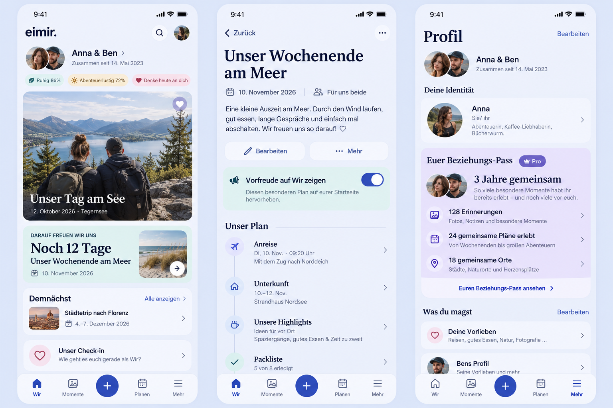

# Anticipation and Pro relationship passport — implementation preflight

Product Owner decision: 2026-10-29. Implement #504 and #497; the new passport
presentation is Pro. Merge authorization covers the requested delivery package
after normal review/protection, CI, product and privacy gates. Existing #1493 and
#1494 remain independently owned. Baseline: `main@413d93465429d4e901d0a168a81aad19a12638be`.

Generated with the built-in Imagegen tool before UI implementation. Synthetic
people, photographs, dates and counts are illustrative. The image's invented
itinerary, mood percentages, extra profile fields, map/photo thumbnail and
decorative controls do not authorize new runtime features. Actual repository
icons, identity semantics, privacy, settings, content and routes remain binding.

## Inspected destinations and reuse

Reviewed TodayPage, its photo-first focal Memory, CouplePresence, own Daily
Check-in, ordered/hidden modules and upcoming agenda; PlanProductPage reading,
editing, schedule/completion, If-Match and Query ownership; ProfilePage identity,
relationship summary, partner/preferences and existing Pro information. Reuse
the Plan domain, authorized Dashboard projection, server clock/account time zone,
calendar-day semantics, existing shared-story aggregates, entitlement service,
generated TypeScript client, Query guards, ProMark, PartnerAvatarPair and tokens.
No external provider, runtime dependency, scheduler or parallel event domain.

## #504 Mobile Interaction Contract

- Task: deliberately highlight an existing scheduled shared Plan, see the next
  special event on Wir, open its canonical detail and return to the same context.
- R3 Plan reading + R4 Today templates. The personal photo stays the focal point.
  A labeled, accessible switch in Plan reading performs one confirmed If-Match
  update. It is available to either partner without a second person's action.
- Persist one default-false Plan metadata flag. Normal plans are never inferred
  from titles. A bounded server query selects one upcoming flagged Plan,
  independently of the ordinary eight-item agenda limit. Nearest calendar day,
  canonical schedule and UUID provide deterministic ordering.
- Use the Dashboard's existing authoritative viewer-local day/time zone; the
  current Space has no general scheduling time-zone field. Date-only schedules
  stay dates. Today/tomorrow/day counts are localized; absolute date remains.
- Integrate one quiet natural-tint countdown inside the existing upcoming module.
  Respect visibility/order; suppress its duplicate agenda row. No seconds timer,
  new push or false automatic Memory. Completion/past day/unmark/delete removes
  the countdown. The normal completion-to-Memory continuation remains.
- Pending is explicit, competing writes are blocked, offline does not enqueue,
  errors preserve the authoritative value and offer retry; 409 refreshes before
  another choice. No late write may revive a denied/replaced Query.
- Loading/older API: no fabricated countdown. Existing Today loading/error/cache
  semantics remain. 320/360/390/430/Expanded, Light/Dark, 200% text, keyboard,
  44px targets and reduced motion preserve the same meaning and action.
- Free/Core in both deployments. Export/restore retains the additive flag;
  previous bundles default false. No media or provider data path is added.

## #497 Mobile Interaction Contract and commercial decision

- Task: recognize shared history in a calm passport after own identity, before
  existing preferences; existing profile and Settings remain discoverable.
  R5 Profile plus v1 Statistic composition; no KPI tile wall or score.
- The PO's new decision supersedes the historic Mixed #497 proposal for this new
  surface: the composed passport and its server aggregation require a new
  Space-scoped `relationship.passport` Pro capability. Both partners benefit.
  Existing relationship duration, ordinary Dashboard counts, source content and
  machine-readable export stay Free/Core. No current surface is reclassified.
- A Free account sees a factual named Pro entry without invented counts. Unknown
  capability/read failure is retryable, never treated as Free or zero. The server
  checks capability before aggregate queries; client gating is not authorization.
- Use authoritative shared Memory/HeartMoment/Milestone counts plus completed
  shared Plans and shared Places. No private partner rows, mood, activity score,
  engagement ranking or counts inferred from paginated client lists.
- Relationship duration is included only when the existing shared duration
  preference permits it. Names/avatars reuse existing identity primitives; no
  presence claim. Canonical content links provide useful return paths.
- This is a live read-only presentation, not a saved Pro artifact. Downgrade
  pauses this aggregation/view, without deleting or hiding any underlying data,
  changing Free duration/counts, or preventing export. No snapshot persistence.
- Loading/error/offline/empty remain distinct. Data is Account+Space scoped,
  volatile, cleared on owner/capability/authorization loss. A failed refresh never
  invents zeros or resurrects a denied result. Retry uses existing ProblemState.
- Same bounded composition in Expanded; localized labels and number formatting,
  screenreader names, 320px reflow, Light/Dark, large text and reduced motion.

## Quality and acceptance

Server authorization, cross-Space/private negatives, ETag conflicts, date-only vs
timed/DST/midnight ordering, hidden/default-false/past/completed/no candidate,
candidate beyond eight ordinary entries, capability-specific grants and expiry,
truthful counts and transfer round-trip need meaningful regression coverage.
Run OpenAPI generation/drift checks, relevant PostgreSQL/API and Web consumer
tests, production/type/lint checks and normal hosted gates. Capture actual
Compact Light/Dark/Expanded and complete Plan toggle -> Wir -> detail -> return,
and Free/Pro Profile reads with failures. Shared Web changes introduce no native
capability. Installed APK upgrade/real-device acceptance remains separate.

No sensitive telemetry, content diagnostics, data copies or managed cost change.
No security, privacy, tenant, provenance, licensing or language gate is weakened.
