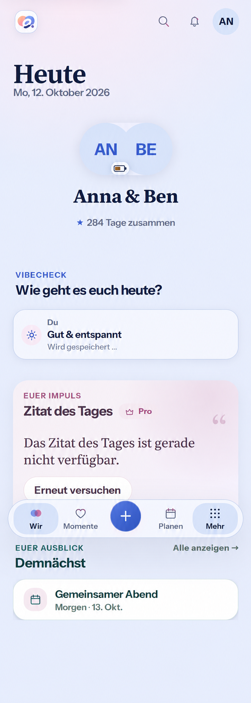

# Daily Check-in ownership across return — #508

Baseline: `main@f19eb5b38b2321c01f8f19ced2eb5ce12a3771d5`, 2026-10-12,
after merged #1305. No open product PR overlaps Daily Energy/Vibe.

## Current destination and reproduction

Reviewed current `DailyEnergyCheckIn`, `DailyVibeCheckIn`, the shared current-day
query, generated API, App session/Space cache clearing, shared query-identity
guard and the shipped partner-gesture mutation-cache owner. Mandatory
engineering/product sources read for the preceding current-main work are
unchanged; ADR 0007's Daily Check-in/Mutual Reveal, module configuration,
feature matrix and R4 Today were rechecked for this slice.

Three new component regressions fail before runtime implementation: after the
last Today consumer unmounts and the ephemeral projection is removed, Energy
loses its pending selected value; Vibe loses its pending card; and Vibe can
issue a competing request while Energy's same-root write remains pending.
Earlier isolated characterizations sent two identical dimension updates with
the same ETag after remount. These prove client requests, not duplicate server
persistence; server admission and full-owner ETag remain authoritative.

A fresh pinned-Chromium 151.0.7922.34 browser journey passed on unchanged main
and supplied the [whole-screen baseline](baseline-390-light.png). Synthetic
Anna/Ben fixtures enable both dimensions, use the current server day and keep
both partner dimensions hidden. The existing shell/header, Today/date, couple
avatars/name/duration, own Energy battery, own pending Vibe card, quote's
unavailable/Retry/Pro state, upcoming Plan and bottom navigation were inspected.

## Generated Compact reference

[Built-in Imagegen prompt and provenance](generation.md). Generated before UI
implementation from the fresh main capture. The same composition remains after
return while the own Vibe request is pending; the own Energy remains confirmed
and no other writer can submit. Rendering scale and asset details are
illustrative. Existing owner assets, localized copy, semantic tokens,
accessibility and actual browser evidence govern; no new design direction.

## Mobile Interaction Contract

| Concern | Decision |
| --- | --- |
| 1. Human outcome | Return to a still-pending own daily choice without losing it or submitting another write. |
| 2. Focal point | Couple identity and existing Today content; personal battery/Vibe remains a bounded contextual ritual. |
| 3. Primary action | Existing Energy slider or Vibe choice/optional note and Save. No new route, gesture or field. |
| 4. Authority/pattern | Product Reference v1 R4/Today, existing avatar popover and ShortTaskSheet; ADR 0007's shared Space-day root. |
| 5. Direct response | Preserve only the submitted own value while pending, using the existing saving state. Partner projection and celebration remain server-confirmed. |
| 6. Shared ownership | One synchronous Account/Space/server-day writer for both dimensions. Duplicate, same-task, remount and competing-dimension writes are excluded. |
| 7. Scope | Use server `checkedOn` and `dailyContextTimezone`, captured ETag and initiating query identity. Do not derive the day from the device or change the sent API contract. |
| 8. Pending inspection | Existing Energy entry may inspect a locked slider; Vibe writer entry remains focusable but cannot start another task. Explicit localized feedback identifies another pending dimension where needed. |
| 9. Dismissal/return | Existing sheet/popover Escape, Back, outside dismissal and focus restoration remain. Route return reads an authorized current projection before showing an own preview. |
| 10. Failure/draft | Clear the own preview, retain the selected own value/note in the current session's bounded mutation lifetime, and expose the existing explicit retry. Never retain partner content in that owner. |
| 11. Conflict | Refresh authorized current data and keep current conflict feedback; never replay a stale PATCH. A new deliberate selection uses the latest admitted ETag. |
| 12. Offline | No paused write/outbox, no reconnect submission. Fail a race with connectivity explicitly; reconnect may perform the existing authorized read only. |
| 13. Success | Reconcile only an existing initiating query at its admitted day/ETag; otherwise use the active authorized consumer's fresh read. Do not recreate removed data or inject a late response into a replacement query. |
| 14. Privacy | Preserve `gcTime: 0`, private no-store and persistent-read-cache exclusion for the server projection. Mutation variables/context/result contain no raw server/partner projection. Query identity must not strongly retain removed projection objects. |
| 15. Session boundaries | Existing Account/Space/session cache clearing retires request ownership and suppresses late writes to caches/announcements. Other scopes own independent attempts. |
| 16. Accessible feedback | Retain native controls, pressed states, polite status, clear inline errors, deliberate focus and 44px targets. No automatic keyboard or hidden-only action. |
| 17. Compact/reflow | Keep 360/390/430px composition and 320px/200% reflow; labels/status wrap in the existing flow. |
| 18. Motion | Existing own pending treatment and only server-authorized reveal motion; reduced motion preserves meaning/focus. |
| 19. Expanded | Same task, current contextual popover/sheet and bounded Today composition. No extra management panel. |
| 20. Input burden/warmth | Keep six semantic choices, slider, optional note and existing relationship copy; no new decoration, status scoring, typing or infrastructure setup. |
| 21. Acceptance | Open, hold, duplicate/compete, dismiss/leave/return, confirm/fail/retry, conflict, offline/reconnect, query removal/replacement, session/scope and server-day change; real Light/Dark/Compact/Expanded/reflow captures. |

This bounded slice supersedes the mounted-task-only own-preview/draft statements
in the earlier Energy/Vibe preflights. It does not expand partner-status
retention or create an offline status/history product.

## Reuse, business and cross-cutting review

**Reuse review relevant:** compare another component ref, a module singleton,
persistent outbox or a generic Plan-completion abstraction with installed
TanStack mutation keys/cache/subscriptions and explicit network mode. Reuse the
framework, existing normalized errors, generated API, shared query-identity
guard and current overlays. A small DailyCheckIn-domain owner preserves its
full-root ETag, server day and privacy semantics; no parallel cache/framework.
Use the ES2022 runtime's weak reference for query identity so an identity guard
does not keep a removed ephemeral projection alive. No new dependency,
provider, license/ToS, data transfer, account/configuration or operating cost.

**No business/freemium impact:** matrix rows for Vibe/Energy remain Mixed,
with the current-day ritual and its reliability Free/Core; `daily.insights`
continues to govern additive longitudinal insight. Module switches do not grant
entitlement or visibility. Cloud/Self-Hosted, quotas, retention/export,
downgrade, ownership and managed cost remain unchanged.

Review security/auth/module admission, dimension-specific Mutual Reveal and
ephemeral data minimization; localized/accessible feedback; same-task and
cross-dimension concurrency; captured validators; explicit offline/retry;
late-cache/session/day boundaries; and current query/GC resource behavior.
Only an own submitted choice/note is retained in existing in-process mutation
state while the same authenticated context lives, with the existing framework's
bounded inactive lifetime. No raw partner value/note, old server projection,
new telemetry/log/URL, durable storage, background service, API/schema,
migration, native capability or deployment change. Broader #508 and final
#946 acceptance remain open.
