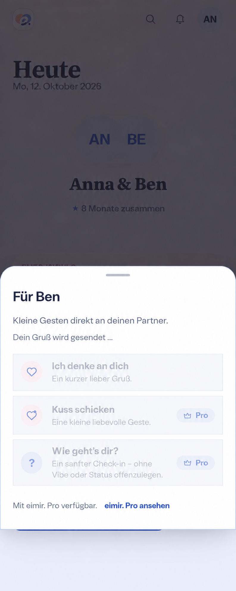

# Partner gesture send feedback preflight

Owning issue: #508. Baseline `main`: `a8d6a575f707300c40fe7d67c4f835825299d1a4` (2026-10-12).
PR #1301 is merged. Current open PRs #1271, #1275 and #1296 do not overlap this sender.

## Current screen and reproduced behavior

Reviewed the current Today route, PartnerQuickActions, the entitlement and Dashboard
queries, generated Notifications API, server request receipts and cooldown admission,
App cache clearing, and the delivered ShortTaskSheet/popover handoff. A fresh pinned
Chromium 151 capture shows the entire 390px Today composition with the Free gesture,
two Pro entries, intro, Pro link, named dismissal and existing shell behind the sheet.
The existing Compact browser journey passes on this baseline.

Two new characterization tests fail before implementation: a pending sender remount
unlocks a competing send; an offline activation pauses and sends on reconnect.
Source inspection also confirms that pending has no textual feedback and component-local
cooldowns/errors are lost on remount. Success already waits for server confirmation.

## Generated whole-screen reference

[Actual baseline](baseline-390-light.png); [generation record](generation.md).
The generated image preserves the complete composition and existing capabilities.
It adds one plain secondary-text sending line after the intro and above the actions.
Its faded disabled copy is illustrative: the implementation must retain compliant text
and focus. Current assets, tokens, exact localized copy and privacy rules take priority.
Expanded retains its existing contextual popover with the same state hierarchy.

## Mobile Interaction Contract

| Concern | Contract |
| --- | --- |
| 1. Human outcome | Deliberately send one content-free partner gesture and understand its actual outcome. |
| 2. Relationship value | A spontaneous small greeting stays intentional; no fabricated delivery or cooldown. |
| 3. Compact state | Existing Today avatar entry and ShortTaskSheet. |
| 4. Dominant action | The chosen existing gesture; no additional submission step or spinner. |
| 5. Hierarchy | Partner/title, intro, honest status, three existing actions, existing Pro discovery. |
| 6. Disclosure | Entry remains contextual; pending/error are visible inside the open surface. |
| 7. Pattern | Existing sheet / Expanded non-modal popover; retain Escape/Back/dismissal and focus restoration. |
| 8. Loading | Existing entitlement loading stays separate from the active send. |
| 9. Empty | No new empty-content or relationship placeholder; existing partner/module gating remains. |
| 10. Error | Persistent localized inline failure survives same-session remount; only deliberate activation retries. |
| 11. Offline | Fail immediately, no paused write/outbox/reconnect submission. An explicit retry may reconcile an uncertain result using the same request ID. |
| 12. Success | Server confirmation supplies success copy and cooldown; cache reconciliation survives sender remount. |
| 13. Privacy | Account + Space mutation scope and initiating query identity; cache clear/replacement invalidates late feedback/results. No partner status disclosure or persistence. |
| 14. Reflow | Retain wrapped labels, 44px targets, 320px/200% and 360/390/430px behavior. |
| 15. Motion | Reuse existing confirmed-success motion; polite pending status, no looping animation; reduced motion retains meaning. |
| 16. Expanded | Existing popover; same actions/results and safe responsive surface handoff. |
| 17. Action list | A bounded three-choice action list supports direct selection; no relationship records/table introduced. |
| 18. Platform reuse | Existing semantic buttons, named sheet, dismissible popover and retained presence; no custom gesture. |
| 19. Input burden | No typing, keyboard summon, hidden-only action or extra recall requirement. |
| 20. Reference | Generated before UI implementation against the inspected baseline and fresh whole-screen capture above. |
| 21. Acceptance | Open, hold send, repeat activation, close/reopen, leave/return, success/failure/retry, offline/reconnect, cache/scope change; Light/Dark, Expanded, reflow and reduced motion. |

Authority: Product Reference v1 feedback/result ownership and R4 Today, existing
short-task/overlay Screen Templates and Component Contracts. Partner identity remains
the focal point. Existing semantic text/surface/focus tokens and relationship copy
suffice; no decoration or new design direction is appropriate to pending.

## Reuse and cross-cutting decisions

Reuse installed TanStack mutation keys/cache/state subscriptions, its explicit network
mode, current query identity boundaries, existing normalized errors, shared secure
request-identity/reconciliation helpers, server receipts/cooldown and current overlays.
Alternatives reviewed: another local component lock, a module singleton, durable outbox,
a toast dependency, or making the Plan completion hook universal. A small partner-domain
hook on the same framework retains gesture-specific semantics without a new cache or
background service; extract only the identical query-identity responsibility where useful.
No new provider, integration, substantial dependency or technical user configuration.

No business/freemium impact: the authoritative Partner Quick Actions matrix remains
Mixed (Free Thinking-of-you; Pro extended gestures), identical on Cloud/Self-Hosted.
Module switches do not grant Pro or visibility. No quota, retention, managed cost,
downgrade, export or data ownership change; no matrix amendment required.

Security/privacy retain current server admission, Membership, entitlement and receipt
contracts. In-memory state clears with the App's existing Account/Space boundaries;
late responses must neither recreate removed queries nor announce into another context.
No new logs, telemetry, content URLs, storage, API/schema, migration, native capability
or deployment change. i18n, polite status/inline alert, preserved focus, duplicate exclusion,
uncertain retry, bounded cache lifetime and responsive/reduced-motion acceptance are
required. #508 and final #946 remain open for their broader acceptance scopes.
