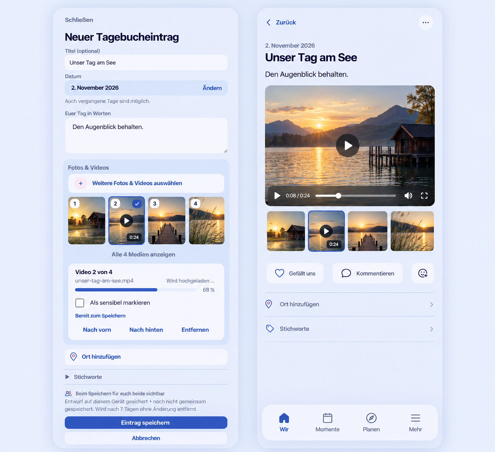

# Short video capture and playback preflight

Owner: [#88](https://github.com/baerenmarke90/eimir/issues/88). Product Owner authorization: 2026-11-02, following the fresh feasibility review. Baseline main: `cb3354f076cdb99855cba9c3b5f4f195a5a7df02`. Explicit integration base: PR #1592 at `739088fd5920bc0343b3b96dabcae116be9c6983`, stacked on #1591. Preserve that dependency; refresh it before final acceptance.

Generated with the built-in Imagegen skill after inspecting the actual Memory capture, photo contact sheet, gallery, HeartMoment detail, native file chooser, attachment authorization and encrypted storage. The current 390px capture evidence from #1586 was supplied as the visual baseline. Product Reference v1 R1/R2, Create/Edit/Detail templates and existing task boundaries remain normative.

## Mobile Interaction Contract

Keep title, date, narrative, optional Place/tags, external photo sources, audience, explicit Save/Cancel and canonical result/return. A mixed contact sheet uses the existing ordered selection and one inspector. Videos receive a Play identity and duration when confirmed; upload progress and server validation remain distinct. Reordering does not restart transfer. Failed or unsupported files are visible, retryable/removable and never silently excluded by Save. HeartMoments retain one attachment and their existing private/shared choice. Plans, avatars and cover-only features remain image-only.

Browse surfaces load only authorized poster images. Starting playback is deliberate; only the active gallery item owns a video player. Use the platform HTML player, inline playback, accessible controls, no autoplay and no looping. Pause and release the source on item/context change, close, page hiding or lost authorization. Preserve gallery focus/Back/swipe and the existing sensitive reveal. A sensitive poster or video never becomes visible before reveal. No provider accounts, technical URLs or new configuration fields for couples.

Compact 360/390/430 and 320 reflow retain the current composition and 44px actions. Expanded adapts the same selection and viewer. Loading, processing, empty, offline, rejected codec, expired playback grant, denied parent, interrupted transfer and retry have localized, non-sensitive outcomes. Reduced motion retains all status and ordering feedback. Open -> select/reorder -> save -> real result -> play/seek -> return must be verified in Light/Dark and at large text.

The generated reference is composition guidance, not runtime evidence. It compresses page height and contains illustrative inconsistencies: uploading cannot also be ready, a four-item selection needs no expand action, and the current detail narrative/comments/navigation order must be retained. Do not copy those artifacts, invented reaction labels or a changed navigation order into the implementation.

## Technical, reuse and security decisions

V1 accepts bounded MP4/MOV containing H.264 video and optional AAC audio. Historical upper limits remain 250 MiB, 180 seconds and 3840x2160 (orientation independent); Memory retains 20 total attachments / 500 MiB, HeartMoment one attachment. Other codecs fail closed with actionable localized copy. No video transcoding, adaptive streaming or offline/background-upload promise is introduced.

Reuse MediaStore, encrypted seekable streams, upload claims, the PostgreSQL queue, parent authorization, cleanup, OpenAPI generation, opaque token generation/hashing, existing draft ownership and the gallery. Extend shared streaming and HTTP Range support. Review standard HTTP/HTML media, FFmpeg/ffprobe, a maintained S3 SDK versus the existing adapter, tus/Uppy, platform pickers and external media providers. Retain the current adapter with bounded spooling/range reads; the small 250 MiB contract does not justify a second upload protocol. No external media provider receives relationship content. Future resumable/background delivery needs its own explicit contract.

Run video processing only in a separately built, optional media-worker image. General workers must never claim video jobs. Parser input/output, runtime, memory, process count and temporary storage are bounded. Disable parser network protocols and restrict formats/codecs/streams; never inherit application secrets into a decoder command. Strip content metadata, re-probe the output and use the existing clean thumbnail variant for a poster. Poster failure remains non-fatal under the canonical variant contract. Original uploads are not the readable result. Failed/in-flight temporary files are cleaned under retries, crash recovery and deletion races.

FFmpeg is an additional system supply-chain boundary, outside `uv audit`. Pin the exact source/build, record checksum/license/build options, run a current advisory check, and fail the production build for an unreviewed applicable vulnerability. The Debian 7.1.5 package has open advisories as of this review, so installing the broad package is not an accepted shortcut. A restricted build and explicit advisory applicability review are required. API/general-worker images remain unchanged by the optional codec layer.

Playback uses a short-lived, hashed opaque grant scoped to a DeviceSession, Space, attachment, variant and parent. Minting requires normal bearer authorization. Each byte-range read rechecks the live session, membership, attachment and canonical parent; a grant never grants a general API session. No raw access token or provider URL enters a video source. Grants are transient, bounded, non-exported and redacted; reverse-proxy logging must omit query credentials. Existing encryption and authenticated chunk reads stay in place.

## Business / freemium consistency

The approved direction continues #88's Pro upload classification with a distinct `media.video_upload` Space capability, identical in Cloud and Self-Hosted. One grant serves both partners. Upload eligibility requires both operator processing availability and entitlement; one never implies the other. Read, delete, privacy control and essential export/restore of existing authorized videos remain Core after downgrade. Normal photo/text use and Plan photos remain Core. No final Cloud byte quota or paid add-on value is invented. Operators own processing/storage costs; resource safety limits apply in both modes.

## Delivery and acceptance

The new contract supersedes the old implementation deferral only for this bounded new slice; abandoned #109 is not an implementation base. Deliver shared transfer/playback foundation, isolated processing, shared Web capture/gallery and narrow Android picker integration. Test Local/S3/encrypted storage, byte bounds, range semantics, malformed/unsupported media, metadata removal, processor timeout/crash, queue routing, delete/cleanup races, parent privacy/session revocation, downgrade, export/restore and client ownership. Preserve startup/media-quality work from #1590. Actual builds, browser evidence and native-capability checks remain required; generated imagery is not acceptance evidence.
