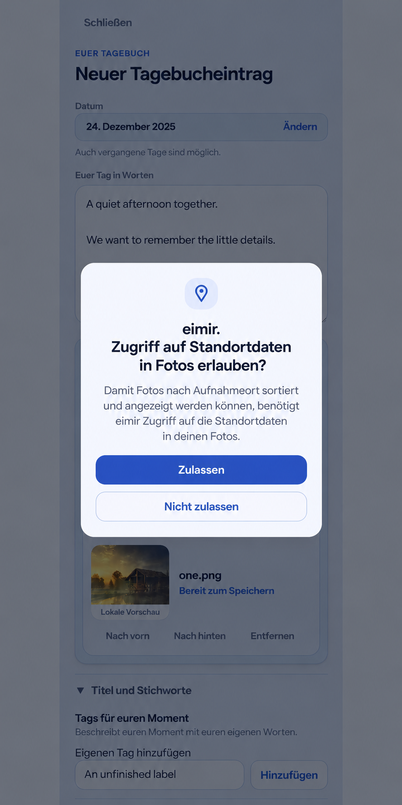

# Android selected-photo location repair

Baseline: main `198c5421c1552bb73a1f1aad288b847e08497059`, inspected on 2026-10-27 before native implementation.

The owner reproduced missing Places with newly selected Android-gallery photos while the account preference was enabled. The Web file input uses Capacitor's ordinary GET_CONTENT chooser; the Android adapter neither requests photo-location metadata access nor opens authorized original MediaStore bytes. Android may redact GPS before the existing server extraction runs.

## Mobile interaction contract

R1 capture and the existing #1459 result/settings composition remain authoritative. Inspected MemoryCreatePage, AttachmentDraftPicker, HeartMomentProductPage, the current date/prose/photos/provider/title/tags/save task, Android MainActivity/manifest, and Capacitor 8.5.2 BridgeWebChromeClient. No React screen, navigation, field, provider choice, theme or token changes are planned.

The authored words and selected photographs remain the focal content. Tapping the existing photo-selection control may request Android's photo-metadata permission. It never requests live/coarse/fine/background location. Android owns the dialog's localization, accessibility, focus, Back, scaling, theme and reduced-motion treatment. The generated image illustrates whole-screen layering only: its dialog wording and sorting explanation are not product copy or an exact OEM template.

After permission is granted, use Android's standard document selector and its per-file read grants to obtain originals. A single native chooser contract serves image inputs without a second photo-upload pipeline. Capture and other file kinds keep Capacitor's behavior. A denied permission keeps ordinary selection usable and must not upgrade any URI to require original metadata. Cancellation completes the chooser once with no files. Duplicate requests cannot replace an active result; Activity destruction cancels the owner before any late asynchronous resolution. No early keyboard, additional per-entry confirmation or technical configuration is introduced.

Existing draft/upload state owns loading, empty, failed, offline and confirmed-save behavior. Missing GPS remains normal absence; private moments and account OFF remain enforced by the existing server transaction. No native cache or persistent URI grant is added. Expanded/Web keeps its existing browser file picker. Compact/native proof must cover the real system chooser and a GPS-bearing selected file; a mocked browser upload alone is insufficient.

## Reuse review

Considered unchanged WebView GET_CONTENT (redaction gap), modern Photo Picker location extra (only available on newer platform versions), broad MediaStore library reads (unnecessary access), a third-party/native photo-copy plugin (duplicate ingress and cache lifecycle), and platform Storage Access Framework plus MediaStore original access.

Select Android ACTION_OPEN_DOCUMENT, ACCESS_MEDIA_LOCATION, getMediaUri and setRequireOriginal, through a narrow BridgeWebChromeClient subclass. Reuse Capacitor activity-result registration/background execution and the existing HTML File/upload/validation/binding contracts. No SDK/library/provider dependency, license change, hosted fee, geocoder, media-library scan or native product UI is added. Platforms/providers that cannot resolve an original retain the explicitly selected readable document rather than failing the photo.

Primary sources reviewed 2026-10-27:

- https://developer.android.com/training/data-storage/shared/media#media-location-permission
- https://developer.android.com/reference/android/provider/MediaStore#getMediaUri(android.content.Context,android.net.Uri)
- https://developer.android.com/reference/android/provider/MediaStore#setRequireOriginal(android.net.Uri)
- https://developer.android.com/training/data-storage/shared/documents-files

## Business/freemium impact reviewed

Restores the existing Free/Core automatic selected-photo Places contract in FREEMIUM-FEATURE-MATRIX. Cloud and Self-Hosted use the same Android adapter. Pro Google/Immich boundaries, existing history, quotas, downgrade behavior and operating costs do not change.

## Cross-cutting review and validation plan

Only selected content URIs may enter the callback; reject non-content/unbounded results. Permission is separate from account consent: the server still checks preference during extraction and association. No coordinates, content URIs or filenames enter logs, diagnostics or persisted native state. Only an explicitly granted media-location permission permits original-URI upgrading. Use read-only per-file grants, no broad storage/media permissions or persisted grants. Do not read full image bytes on the UI thread. Reuse SDK cancellation and lifecycle ownership.

Add device/instrumentation proof for image filtering, single/multiple intent contracts, cancellation/ownership, real MediaStore document conversion and EXIF survival, plus an actual system-picker round trip on a supported emulator. Extend the existing native verification job rather than adding a competing emulator pipeline. Existing backend privacy/encryption tests remain unchanged. A new APK is required; a Web-only deployment cannot repair an installed Android wrapper.

## Provenance

The generated reference is an original eimir. ImageGen workflow asset. Its input is the existing #1444 diary composition; any embedded cabin photo inherits that reference's recorded CC0 provenance. It is concept guidance, not runtime acceptance evidence. See image-prompt.txt for the exact generation prompt.
