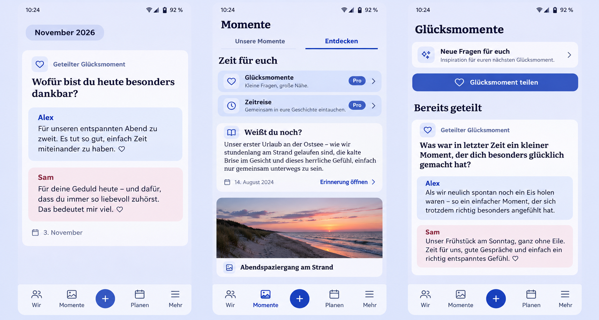

# App continuity and content composition corrections

## Baseline and acceptance

Product Owner follow-up, 2026-11-05. The implementation branch starts at PR
[#1650](https://github.com/baerenmarke90/eimir/pull/1650),
`9170579b532f5df0cd80758d0b97c606a4576494`. Current `main`,
`57cd3b928b774b4a9e526f931be5d195776a1550`, is already an ancestor.

The six requested outcomes are:

1. Wishes appear in locale-aware alphabetical order, across loaded pages.
   The overview omits the creator byline; the detail retains authorship.
2. Sticky Diary month headings stop below the real system top inset. The
   existing transparent, edge-to-edge system bar and ambient canvas remain.
3. Opening a current partner signal consumes that one event, including after
   returning/restarting. Current attention and the historical activity trace
   have separate purposes and do not repeat the same event simultaneously.
4. Discover composes prose and media together: a long retrospective gets a
   comfortable full-width reading surface; adjacent photos retain their own
   proportions. Each retrospective appears once, with no duplicate lead/item.
5. Both partners' happiness answers remain visibly distinct from their parent
   surface in history, Diary, Discover and detail, in both themes.
6. Previously loaded images survive an ordinary same-session app restart,
   without redownloading their bytes. Current parent authorization, account/API/
   Space isolation, sensitive reveal, deletion and logout revocation still apply.

## Product Design Preflight / Mobile Interaction Contract

Authority: Product Reference v1, R2 Moments, R3 Planning and R4 Today;
Story Timeline, Discovery, Detail View and Today templates. This is a correction
to existing journeys, not another navigation or dashboard design.

Inspected destinations: `SharedPlanningOverviewPage`, `WishProductPage`,
`StoryProductPage`/`StoryRetrospective`/`useDiscoverLayout`,
`TodayPage`/`todayComposition`/`attentionReceipt`, `CoupleExperiencePage`/
`ExperienceAnswers`, normal-flow shell and SystemBars CSS insets. The existing
Diary/Discover tabs, year/chapter entries, filters, shared experience links,
canonical detail navigation, capture plus, and four bottom destinations stay.

**Human outcome:** find a wish, read a memory comfortably, notice a new partner
contribution once, and return without rebuilding the visual album every time.
Personal words/photos remain focal. Opening that content is the dominant action;
no new typing, keyboard activation, permission, setting or technical control.

**Compact:** month context stays below status icons while content remains
immersive; dense prose spans both album columns and media keeps natural height.
Answer surfaces have equal visual separation. Wish title leads the quiet list,
whose alphabetical order supports finding a known shared intention.
**Expanded:** the same content/order and canonical destinations; wider reading
measure and archive composition, without stretching images to match long prose.

**States:** keep existing loading/empty/error/retry and unsaved-write handling.
Cache failure falls back to authorized network reads. Offline display does not
invent a write queue or grant access. Failed/denied authorization cannot reveal
stored bytes. Consumed attention leaves a quiet history; new events can qualify.

**Interaction/return:** reuse actual links, Task Origin and browser/system Back.
One event's receipt is independent of other events, accounts and Spaces.
Existing microfeedback and reveal roles remain; reduced motion retains the same
visible result without added animation. No guilt, decorative stock couple, or
extra relationship copy is needed for these corrections.

**Scaling:** verify 360/390/430 px, Expanded, long content, Light/Dark, reduced
motion, safe-area scroll geometry and existing accessibility/reflow assertions.
Browser geometry simulates native CSS insets; actual device acceptance must not
be claimed from a desktop browser.

## Generated composition reference

Generated before UI implementation with the built-in Imagegen tool after the
repository review above. Synthetic people/content only; user screenshots remain
private and are not committed. The generated mockup expresses composition, not
new literal copy, navigation labels or feature changes. Existing components,
tokens and locale resources govern the implementation.

Prompt: generate a repository-grounded eimir Compact three-screen comparison
using the current periwinkle canvas, blue accent, Instrument Sans/Literata and
transparent Android system bar. Show the real four-destination bottom shell and
central plus; a sticky month below status icons; a full-width prose retrospective
followed by a naturally proportioned photo, retaining the happiness/time-travel
entries; and a neutral happiness-history parent with equally distinct blue/rose
answer blocks. Use fictional German content and no unrelated redesign.

## Reuse and cross-cutting review

Keep the existing native/browser IndexedDB image store, authorization loader,
bounded LRU and Blob URL lifecycle. Compare HTTP caching (signed URLs and private
no-store responses cannot supply this contract), a new native filesystem plugin
(another platform lifecycle/dependency), and the existing origin-owned Blob store.
Chromium documents that persisted IndexedDB Blobs are stored on disk:
<https://chromium.googlesource.com/chromium/src/+/master/content/browser/indexed_db/docs/README.md>.
Browser storage can still be evicted under storage pressure; no unconditional
permanence promise is made. Current platform review:
<https://developer.mozilla.org/en-US/docs/Web/API/Storage_API/Storage_quotas_and_eviction_criteria>.
Reuse locale `Intl.Collator`, CSS grid/sticky and the existing bounded local
attention receipt rather than introducing sorting/layout/notification services.

No new dependency/provider, credentials, data transfer, cost, schema or entitlement.
No business/freemium impact: Wishes and retained-media reading remain Core;
happiness/time-travel admission retains its current Pro boundary. Equal Cloud/
Self-Hosted behavior and existing quotas/downgrade/data rights remain.

Privacy review must cover cache invalidation, reload/rotation versus real login
changes, asynchronous old writes, cross-account/API/Space access, sensitive
content, and parent deletion/denial. Test durable reuse through the real loader
and restarted runtime, not only a raw store unit test. Content-based layout must
preserve DOM/focus order and readable untruncated canonical content.

## Validation plan

Run targeted component/cache/session regressions, TypeScript, formatting/lint,
token/PWA guards and production build. Reuse the mandatory browser selection
inventory, retain relevant ownership, and run affected real-browser journeys
with screenshots plus download/authorization counts across reload. Record actual
results and limitations in the PR and this evidence directory before final review.
