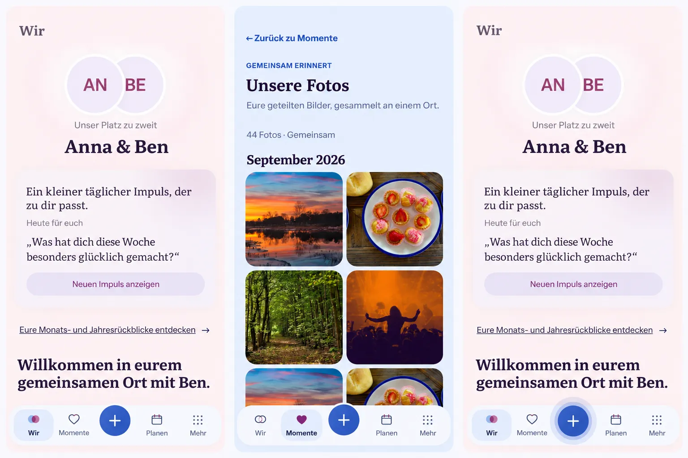

# App quality continuity preflight (#1590)

Baseline main `4a904c8cbdb31fa8bcdebc0038bb423558f2b0a7`, #1588 `6ed756bb51aaea981625cdb2b340f31f004a207a`, and #1589 feature baseline `4f740a8f621dbfce18968386fce3b625db5d940d` were inspected before implementation. Integrated PR #1591 (`48b589d44fa09595294535b4d0e2959756bfa858`) before publishing the implementation. The startup change is stacked on its `feat/1589-upcoming-plans` branch; later slices depend on the preceding quality slice.

Generated with the built-in Imagegen tool before UI implementation, using the repository's actual Wir and media-browser screenshots as inputs. The prompt requested three complete Compact compositions: settled existing Wir, settled existing photo browsing, and circular create-press feedback; preserve the current palette, typography, content hierarchy and four destinations with central create. No redesign, new capability or replacement UI stack.

This is illustrative composition evidence, not timing, permission, performance or device evidence. Incidental generated quote controls, copy, back links, dates and glyph substitutions are not requirements. Actual current routes, controls, localized copy and Product Reference v1 remain authoritative. It does not authorize a new daily-question action or replacing the current root screen.

## Mobile Interaction Contract

R2/R4 and D1/D4/D8. Existing personal content stays the focal point. Existing root navigation and create remain reachable. Persist only a bounded per-instance/account/Space server-confirmed design choice; it grants no capability. Gate an unresolved first design instead of painting a false selected theme. Preserve authorized content during ordinary refresh, remove it on denial/context change, keep sensitivity concealment. Media previews use the current derivative contract and full viewing retains originals. Controls respond at contact within their actual outline, retain keyboard/TalkBack focus and reduce movement under reduced motion. Existing Back/task return and saved-state boundaries remain authoritative. Native renderer loss leads to explicit bounded recovery, with no automatic restart loop or promise of unsaved draft restoration.

360/390/430 Compact, relevant Expanded, Light/Dark, 320px/large text, reduced motion and failure/denial/context-switch states form the review matrix. Real Android cold-start/resume/process-loss evidence remains required for wrapper acceptance.

## Reuse, model and privacy

Reuse TanStack Query, existing browser/Android APIs, authorized byte cache, Object URL ownership and motion tokens. No new dependency/provider/account/telemetry service. Core reliability and interaction improve identically for Cloud/Self-Hosted; optional designs retain current entitlements. No API/DB schema, offline write, media derivative, quota or grant change. Only bounded presentation metadata is persisted; no private content, token, signed URL or grant. Native diagnostics contain build/WebView/renderer facts only.
