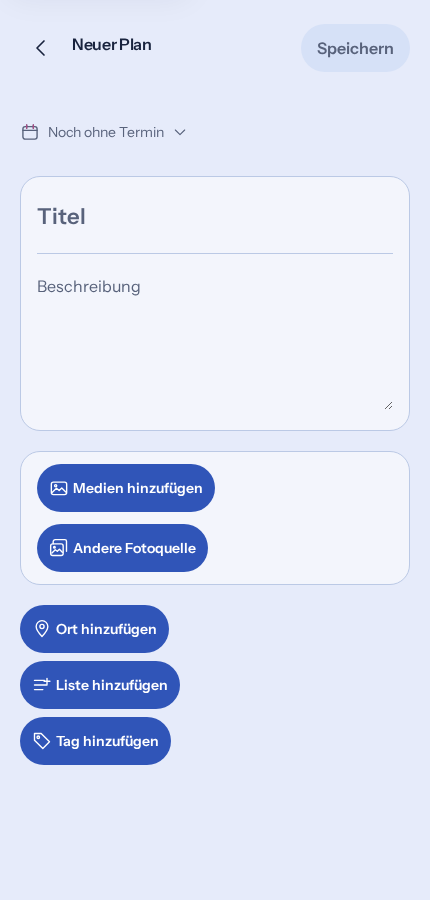

# Contextual button icons — browser evidence

Request and preflight: [#1724](https://github.com/baerenmarke90/eimir/issues/1724).
Implementation: [#1725](https://github.com/baerenmarke90/eimir/pull/1725).

These are unchanged Chromium screenshots produced by the committed browser journeys with synthetic identities/content. This evidence-only branch pins the captures without changing the tested implementation branch.

## Revision and execution

- Baseline main: `a9051247a63cc598378ced649a831063b3dacdb9`.
- Implementation head: `64685aef92cf1d6ee4757c6c67b81936f48f911e`.
- Hosted integration revision: `81c5d637c193d60605a6cf50647bcf6895742d77`.
- Tested implementation tree: `2a1f9c2320a182745b0be0cf1575016b012beb7d`.
- [Web Browser QA](https://github.com/baerenmarke90/eimir/actions/runs/42811375561): **875 critical cases across four shards plus 268 complete affected-spec cases passed (1,143 total)**. No failed/flaky case or hosted retry was reported.
- [Web Reference Flow](https://github.com/baerenmarke90/eimir/actions/runs/42811375612): **2,866 component tests passed**, two existing skips; TypeScript, lint, formatting, generated resources, Capacitor foundation and production build passed.
- [Video browser acceptance](https://github.com/baerenmarke90/eimir/actions/runs/42811375931/job/129813364290): **18 passed**. This separate job overlaps the main browser selection and is not an additional unique-coverage claim.

## Reviewed captures

| Capture | Meaning and reviewed result |
| --- | --- |
| [Plan, 430px Light](evidence/plan-430-light.png) | All five contextual motifs, the existing writing/media composition, shared pill sizing and complete visible labels. |
| [HeartMoment, 360px Dark](evidence/heart-360-dark.png) | Shared media/source, pin and tag treatment; existing audience and emotion presentation remain. |
| [Memory, 390px Dark](evidence/memory-390-dark.png) | Populated mixed-media draft retains the same media/pin/tag mapping, contrast and gallery controls. |
| [Memory, 1280px Dark](evidence/memory-1280-dark.png) | Expanded retains the same hierarchy and icons rather than introducing a separate UI. |
| [Plan, 320px at 200% text](evidence/plan-320-text-200.png) | Media/list labels wrap and tag insertion remains operable without overlap. Existing keyboard focus and native input ownership are retained. |

The two initial Plan/HeartMoment captures precede the existing connected-source journey, which continues through import, canonical parent save, result read and return without duplicate consent. Complete retained journeys also cover native file intake/cancellation, Place selection and save, authored-tag disclosure/insertion/removal, failure recovery, draft/Back safety, Light/Dark, reduced motion and reflow. The shared add-action assertion checks the exact typed motif, canonical icon size, decorative accessibility semantics and inherited foreground strokes.

No native wrapper/platform capability changed; these captures establish Web product evidence, not physical-device acceptance.

## Artifact provenance

Images were copied byte-for-byte from:

- [PR shard 2 artifact](https://github.com/baerenmarke90/eimir/actions/runs/42811375561/artifacts/13763706448), archive SHA-256 `5d129a5e0ce427dc2f53a55383153fe482c8dd5852cb86e97cfa60061279a6dc`.
- [PR shard 3 artifact](https://github.com/baerenmarke90/eimir/actions/runs/42811375561/artifacts/13762752149), archive SHA-256 `d40119be4d00bb6f0493ca031a46384343443028174907128e4435143e004cb7`.
- [Video artifact](https://github.com/baerenmarke90/eimir/actions/runs/42811375931/artifacts/13762441237). Original screenshot assets/content remain the repository's synthetic browser fixtures; no predecessor or third-party screenshot was used.

The initial Product Design Review correctly rejected the draft's four pending visual-evidence declarations. After the actual output was inspected, the PR body is updated through its supported edited event. No runtime correction push, rerun-all, weakened assertion or protection bypass is needed.
