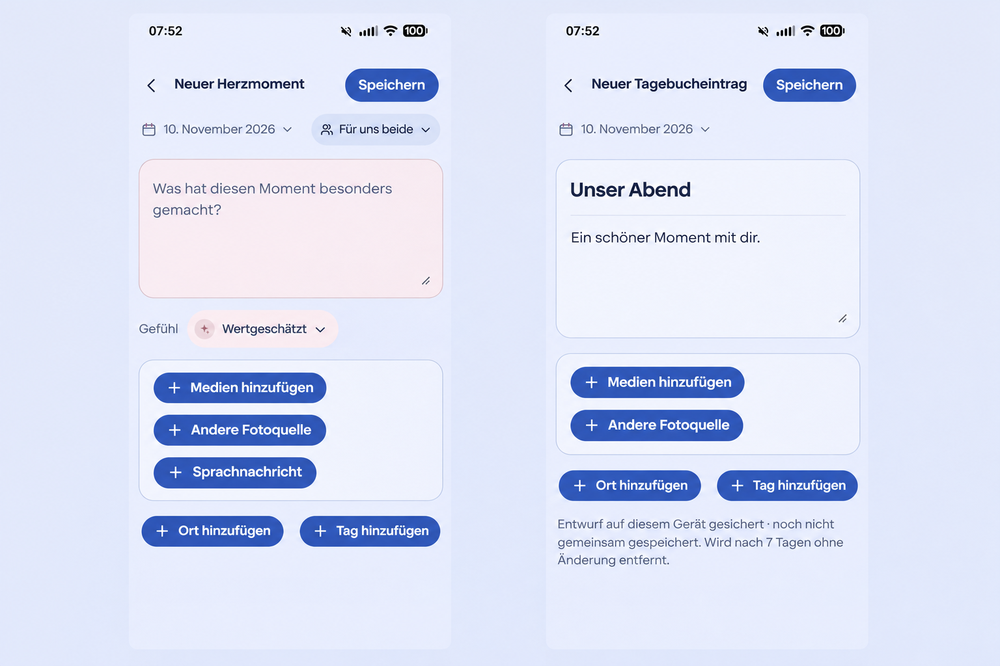

# Composer and upload polish (#1719)

Baseline: `a7417aed1df7540f898f765f07f471cb46263378` (merged #1718).
The Product Owner supplied four current app screenshots on 2026-11-10 and
requested a smaller global blue action treatment, a subtle title/prose divider,
one video Play cue, stable upload feedback and a working discard/return flow.

## Generated visual preflight

Generated before UI implementation from the supplied HeartMoment and Diary
screens with the built-in image tool. The prompt preserves the current palette,
compact Back/title/native Save header, date/audience, feeling surface, full media
frame, voice/source capabilities and enrichment actions. Only the blue pills are
modestly compacted and the Diary gains a quiet interior title/prose separator.
The generated reference guides composition; exact target sizes, tokens, native
semantics and the runtime evidence govern implementation. It is not runtime QA.

## Interaction and reuse contract

Product Reference v1 principles 2–6/9 and R1 capture apply, with Create/Edit and
Detail templates. The existing #1717 quiet composer remains the composition.
Keep the authored words as the focal point, native Save as the dominant action,
and one shared writing surface with separate accessible title/prose fields.
HeartMoment's single prose field needs no divider. Expanded retains the bounded
writing task. Use existing semantic tokens, `AddAction` presentation,
`FreeComposer`, `DraftExitPrompt`, `ShortTaskSheet` and editor-history ownership.

Keep at least 44 CSS px action targets, visible labels and plus icons, wrapping,
keyboard focus, reduced-motion equivalence and pending labels. Explicit discard
must finish the nested sheet's history/modal teardown before returning from the
editor; keeping the draft restores the trigger and preserves all inputs.
Browser/System Back uses the same ownership. No local history jumps, delays or
forced scrolling may hide a lifecycle failure.

Video preview retains the centered Play cue, duration, count, sensitivity,
swiping and deliberate full-screen playback. Upload state belongs to its
authorized transfer/attempt. Preparation, uploading and server processing have
distinct truthful meanings; stale progress must not replace newer progress or
restart the page's loading/entrance state. Retry and revocation stay explicit.

Validate real return journeys and upload/layout changes in Chromium; cover
Compact 360/390/430px, Expanded, Light/Dark, reduced motion and 320px large-text
reflow with the existing owned suites. Use lower-level regressions for state
invariants. Runtime evidence is separate from this generated image.

## Commercial and cross-cutting review

No business/freemium impact: current Core capture/read and entitled media
capabilities, couple ownership, Cloud/Self-Hosted behavior, quotas, retention,
export and downgrade semantics remain unchanged. No new dependency/provider,
license, configuration, storage or network data flow. Review nested history and
async transfer races, focus/scroll stability, localization, account/Space
revocation, offline/error states and small-screen performance.
