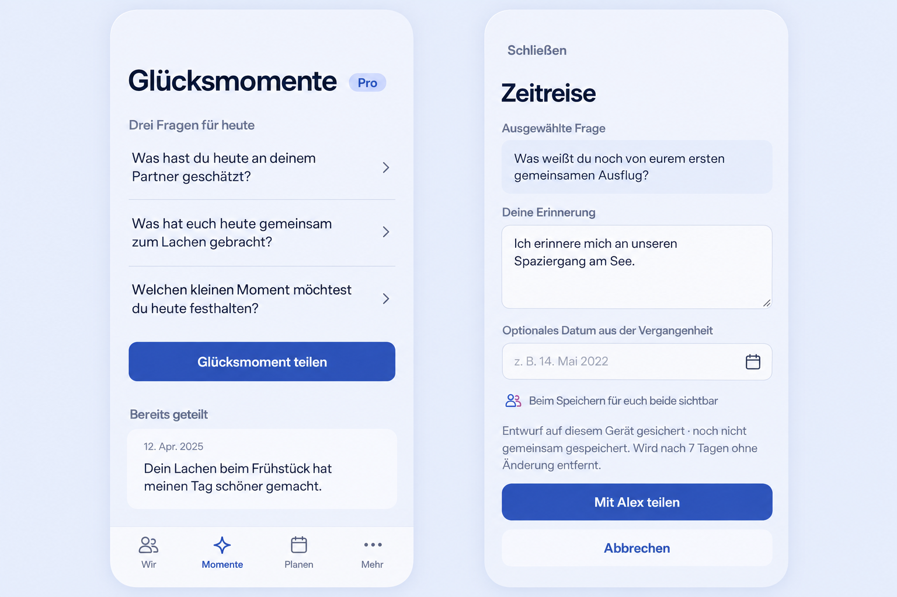

# Daily writing questions and module notification workflow

## Product decision and preflight

The Product Owner approved three questions per module per day and the module
notification workflow in the implementation request on 2026-11-01. This follows
PR #1568 at `3bebb912c05ade3d0860d770022a42822f2eaffb`; inspected current main is
`921f5eb4c80cff165a005691306d782b1266f13a`. This decision supersedes the older
conversation-only six-impulse round and authorizes the previously deferred
cross-domain notification classification, without a daily summary or settings UI.

Generated with built-in Imagegen after inspecting CoupleExperiencePage,
MemoryCreatePage, its actual Compact screenshot, the #1566 and journal/map
preflights, TodayPage, notification policy/projection and existing semantic
tokens. The reference preserves question selection, free writing, retained
history, focused composer, audience, draft status, share result and return.
Use current icons, fonts, theme and navigation; generated pixel values and
illustrative dates/labels are not authoritative.

The [generation prompt](prompt.txt) records the built-in Imagegen input. The
initial automatic approval review rejected uploading the internal reference and
documentation to an unconfirmed remote. This preflight was recorded locally
before feature UI code. The Product Owner explicitly authorized publication of
code, documentation, screenshots and a draft PR to `baerenmarke90/eimir` in the
subsequent request. Publication records this sequence without claiming that the
remote issue already contained the image before local implementation.

Before publication, PR #1568 had merged as
`933aae622b34851e0cbf59d08ca555d3faf05f8a`, with final source
`b048400a4be3fec5366db615b167d06f583f78e0`. The feature is reconciled onto that
merged baseline, preserving its startup, quote-setting, map, focus, Wish-control,
draft-recovery and incoming-contrast corrections. All twelve original prompts
remain in the daily pools; the object/keepsake impulse moves to Zeitreise.
Legacy `?prompt=` links retain their original wording, including draft resume.

## Mobile Interaction Contract

Product Reference v1 R1/R4/R5 and Screen Templates Create/Edit/Detail apply.
The focal point is an optional authored thought. The overview offers exactly
three full-width question links followed by free writing and retained history.
Glucksmomente contains present joy/appreciation; Zeitreise contains recollection.
There is no progress meter, quota on writing, obligation, streak or daily Push.
Both partners receive the same stable Space-day selection, rotated without
repetition until the pool is exhausted. Reuse the Space daily-context timezone
and a deterministic fallback shared by both partners; never the browser clock.

A question opens the existing focused Memory composer. Show it as context,
never overwrite authored text, and retain its identity with the existing
owner-local draft across reload, errors and midnight. Choosing another question
must not destroy an existing draft. Free writing remains available. One person
can complete and share independently; the partner can simply read later.

Reuse PageHeader, ProMark, TaskOriginLink, MemoryCreatePage and its draft,
idempotency, offline, save/result/return and author permissions. No new answer
store or bilateral reveal mechanism. Loading/error/partner absence/Pro states
use existing explicit UiState/ProblemState. Offline writes remain unsaved;
question retrieval failure does not remove free writing or retained history.
Success opens the canonical saved Memory. No automatic keyboard or focus theft.

Compact 320/360/390/430 and 200% text use wrapping content-driven links of at
least the existing touch target. Expanded keeps one bounded reading column.
Existing interaction/motion tokens apply; no arrival motion is introduced and
reduced motion preserves information. Check keyboard, focus, direct navigation,
dirty draft recovery, midnight, account/Space isolation and both themes.

## Reuse and cross-cutting review

Reuse Python date/zoneinfo, existing Space daily context, FastAPI/OpenAPI and
generated fetch client, React Query, IndexedDB draft ownership, transactional
Outbox, Notification, PushDelivery, account consent, quiet hours, canonical
target resolvers and SQL authorization. External schedulers, brokers, question
services and a new client event stream add no necessary capability; no new
dependency or provider is needed. Reuse the existing platform transports with
a negotiated, backward-compatible canonical-notification reference.

New question metadata is a closed editorial identifier, never an answer in a
URL, event or provider payload. Existing canonical text remains protected and
portable. Reads and delivery recheck membership/target visibility. New event
admission is explicit; unclassified events stay silent. Suppress self notices,
deduplicate retries and coalesce frequent reactions. No inferred partner mood,
presence, private-answer status, private content or surprise existence is sent.

Business/freemium impact reviewed: creating experiences retains games.couple
Pro; retained reads/edits/export remain Core. Three is an inspiration-display
bound, not an authored-content quota. Notification quality remains Free/Core,
with identical Cloud/Self-Hosted behavior, no new paid provider, tracking,
storage quota or downgrade restriction. Migration/client drift and PostgreSQL
privacy/idempotency checks are required for newly persisted notification kinds.

## Acceptance

Two accounts see identical three-question sets; day rollover advances the set
while an existing draft retains its question. Both kinds share through canonical
Memory, produce one neutral partner notification and open that source from Wir
and history. Verify free writing, no question-triggered notification, retries,
authorization loss, quiet hours, plan-change relevance, private selection
non-disclosure, reaction coalescing and silence of ordinary edits/imported history.
Browser mocks prove UI behavior, not installed-device delivery acceptance.

## Implementation and visual evidence

The implementation uses 24 questions for each module, retaining the approved
original prompts alongside newly authored inspirations. Exactly
three are visible per shared calendar day; the complete pool rotates before
repeating. The selected wording is the canonical protected Memory title, so
draft recovery, history, editing and export preserve the question and answer.
The [module inventory](../../../notification-workflow.md) defines intentional
attention, quiet updates and the existing delivery/consent boundaries.

The evidence directory contains 30 actual browser screenshots: question
selection, focused composer and incoming partner experience, for each module
at 320, 360, 390, 430 and 1280 CSS pixels. Both themes are covered; 320 uses
200% text. Browser checks cover reduced motion and normal incoming motion.
Representative results:

- [Glucksmomente, 320 / 200% text](evidence/happiness-questions-320-light.png)
- [Glucksmomente, 360 / Light](evidence/happiness-questions-360-light.png)
- [Zeitreise, 390 / Dark](evidence/timeTravel-questions-390-dark.png)
- [Selected question in the composer](evidence/timeTravel-compose-390-dark.png)
- [Partner incoming experience](evidence/happiness-incoming-430-light.png)
- [Expanded overview](evidence/timeTravel-questions-1280-dark.png)

Review found and corrected two accessibility problems: the title/Pro layout
and long primary action could overflow at 320 with 200% text; the incoming
content's opacity animation temporarily reduced text/button contrast. The
heading can now use the full line and wrap its Pro mark. Arrival motion keeps
the content at full opacity, with fading limited to its decorative symbol.
All question, composer and incoming states run scoped axe and horizontal
reflow checks. Browser Back returns from the saved source to retained history.

## Local validation and remaining delivery gate

- Full Web suite: 2,434 passed, two intentionally skipped. Two workers avoid
  contention from the large local suite; failed targeted cases were rerun after
  fixing the TransferPanel route dependency and the visual issues above.
- Full backend unit baseline: 1,089 passed. Final notification, API, transport,
  reminder and daily-question acceptance: 224 passed, using real PostgreSQL for
  the integration cases. This includes encrypted and plaintext configurations,
  duplicate projection, hidden-Center external opens, and imminent cancellation.
- Final browser run: all 10 two-account journeys passed without retries, covering
  both modules at all five widths. The final screenshots come from the reconciled run, which also checks legacy
  link draft recovery and incoming contrast at the paused animation midpoint.
- Production Web build, TypeScript, formatting, scoped lint, backend Ruff and
  strict mypy pass. No new runtime dependency or provider was introduced.
- The current OpenAPI contract matches the running ASGI app. The generated
  fetch client matches the pinned OpenAPI Generator 7.24.0 output.
- PostgreSQL migration 0001 through 0098 and a populated 0098/0097/0098 round
  trip pass. Authored Memory content survives downgrade; only the new derived
  notification state is removed. The isolated test database uses UTC, matching
  the existing timestamp assertions and CI convention.
- Android Java compilation passes with Java 21 and the installed Android SDK.
  Reference routing negotiates native and server capability; legacy peers keep
  their existing one-field encrypted wake. Unit tests cover both modes and
  account/Space changes while a tap is pending.
- Installed Android acceptance uses the existing API 28/36/37.1 emulator matrix,
  with six dedicated cases for neutral system notifications, real PendingIntent
  taps, cold-start retention, legacy wakes, wrong-account rejection and malformed
  input. The test crosses the native service/Android notification/Capacitor
  boundary with synthetic already-decrypted connector messages; external
  distributor delivery/decryption and physical keyboard/IME are separate from
  that claim. The local emulator could not start within available disk space;
  task-owned image/data files were removed without altering unrelated files.
  Remote CI and the owning issue/draft PR publication follow the explicit
  authorization above. The
  requested test release must use the existing release-channel rules; this
  implementation does not bypass review, checks or channel admission.

## Publication checks

The original main revision's full browser run failed on an obsolete R2 Timeline
assertion expecting an author avatar. PR #1568's approved reference explicitly
omits overview avatars. The assertion now requires zero matching author images,
while keeping the title/content/photo metadata and accessibility assertions.
The exact formerly failing case passes locally (6.0 seconds).

The first native matrix passed all six notification cases on APIs 28 and 37.1.
API 36 reported all six cases successful, but the new 90-second instrumentation
process window ended before the runner's final summary. The new fixture now has
the same 180-second process budget as the existing fixture; its per-case
five-second event/notification assertions and all pre-existing budgets remain
unchanged. Fresh matrix results are required before merge. The documentation
language guard's English compound false positive was fixed by clarifying the
sentence, with all 26 guard tests passing and no guard exception added.

The complete backend endpoint inventory required explicit matrix registration
for the new daily-question read and authenticated notification-open operation.
Both now participate in the existing anonymous/foreign/malformed Space and
unknown/malformed resource checks. All 29 selected matrix cases and contract
completeness pass locally against real PostgreSQL; no endpoint is excluded.

The Product Owner explicitly authorized merging after successful checks and
updating `eimir-test`, and will perform the running-instance smoke check personally.
Publication verification therefore binds the selected Git channel and image pair
to the exact merged source, without claiming that Arcane has already deployed it.
