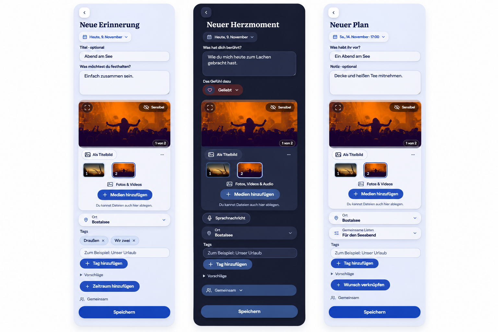

# Free composer — approved composition and preservation contract

Owner: [#1715](https://github.com/baerenmarke90/eimir/issues/1715). The Product
Owner approved implementation on 2026-11-09 after reviewing the interactive
composition and correcting omitted existing media/tag behavior.

## Baseline and reference provenance

Reviewed main: `559c0f46bcc3757a44ce06c99a21e72091840ccd`, including #1712.
Reviewed MemoryCreatePage, HeartMomentProductPage, PlanningCreatePage,
StoryFormPageShell, StoryDetailPageShell, AttachmentDraftPicker,
PlanPhotosEditor, PhotoDraftGallery/PhotoDraftSorting, MediaGallery/ZoomablePhoto,
ContextTagEditor, VoiceNoteEditor and PlanScheduleFields. #1714 is an independent
video-preparation dependency. The PR records the integrated main and dependency
revisions alongside validation of the actual delivered source.

Generated with the built-in Imagegen tool before runtime implementation. Inputs
were the approved interactive Memory Light, HeartMoment Dark and Plan Light
compositions, using synthetic repository demo photographs. This generated image
is a design reference, not a product screenshot or runtime asset. No private
couple content, old-application source, or external stock asset was imported.

The owning issue records the Mobile Interaction Contract, existing-function
inventory, reuse/business/cross-cutting reviews and validation plan. This
document records the stable design decision and implementation evidence; it is
not a second project-status source.

## Product Owner decisions

### Scoped follow-up: quiet mobile composition (#1717)

The Product Owner subsequently approved the
[quiet-composer refinement](../quiet-composer/README.md) on 2026-11-09 against
main `3008a6c3c240615ebf8ca3bc9dad734823376c55`. Within Diary/Memory, HeartMoment
and the shared Plan/Wish editors, one authored surface now groups title/prose,
the native Save action moves into the compact task header, dates/schedules use
the existing short-task lifecycle and only empty tag entry is disclosed. Native
labels, form ownership, constraints, recovery and all media/tag functions below
remain binding. HeartMoment writing/reading cards use the full selected feeling
surface. Other capture types retain this document's existing presentation.

### Original #1715 decisions

- Use the current eimir. palette, self-hosted typography, material depth, glyphs
  and labeled canonical-blue AddAction controls. Warmth comes from composition
  and personal content; do not create a replacement identity.
- Keep title and authored text/description visibly framed. This later explicit
  decision creates a scoped authored-field role; ordinary utility controls keep
  the existing borderless role. It supersedes #1574 only for these authored
  fields, not for the whole application.
- Author before selecting media: Memory title/body; HeartMoment thought and
  compact feeling; Plan title and visible note. No invented HeartMoment title.
  Dates/periods remain compact and retain their actual domain semantics.
- Plan note precedes shared Lists. Existing selection, creation and links remain.
- Present one shared media composition with meaningful preview, native swiping,
  whole-image viewing, zoom/pan, ordered thumbnails and real source intake.
  Keep sensitivity at a stable top-right position and cover selection explicit.
- Tags remain individual selectable/removable chips. Optional enrichment may be
  disclosed, while selected state, privacy, errors and consequences stay visible.
- Preserve the current save, upload, authorization, draft, resource and return
  owners. Presentation must not recreate these lifecycles or unmount hidden
  form fields. Keep read, compose and edit distinct.
- Apply the same visual grammar to the other capture/edit tasks, preserving
  their different domain and privacy contracts. Detail pages use their actual
  content and useful contextual actions without blank hero slots or filler.

## Generation prompt

Use case: ui-mockup. Generate one faithful, high-fidelity three-column Compact
composition of the approved eimir. Memory Light, HeartMoment Dark and Plan Light
task pages. Preserve pale-periwinkle page/surface materials, dark-blue content,
canonical-blue labeled pill Add controls, Instrument Sans and selective Literata.
Show framed optional Memory title/body before media; HeartMoment date, framed
thought and compact Geliebt choice before photos/video/audio; Plan compact
schedule, framed title and Notiz before media, Place and shared Lists. Show
meaningful imagery, expand, fixed top-right Sensibel, gallery count, explicit
cover, sortable thumbnails, Medien hinzufügen, individual Draußen/Wir zwei chips,
visible audience and one Speichern action. Keep the existing shell and product
meaning. Do not add dashboard fields, quotas, decorative romance, tutorial prose,
placeholder gaps or new navigation. Reference source and full acceptance scope
are recorded in #1715.

## Implementation evidence

Behavioral and visual evidence is bound to the tested revisions in the PR and
the [runtime capture record](../../evidence/free-composer/README.md): actual
create → saved detail → edit → return, draft/error/pending safety,
media/tag identity, pointer/touch gestures, Compact/Expanded, Light/Dark,
200% text and reduced motion. The generated reference is not that evidence.

## Implemented placement and preserved owners

The same `FreeComposer` authored-field and continuous-page roles now apply to
capture and correction. `border.authoredFrame` is separate from ordinary utility
controls. The former Memory and HeartMoment capture-only framing is retired;
compact completion targets retain the comfortable control token. Read pages use
the shared continuous `StoryReading` role without reserving absent media space.

| Surface | Content placement and retained domain contract |
| --- | --- |
| Memory create/edit | Compact date/period, framed optional capture title and narrative, media, ordered Places and visible tag chips. Existing experience/reply rules, durable recovery, uncertain/partial save and Plan origin stay in their controllers. |
| HeartMoment create/edit | Date, framed thought, compact feeling disclosure, shared media/voice group, protected location or shared Places, tags and audience. Six native radio controls remain mounted when collapsed; text/media/audio/tag-only eligibility and owner-only writes are retained. |
| Plan create/edit | Intention and visible note precede media and linked Lists. Native date-only/start/end/cross-day scheduling, Places, tagged context, source Wish, list selection/creation and partial association recovery retain their owners. |
| Wish | Framed intention and tag chips; original planning conversion, shared selection, lifecycle and task-origin return. |
| Shared List | Framed creation title; original item insertion, pin/order/completion, permissions and Plan links. |
| Milestone | Compact native date, framed title and visible optional prose; original source Plan, links, validation and completion. |
| Chapter | Framed title/prose; existing date range, Place choice, relation management and diary continuity. |
| People | Name before optional profile media; shared media source actions, relationship, note and birthday fields keep their existing typed semantics and upload/exit guards. |
| Occasions | Existing short editor uses the authored-field role while retaining precise date/category/repeat/reminder and relationship context. |
| Place | Framed authored name/description; existing address, internal map/coordinate picker, archive, permissions and linked content. |
| Private note / gift idea | Framed authored fields, with owner-only pin/link/person/occasion/status and deletion/return semantics unchanged. |
| One-time message | Framed authored message and the shared media-action boundary; existing photo/audio/recording, recipient consent, Pro send, explicit Send, expiry and protected temporary lifecycle. |
| Detail pages | Actual prose/media and existing date/Place/tag/audience/authorship, comments, reactions, links, edits and Plan continuation; no blank photo slot or new decorative container. |

### Media presentation contract

`AttachmentDraftPicker.gallery` lets Memory, HeartMoment and Plan mount the same
`PhotoDraftGallery` inside the existing `MediaActionGroup`. Device/external
selection, file drop and voice controls keep their existing admission and
resource owners. The gallery delegates swiping, full image display, pinch,
double-tap, zoomed pan, local Back and focus to `MediaGallery`/`ZoomablePhoto`.
Only completed native scrolling updates the selected thumbnail; no second
gesture or upload lifecycle is introduced.

Draft images supply their File to the existing object-URL owner, bounded to the
active photo and its neighbours; the draft thumbnail URL is never transferred
or revoked by the reader. Saved items retain their authorized, parent-bound
resource loaders and transient video playback grants. Available local video
previews borrow the draft-owned URL only for the draft's lifetime. Recovered
preview identity is part of the resource scope; reordering alone does not
replace that scope.

Direct pointer/touch sorting remains in `PhotoDraftSorting`. The existing
`PhotoArrangeTask` supplies explicit first/earlier/later/last and keyboard
alternatives without saving the parent. Sensitivity stays at the active
preview's top-right and on each thumbnail. Explicit cover selection survives
sorting; automatic-first reset and removal fallback remain available. Existing
limits, progress, errors, retry, cancel, mixed-media status and permission rules
are retained. This UI work does not modify #1714's preparation or transfer code.

### Validation ownership

The PR records the actual tested source, current dependency and completed
checks. Existing complete feature/reference suites retain their interaction,
privacy, recovery, touch, keyboard, themes, reflow and accessibility assertions.
The retired optional-detail and media-first layout expectations are replaced by
the approved visible-field/order contract. New focused journeys carry two
selected photos through fullscreen swipe/double-tap, a stable relative privacy
control, touch/mouse drag, the accessible arrange task, explicit cover and the
actual saved result. The compact feeling test verifies FormData after collapse.

Implementation captures are under `../../evidence/free-composer/`; all content
is synthetic repository test data. They supplement behavioral evidence and do
not establish physical-device acceptance or deployment/publication.
