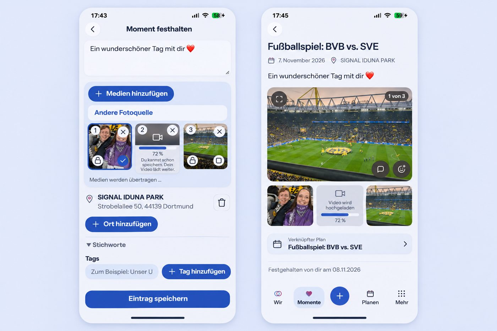

# Media transfer and destination context

## Baseline and scope

Reviewed `main` at `6d1c61d7`: Memory capture/read/edit, HeartMoment capture,
`useAttachmentDrafts`, the selected-media provider and native session storage,
Attachment creation/streaming/finalization/binding, restricted video processing,
Memory planning links, Memory map and Wish selection setup. Open #1666 owns
Google Photos setup; #1676 owns PWA delivery; neither is incorporated here.

Product Owner request, 2026-11-08, including both map follow-ups:

1. Remove a draft Place with a named trash icon beside the Place itself.
2. Save the parent while a video uploads; retain its gallery position as a
   placeholder. Upload independently of the editor. Android continues the
   explicitly initiated transfer in the background with notification progress.
   Stored/playable video is at most 1920 by 1080 (or portrait equivalent).
3. Planning relations identify their destination type, title and navigation.
4. Place links open the existing internal map at the selected coordinates.
5. Wish selection setup sorts the complete candidate set alphabetically using
   the current locale.
6. Selecting a Place below the map zooms to it and hides other markers. A normal
   filter icon opens an explicit Place filter with an All places reset.

## Product Design Preflight / Mobile Interaction Contract

Authority: Product Reference v1 R1 capture, R2 Moments, R3 Planning; Create/Edit
and Detail View templates. Existing gallery, shell, Back/task origins, date,
tags, cover, sensitivity, media-source selection and ordered Place selection
remain. Reuse `EimirIcon`, `ShortTaskSheet`, `TodayDestinationLink`, filled
`AddAction` controls, `PlaceMapCanvas`, semantic spacing/surface/type/motion
tokens and locale `Intl.Collator` ordering. No additional primary destination.

Human outcome: keep the words and shared day immediately, continue using the
app during a transfer, recognize a linked intention, and see the selected Place
on the same map. The words/photos remain focal; Save is the capture action.
Upload progress is supporting status, never a reason to hold the parent open.
The upload notification contains generic localized progress, no names, location,
titles, file names or sensitive previews. Private HeartMoments stay owner-only.

Compact: trash stays in the Place row in a 48px target; content wraps without
pushing it below the address. Existing gallery slots show pending/progress,
processing or recoverable failure. Related destinations use a quiet icon/type/
title/chevron link. Map selection and Place filter share URL state; All places
restores the overview. The filter is an accessible standard icon button, with
a selected state. Selection uses a sheet rather than text entry. No keyboard
opens automatically. Expanded keeps the same meaning and bounded reading width.

States: empty galleries/maps retain existing guidance; Loading distinguishes
upload from server processing; success replaces the same slot without changing
order; failures retain the saved parent and expose a real retry when this device
retains bytes. Offline never claims a new parent write succeeded. An explicitly
started transfer may wait/retry through the platform; browser lifetime remains
bounded by its document. Cancel and logout revoke local work. Unavailable local
draft storage must not block a verifiable online parent save with reserved media.
Conflicts and uncertain create responses retain their existing idempotent
reconciliation and cannot silently create a second parent.

Interaction: Open -> choose -> save immediately -> observe placeholder ->
navigate/put Android in background -> observe progress/completion -> return.
Links preserve native modified clicks and task-origin Back. Map zoom follows
explicit selection; pan/resize does not continually reframe the map. Reduced
motion uses immediate centering and identical selected/filter feedback.
Large text and 360/390/430px wrap labels; Expanded and Light/Dark are verified.
No romantic/generated text or celebration is needed for transfer/error status.

## Generated composition reference

Generated after repository review and before UI code. The attached request
screens were composition inputs; original user screenshots are not committed.
The generated board is illustrative. Existing components, capabilities, i18n,
privacy and the explicit map filter decision govern the implementation.

Prompt: repository-grounded eimir Compact capture and saved-memory detail;
retain original-blue pills, periwinkle canvas, media ordering/cover/sensitivity,
Place address, tags and shell. Put trash beside the Place, show video upload
progress without blocking Save, and identify a related Plan with icon, type,
title and chevron. Preserve existing neighboring actions and content hierarchy.

## Reuse, model and cross-cutting decisions

Considered tus/Uppy (a new server/client protocol would not itself supply native
background ownership), WorkManager (new dependency and foreground/quota
consequences), Android JobScheduler user-initiated transfer jobs, foreground
data-sync services, Media3 Transformer, browser WebCodecs/mediabunny, and the
existing restricted FFmpeg worker. Select native Android scheduling/notification
and bounded streaming over the existing authenticated Attachment protocol;
reuse the server's 1080p normalization and validation instead of adding another
mandatory codec dependency. Existing local WebCodecs optimization can reduce
bytes where supported; the server remains authoritative. References reviewed:

- <https://developer.android.com/develop/background-work/background-tasks/uidt>
- <https://developer.android.com/develop/background-work/services/fgs/service-types>
- <https://developer.android.com/media/media3/transformer/getting-started>

No new provider, credentials, fees or user setup. Platform APIs and existing
dependencies retain their licenses. Cloud and Self-Hosted use the same protocol.
Video remains `media.video_upload` Premium; ordinary capture, Places and local-source
selection remain Core, and the existing map entitlement remains unchanged.
Existing storage/input/duration/gallery quotas and retained-data/export rules
still apply. Native private no-backup staging is bounded and removed on
completion, cancellation, expiry or logout. Credentials use the existing
Keystore encryption contract. No content enters logs or notifications.

Pending binding must retain same-Space ownership, parent-type, cardinality,
expiry, cleanup, deletion, authorization, version and sensitivity rules.
No pending bytes become readable, exportable as completed video or playable.
The same placeholder/status contract serves Memory and HeartMoment consumers.
Validate cross-tenant/private denial, pending -> processing -> ready/failure,
interruption, logout, retries and deletion races at the appropriate test layer.
