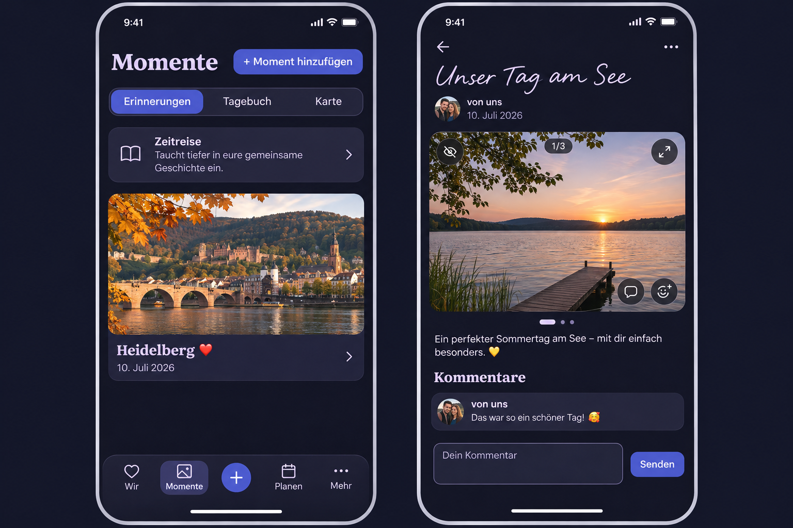
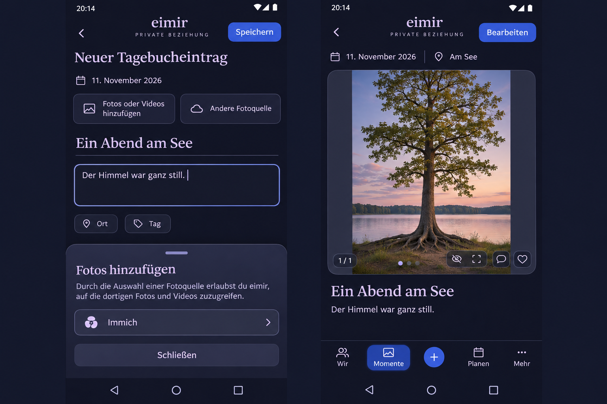

# Mobile gallery and overview corrections

Baseline `3f15be74bc3df6f7f376bd96a4912530cbdb7469`, reviewed on 2026-11-11.
The Product Owner requested one merge-ready PR covering the following corrections.

## Acceptance and interaction contract

- Remove the gentle invitation card from Wir. Reuse existing personal Push delivery.
- Place the labeled creation action at the trailing edge of the page heading on
  Moments, Planning, Places, Lists and People. Wrap the action to a trailing-aligned
  second row when width or enlarged text requires it. Planning follows the active
  segment. Retain the existing task, focus restoration and origin context.
- Remove the retrospective kicker and redundant open text from Moments discovery.
  Keep its photograph, title, date and linked destination, with a trailing chevron.
- Slow the explicit map camera journey from 900 to 1100 ms, retaining interruption
  and the reduced-motion outcome.
- Keep the video comment action in the media action position shared with photos.
- Show the sensitive-media hide action over the image as an accessible icon button.
- Use the existing reaction icon with its localized accessible name.
- Animate the gallery position indicator with a small launcher-like active marker.
  Keep native scrolling, touch selection, keyboard names and reduced motion.
- Start comment textareas at two lines, retain resizing and existing draft safety.

## Product and reuse review

Product Reference v1 R2, R3, R4 and R5, the Overview/Detail templates and the
page-composer contract govern. Authored content remains the focal point.
Reuse PageHeader, AddAction, MomentCreateMenu, the existing media carousel,
SensitiveMediaControl, CommentsPanel, semantic tokens and CSS transitions.
Retain native links, forms and Leaflet camera interruption. Existing React/CSS
capabilities fit this scope. No new provider or dependency is required.

The same mobile-first composition adapts to Expanded. Check Light/Dark,
360/390/430 px, 320 px enlarged text, keyboard focus and reduced motion. Existing
loading, empty, offline, failed and saved states retain their owning controls.
Sensitive reveal stays volatile and resets on backgrounding and identity changes.
Review actual capture/save/result/return and cancellation journeys.

No business/freemium impact. This changes presentation and existing entry points,
with the same Core/Premium capabilities, Space ownership, Cloud/Self-Hosted
availability, quotas and retained-data rights.

## Generated preflight

Generated with the built-in Imagegen tool before UI implementation. The prompt
specified the current navy/lavender eimir composition, labeled heading action,
existing three Moments segments and bottom navigation, linked retrospective
photo/title/date/chevron, photo-overlay eye-off/comment/reaction actions, a
launcher-like active gallery marker and a two-line comment textarea. Synthetic
Heidelberg/lake imagery supplies illustrative content. Actual typography, shell
icons, author presentation and component tokens follow the repository.

The reference guides placement. Runtime evidence and the Product Owner's
requested changes determine acceptance.

## Composer and reader follow-up

The Product Owner extended #1740 on the same PR after reviewing the Diary
composer and photo chooser on Android. Main remains
`3f15be74bc3df6f7f376bd96a4912530cbdb7469`; the reviewed PR baseline is
`e45d0aac02f7a7b8352e3a3ba2e5f0d457b96748`.

- The separate Other photo source entry shows external providers. The toolbar
  photo entry and gallery Add control offer both the device and configured
  external sources, with the existing consent, draft admission and Back path.
- The shared title and prose focus treatment is thin, rounded and legible in
  both themes and forced colors. Borderless writing remains calm at rest.
- Plan creation and its wish-selection sheet use the wish-specific label and
  existing Wish-only query and save flow. Diary retains its two valid targets.
- Restore direct photo thumbnail sorting in composers. Hold then drag on touch;
  pointer and keyboard sorting use the existing library and stable attachment
  identities. Preserve selected cover, thumbnail tap/scroll, accessibility,
  cancelled drags, file drop and upload ownership.
- Opened Diary, HeartMoment, Plan and other reading galleries use a taller
  shared frame and fit the entire original photo. Existing thumbnails and
  sensitive covers retain their composition. Check portrait and landscape,
  small height, Light/Dark, reduced motion, enlarged text and fullscreen return.
- Today shows the first three eligible activities, preserving the full Activities
  destination and order.

Reuse the shared source sheet, text controls, dnd-kit sensors and gallery.
CSS fits the existing authorized image without adding a transform service.
Provider access, commercial admission, upload limits and retention keep their
existing contracts. No business/freemium impact.

The built-in Imagegen prompt shows the external-only source sheet, a softly
rounded focused text field, and a taller photo frame with the whole portrait
visible. Its media and people are synthetic. The actual eimir. shell, consent
copy, colors and product controls follow the existing app.

## Runtime evidence

These Playwright captures use synthetic fixture accounts, content and media.

| Surface | Browser capture |
| --- | --- |
| Moments title and action | [360 px Light](evidence/moments-360-light.png), [1280 px Dark](evidence/moments-1280-dark.png) |
| Contextual Planning and Places actions | [Planning 390 px Light](evidence/planning-390-light.png), [Places 390 px Dark](evidence/places-390-dark.png) |
| Lists and People actions | [Lists 390 px Dark](evidence/lists-390-dark.png), [People 390 px Light](evidence/people-390-light.png) |
| Moments retrospective link | [390 px Light](evidence/retrospective-390-light.png) |
| Revealed photo, position indicator and adjacent actions | [390 px Dark](evidence/gallery-390-dark.png) |
| Compact reply after focusing from the media action | [390 px Dark](evidence/comment-390-dark.png) |
| Today with gentle prompts enabled | [390 px Dark](evidence/wir-390-dark.png) |

The browser journeys also exercise 320 px reflow, enlarged text, the named
controls on photos and ready videos, native carousel swipes, fullscreen return,
background concealment, map interruption, reduced motion and draft retention.
PR validation records the tested source revision and the broader CI result.
