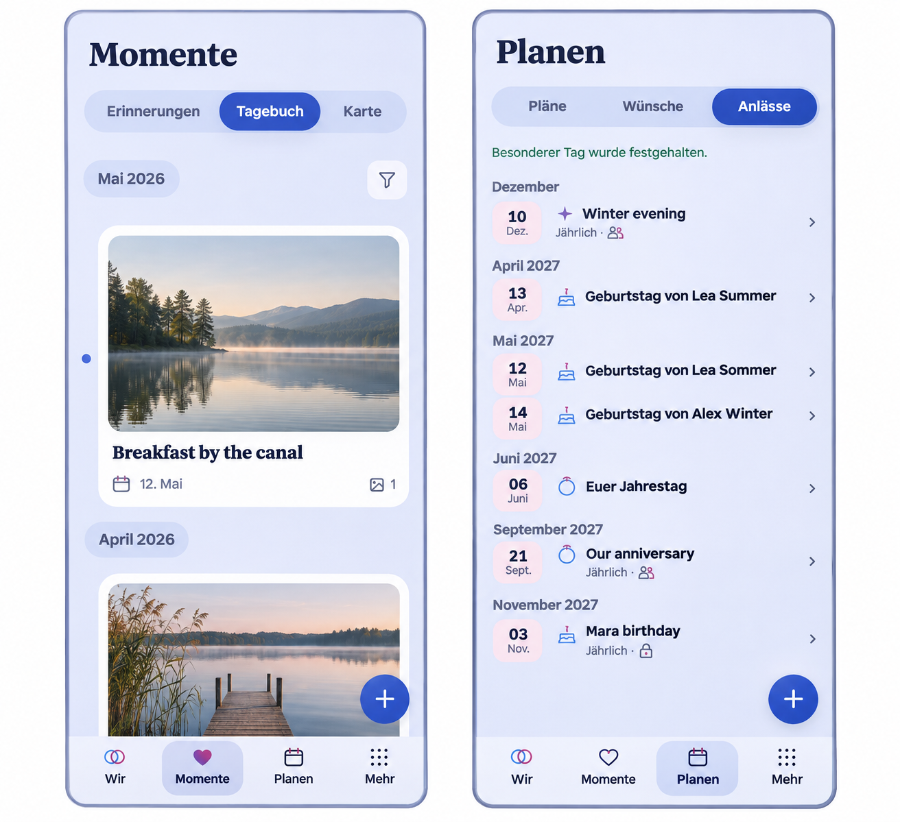
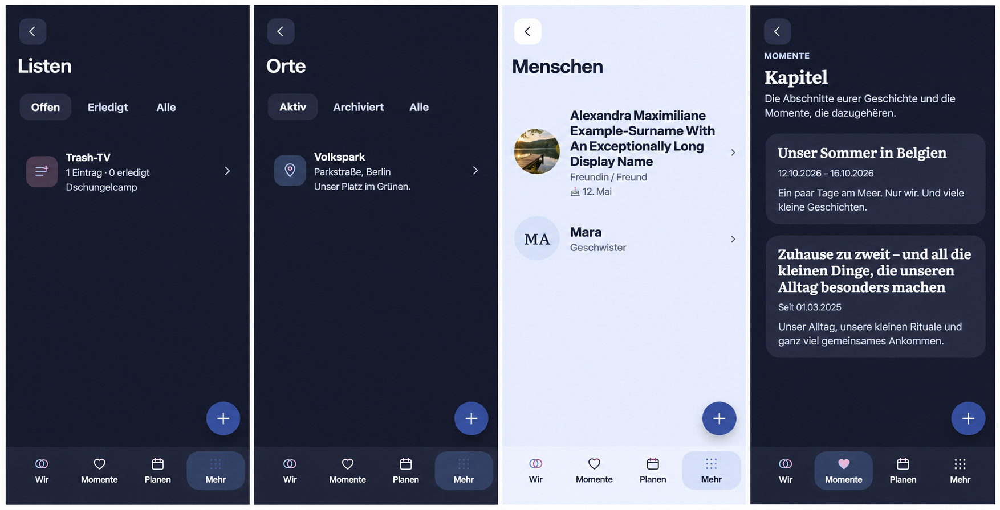
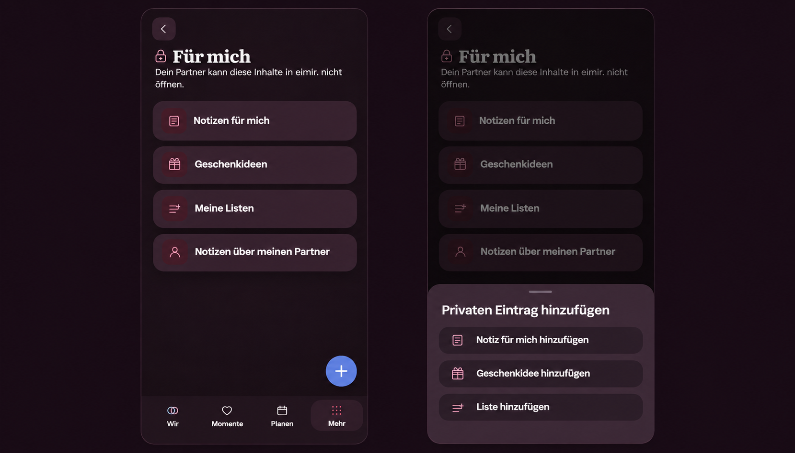
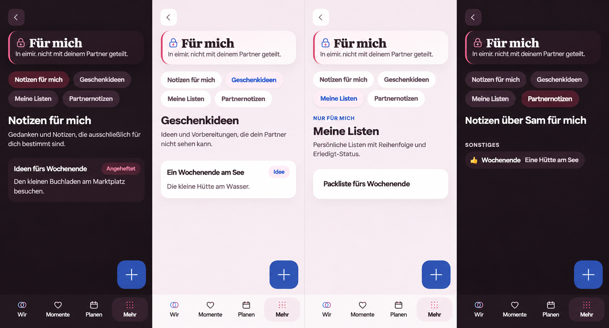

# Contextual creation on Compact

Product Owner follow-up to [#1740](https://github.com/baerenmarke90/eimir/issues/1740)
in [PR #1741](https://github.com/baerenmarke90/eimir/pull/1741).
Reviewed main `3f15be74bc3df6f7f376bd96a4912530cbdb7469` and PR head
`471e31f57f24aa25311b0181a342f94542dea601`. The reviewed app surfaces
were Wir and its partner actions, Momente discovery/diary/map and
Planning's Plans/Wishes/Occasions, the docked navigation, and their existing
create, sheet, detail and return flows.

The built-in ImageGen reference uses the PR's real Compact screenshots.
The lake photographs are synthetic. Production content, icons and tokens are
authoritative.

ImageGen prompt

> Use case: ui-mockup, repository design reference for the eimir. Android app. Compose two readable front-on smartphone viewports side by side, Momente/Tagebuch and Planen/Anlässe, using the attached actual app screens as composition references. Preserve the cool lavender surfaces, editorial navy headings, named segments, list of authored content and dates, filter affordance, and subtle selection backgrounds. Replace the green fixture placeholders in Momente with a quiet realistic lake photograph. Match the screenshots' compact layout at ordinary phone scale and crop each to one viewport. In both screens remove the add action in the page header and the plus in the docked navigation. At the bottom keep four evenly spaced icon-with-label destinations exactly 'Wir', 'Momente', 'Planen', 'Mehr' in this order, flush with the viewport, with the current tab marked. Place one small circular filled canonical blue button containing a white plus glyph at bottom right, floating clearly above the tab bar with a gap and safe-area clearance. The floating control is icon-only and has no text, tooltip, badge or caption. Show no other plus. Do not change the page or section structure. No external annotations, no device brand, no headline outside the app, no decorative chrome.

## Mobile interaction contract

- Keep four evenly spaced, docked destinations with the existing active and
  unread states. One icon-only, named create action floats above the measured
  bar on Wir, Momente discovery/diary and Planning. Reserve room to scroll
  and focus the final item above it. It uses the same position across views
  and a minimum 48 dp app touch target.
- Wir and Momente use the existing Moment choices for a diary entry, heart
  moment or milestone. Use the composer terminology for the diary choice.
  Keep the named partner-message entry available apart from partner gestures.
  Existing entitlement and recipient-consent checks govern its destination.
- Planning opens Plan, Wish or Occasion creation directly from the active
  segment. Keep the map action in the heading. More and secondary utilities
  expose their existing named, local actions. Detail, editor and full-screen
  tasks use their own controls.
- Expanded puts local actions in the page heading. The existing Expanded
  browser shortcut is gated by runtime platform. Mobile browser and Capacitor
  share the contextual action and the bottom navigation.
- Reuse the filled add control, shell safe-area geometry, existing Short Task
  Sheet, routes and task origins. Escape/system Back close sheets first.
  Keep draft safety and success/detail return, restoring segment, filter,
  scroll and the invoking action. Preserve loading, sparse, error, offline and
  permission semantics. Keep the bottom action out of the way while a modal
  or keyboard owns the interaction.
- Update the optional tour to demonstrate the Moment action on its actual page.
  Authored content, partner context and active segments remain the focal points.
  Keep existing short pressed/focus feedback and reduced-motion behavior.

## Product, reuse and verification

Product Reference v1 R2–R5 and the Today, Story Timeline and Plan Hub templates
apply. The Product Owner's icon-only preference supersedes the visible-label
requirement for the floating control. Its accessible name remains localized.
Reuse semantic button/link elements, React, CSS fixed positioning and the
existing sheet and task origin mechanisms. A new shell menu, native plugin or
dependency would duplicate these capabilities.

No business/freemium impact. Creation remains subject to the existing Core,
Pro, privacy and Space boundaries. No new provider, transport, operating cost,
quota, export, retention or Cloud/Self-Hosted distinction is introduced.

Validate four tabs, contextual names and direct destinations; sheet dismiss and
focus; save/result/return with a filtered list; Compact and Expanded Web and
the Capacitor runtime boundary; 320 px reflow, large text, light/dark and
keyboard/fullscreen clearance. Capture representative runtime evidence.

## Runtime evidence

These synthetic fixture captures come from implementation revision
`58a429f15673cf60e764d53beaeb435162217549`.

- [Wir at 360 px, with the create and photo reveal controls separated](evidence/contextual-wir-360-light.png)
- [Moments at 360 px in Light](evidence/contextual-moments-360-light.png) and [390 px in Dark](evidence/contextual-moments-390-dark.png)
- [Moment choices at 390 px in Dark](evidence/contextual-moment-choice-390-dark.png)
- [Planning at 390 px with the Plans segment active](evidence/contextual-planning-390-light.png)
- [The Moments heading action in Expanded Web](evidence/contextual-moments-1280-dark.png)

The browser review covered safe-area and final-control clearance, 320 px
reflow, 200 percent text, Light/Dark and reduced motion. It exercised direct
planning destinations, the Moment sheet, result and filtered return, and the
partner message entry with gestures disabled. The Capacitor platform check
used the production Web shell with an Android runtime fixture.

## List, Place, People and Chapter overview follow-up

The Product Owner extended contextual creation to four more overviews after
[PR #1741](https://github.com/baerenmarke90/eimir/pull/1741) merged. The reviewed
`main` baseline is `f6b227c6e440d0c0e55b15774df35c3084b2675c`. The Compact
reference uses fixture screenshots from that revision.

The four panels retain the visible content and controls from the current app.
The built-in ImageGen reference guides placement and hierarchy. The existing
components, semantic tokens and authorized content govern the implementation.

ImageGen prompt

> Use case: ui-mockup
> Asset: one wide, flat product-design reference of four complete eimir. Compact app viewports, each modeled on 390 × 844 CSS pixels. Arrange four aligned equal-width screens in one horizontal row with narrow separators, plain background, no device frames, captions or marketing text. The first four attached screenshots are the exact baseline compositions: 1 Listen, 2 Orte, 3 Menschen, 4 Kapitel. The fifth screenshot (Momente) supplies only the style, size and placement of its round floating plus. Keep each of the four actual screen compositions recognizable, with original dark/light theme, back button, top title, text, icons, contents, row styles and comfortable negative space. Retain List scopes "Offen", "Erledigt", "Alle" and its Trash-TV row and counts. Retain Place scopes "Aktiv", "Archiviert", "Alle", Volkspark address, description and pin row. Retain portrait-led Menschen list, two separate portrait/name/relationship rows and birthday metadata. Retain Kapitel’s Momente eyebrow, its introduction, two chapter cards with dates and excerpts. Preserve the existing navigation bar of exactly four equally spaced labeled tabs "Wir", "Momente", "Planen", "Mehr", with Mehr selected in the first three screens and Momente in Kapitel. Move each existing create action out of the heading: add a single filled canonical-blue circle with a centered light plus symbol, 48 px in a 390 px app, at the bottom-right app gutter 12 px above the navigation, matching image 5. No visible caption on this plus, no additional controls, no center nav action. Let the headings and content close the gap left by the removed heading button while preserving their order and styling. Retain complete viewport top, all existing visible feature controls and bottom navigation. High-fidelity product UI reference, not a new brand or visual redesign.

### Mobile interaction contract

| Overview | Existing content and navigation | Direct action and result |
| --- | --- | --- |
| Lists (`/more/collections`) | Back to More, status filters, list names, progress and item previews | Open the existing short List creation sheet. Save into the new List and retain the originating scope on return. |
| Places (`/more/places`) | Back to More, active/archive filters, place names and address previews | Open the existing short Place creation sheet, with optional coordinates and map selection. Save into the new Place and retain the originating scope on return. |
| People (`/more/people`) | Back to More, portraits, names, relationship and birthday context | Open the focused person editor and show the new profile on save. Retain photo viewing, draft handling and the People return path. |
| Chapters (`/story/chapters`) | Back to Moments, chapter introduction, titles, dates and excerpts | Open the focused Chapter editor and show the new Chapter on save. Retain the Chapter collection and task origin. |

The goal is to add the object named by the current overview in one tap. Shared
plans and memories are easier to keep organized when the action is reachable
and the visible content remains the focus. Product Reference v1 R2 and its
Chapter experience apply to Chapters. R5 and the overview, list and focused
task patterns apply to the three More destinations. Browsable rows and cards
keep their existing order and visual roles. The plus is the sole dominant
creation action and uses the existing 48 px target, localized accessible name
and safe-area clearance above four docked navigation destinations.

Sheets and focused editors disclose the fields after activation. They own
validation, keyboard handling, close, Back, draft protection, failure and retry.
The floating trigger yields to the modal or keyboard and returns on dismissal.
List and Place filters, loaded content, empty states and error recovery stay
with their existing owners. Authorized offline reads and unsaved write
feedback retain their current behavior. Expanded keeps a labeled action with
its contextual icon in the existing heading. Existing focus and press feedback
apply with reduced-motion support. Portraits, names and chapter writing carry
the relationship context. The action needs only its localized accessible name.

### Reuse, business and verification

Reuse PageHeader, AddAction, the measured shell clearance, native links and
buttons, the existing short sheets and focused tasks, and their task origin
mechanisms. A new menu, native control or component library would duplicate the
established platform and React behavior. No new dependency or provider applies.

No business/freemium impact. Shared Collections remain Core. Basic Place,
RelatedPerson and Chapter creation retain the Free portions of their existing
Mixed classifications. Existing Space access and ownership, managed resources,
Cloud/Self-Hosted behavior, retention, downgrade and export contracts apply.

Review 360, 390 and 430 px, dense and sparse content, both themes, Expanded,
enlarged text, focus and reduced motion. Verify the named action, tap target,
clearance, actual save/result/return and cancellation for all four overviews.
Use the existing browser journeys and their affected feature ownership.

### Follow-up runtime evidence

Chromium captures from implementation revision
`e95efe32e3eccc23d70bd48774316eb865dcf089` use synthetic fixture content.

- [Lists at 360 px, Light](evidence/contextual-lists-360-light.png)
- [Places at 390 px, Dark](evidence/contextual-places-390-dark.png)
- [People at 390 px, Light](evidence/contextual-people-390-light.png)
- [Chapters at 430 px, Light](evidence/contextual-chapters-430-light.png)
- [Places in Expanded Web, Dark](evidence/contextual-places-1280-dark.png)
- [Chapters in Expanded Web, Dark](evidence/contextual-chapters-1280-dark.png)

The four affected suites passed 24 Chromium cases on this revision. Their
journeys include saving and returning to the correct overview, filtered List
and Place return, cancel and focus restoration, and modal priority for People
photos. Compact checks include 320 px with enlarged text, Light/Dark and
reduced motion. Expanded checks retain the visible names and motifs.

## Private Area overview and floating target follow-up

The Product Owner extended contextual creation to the Private Area overview
and requested a slightly larger floating control. The reviewed `main` baseline
is `1ff8f25aac55b88b5f5a7bbbd0690b95077b45c9`, which includes [PR #1742](https://github.com/baerenmarke90/eimir/pull/1742).
The Compact reference uses the actual Dark overview at 390 px and the existing
Moments choice sheet for its interaction geometry. The overview presents its
privacy label and the four existing destinations for personal notes, gift
ideas, private lists and partner notes. No private records appear in it.

ImageGen composition instructions

The prompt used the 390 px Dark private overview and the existing Moment
choice sheet. It requested two full 390 × 900 Compact viewports, retaining
the actual Vault colors, lock, localized privacy copy, four browse cards and
four-tab navigation. The first panel shows the filled 52 px circular plus
at the trailing gutter, 12 px above the dock. The second shows the same
overview dimmed behind the bottom sheet, with three localized action rows
for a personal note, gift idea and private list. The reference shows no
authored private content.

### Mobile interaction contract

- Product Reference v1 R5 and the overview, short task and focused task
  patterns apply. Keep the privacy heading and four destination cards as
  the focal point. Add one primary control to the overview. The Compact
  control uses a filled icon-only plus, a localized accessible name and a
  52 px circular target shared by contextual floating actions. Reserve
  matching clearance above the measured four-tab dock. Expanded uses a
  labeled action in the existing heading. In the private area the Expanded
  header omits the global shortcut to keep shared creation out of the private
  context.
- Open the shared short task sheet and offer personal note, gift idea and
  private list creation. Each choice opens its existing focused task.
  Partner notes remain accessible from their overview card and use their
  existing editor. The child views retain their local actions.
- Give initial focus to the first choice and restore focus to the trigger
  on dismissal with Escape or system Back. Save shows the created item.
  Closing a focused task or returning from its result uses the overview
  origin and existing draft protection.
- The overview and chooser present navigation only. The existing tasks
  own loading, empty and error states, offline behavior and save feedback.
  Keep the sheet, press and focus feedback and reduced-motion behavior.
  The owner-only scope applies throughout the flow. The chooser has no
  shared destinations or private previews.

### Reuse, business and verification

Reuse the Moment choice sheet pattern, the semantic AddAction control and
shared shell clearance, router links and existing private task origins. A
global creation menu would mix visibility scopes. A local duplicate sheet
would repeat the focus, dismissal and origin logic. The platform, React and
existing components cover the interaction without an additional dependency.

No business/freemium impact. Personal notes, gift ideas and private lists
remain Free/Core, and private isolation remains non-paywallable. Existing
ownership, Cloud and Self-Hosted behavior, resource use, retention, export
and downgrade semantics apply.

Verify the three open, save, result and return journeys, cancellation and
draft handling, sheet dismissal and focus, shared floating size and
clearance, and absence of a second floating action in child tasks. Review
Compact at 360, 390 and 430 px, 320 px with enlarged text, Expanded,
Light/Dark and reduced motion. Capture representative runtime evidence.

### Private Area runtime evidence

Chromium captures use synthetic fixtures from implementation revision
`9947b71cfb1331aa382323360098facb9b5f05cb`.

- Private overview at 390 px in [Light](evidence/contextual-private-390-light.png) and [Dark](evidence/contextual-private-390-dark.png).
- The three private create destinations at 390 px in [Light](evidence/contextual-private-chooser-390-light.png) and [Dark](evidence/contextual-private-chooser-390-dark.png).
- [Private overview in Expanded Web](evidence/contextual-private-1440-dark.png).
- [Shared 52 px control on the Places overview](evidence/contextual-places-52px-390-dark.png).

The Private Area browser journeys cover the three saves, their resulting
items and focus on return to the overview. They exercise Escape, history Back,
and retaining or discarding a draft, with the Android runtime fixture in
Compact Dark. The resize coverage includes 360, 390 and 430 px, the
Compact/Expanded boundary, 320 px reflow and enlarged text. Expanded keeps
the existing label and the privacy heading.

## Private subpage creation and shared floating control follow-up

The Product Owner extended the floating creation action to the private
subpages and requested a larger, more angular control. The reviewed `main`
baseline is `790105977ea83fb4ace70978770343e9845accdf`, which includes
[PR #1743](https://github.com/baerenmarke90/eimir/pull/1743). The generated
reference uses four actual Compact captures from that revision with synthetic
content. It preserves the privacy heading, section tabs, active selection,
item content and metadata, and bottom navigation.

### Mobile interaction contract

| Private subpage | Local action and result |
| --- | --- |
| Personal notes | The plus opens the existing personal note editor. Save shows the note. Back returns to the personal notes list. |
| Gift ideas | The plus opens the existing gift idea editor. Save shows the idea. Back returns to the gift ideas list. |
| Private lists | The plus opens the existing private list editor. Save shows the new list. Back returns to the private lists overview. |
| Partner notes | The plus opens the existing private preference dialog after the partner and preferences are available. Save displays the new note on the page. Dismissal and save restore focus to the trigger. |

- Product Reference v1 R5, the Settings and Privacy, Create/Edit and Detail
  templates, and the existing short preference dialog govern the four flows.
  The active section and authored content remain the focal points. Each
  available local creation task has one primary action.
- Compact uses the shared filled, icon-only plus in a 60 px rounded square
  with a 16 px radius and a 32 px icon box. Use the existing dock offset,
  safe areas, touch feedback and matching end-of-content clearance. The
  localized accessible name identifies the local task. Expanded uses the
  existing labeled heading action with its contextual icon.
- Preserve the privacy heading, section navigation, empty and loaded content,
  and existing loading, error, offline and save feedback. Partner notes use
  the existing partner availability and owner-only write rules. The dock
  action yields to an active modal or text field. Reduced motion preserves
  the same placement, interaction and result.
- The hub chooser continues to open its existing focused tasks. Checklist
  item insertion remains attached to its input in the list edit form.

### Reuse, business and verification

Use the existing AddAction link and button, shared CSS safe-area positioning,
canonical tokens, router destinations, focused editors and preference dialog.
A second action, per-page geometry or a separate Capacitor control would
duplicate the existing interaction. No provider or dependency is needed.

No business/freemium impact. The same Free/Core tasks, owner-only boundaries
and partner requirements apply. The change concerns placement and appearance.
Cloud and Self-Hosted behavior, entitlements, managed resources, storage,
retention and data lifecycle remain governed by the existing contracts.

Exercise all four Compact entry points through save and result. Check return
to each source list, the partner dialog's focus and existing retry behavior,
single-action placement, both themes, 360/390/430 px, 320 px reflow with
enlarged text, Expanded labels and reduced motion. Check that the larger
shared control clears the dock and the last focusable item. Capture
representative real-browser evidence.
