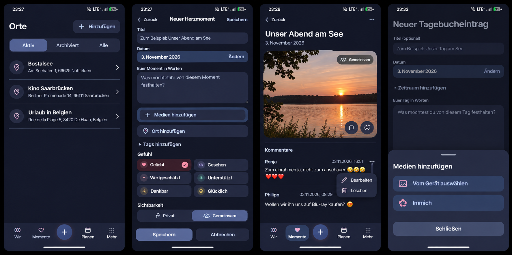

# Moment experience polish — preflight

Owning issue: [#1628](https://github.com/baerenmarke90/eimir/issues/1628).
Baseline main: `cf71ad7784497f9efd4037bb2276af593803de30`, including #1625 and #1627.

The built-in image generator produced this reference before UI implementation.
The [exact prompt](reference-prompt.txt) records the reviewed current components,
shell, tokens and adjacent capabilities. The issue contains the complete Mobile
Interaction Contract, reuse, commercial-model and cross-cutting preflight.

The composition guides hierarchy, not pixel matching. Preserve the actual shell
and icon grammar. HeartMoment has one authored text field, not an additional title.
Only the current author's comment offers Edit/Delete. Comments remain oldest first.
Use the privacy icon for concealment, not the generated shared-audience badge.
No generated photo, address or personal example becomes application data.

Reuse Product Reference v1 R1–R5 and Screen Templates 4/8/9/11, shared status
segments, overflow, ShortTaskSheet, protected payloads and versioned Place PATCH,
attachment selection and localized product copy. Archiving never deletes existing
Place links. Keep protected names out of plaintext indexes and cursors. Settings
owns the existing Immich setup; capture owns deliberate selection only. Existing
Pro, authorization, consent, downgrade and Cloud/Self-Hosted boundaries remain.

Actual implementation evidence and exact-source validation are recorded here
before merge, including Compact/Expanded, Light/Dark and reduced-motion journeys.
