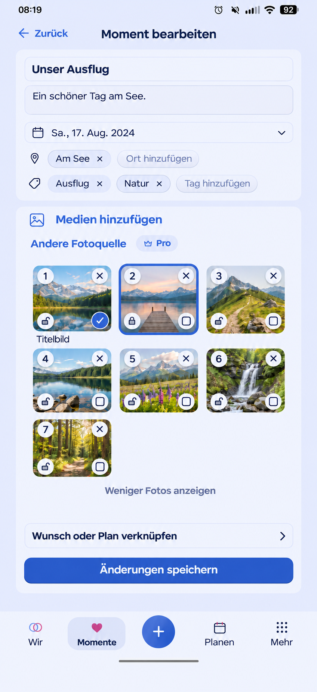

# Direct photo controls

## Preflight

Product Owner request and clarifications, 2026-11-06. Baseline main
`1610a6a93` (includes voice notes #1671). Integrated main `61dc1415a`, including
merged #1673, before final validation; the Memory editor composition was unchanged. Reviewed MemoryProductPage edit, PhotoDraftGallery,
PhotoDraftSorting, AttachmentDraftPicker, PlanPhotosEditor and HeartMoment
consumers; retain title/body/date/Places/tags, source picker, bounded gallery,
linking, explicit Save, failure/retry and return/draft safeguards.

Generated using the built-in imagegen tool before runtime implementation.
Neutral synthetic landscape photographs replace private input photographs.
The image is a composition reference, not runtime evidence. Current route is
`/story/memories/:id/edit`; existing fields and shell remain authoritative.

Prompt: render the existing blue eimir. Memory editor on a 390 px phone, keeping
its fields, media/source actions, seven landscape thumbnails, disclosure,
planning link and Save. Each photo has one position number at top left, removal
X at top right, sensitivity padlock at bottom left (closed sensitive/open
normal), and independent cover check at bottom right. Outline selects a photo;
cover and selection can identify different photos. Omit ready status, text
remove/cover/automatic/earlier/later controls and drag grips. Do not reproduce
private photographs, add helper paragraphs or invent modules.

## Acceptance and Mobile Interaction Contract

- Reuse Product Reference v1 R1 capture, Create/Edit and Detail templates.
  Personal media is the focal point and Save is the dominant completion.
- A tap on the image selects it through the outline. Cover uses its own check;
  a normal tap never changes cover. Removing the cover falls back to the first
  remaining item. A chosen cover retains identity when order changes.
- Entire image accepts mouse drag or touch hold/drag; remove the separate grip
  and earlier/later actions. Native page scrolling before hold stays usable.
  No additional keyboard sorting workflow requested by the Product Owner.
- Direct X removes only that item's draft. Saved removal retains the existing
  reversible keep-photo action and the existing removal permission.
- Both active partners may mark and unmark images already bound to a shared
  Memory, regardless of uploader/Memory authorship (explicit PO decision).
  This supersedes the prior author-only classification rule for shared Memory
  photos only. HeartMoment/private/experience-answer authority remains intact.
- Use named, independently operable 44 px icon buttons, existing lock/open-lock,
  check and close glyphs, semantic surfaces/type/spacing and motion tokens.
  Compact has three columns where space allows; Expanded retains the same flow.
- No redundant ready or inspector instructions. Pending/processing/failure,
  progress and retry remain with the affected file. Empty media collapses;
  failed/offline writes preserve the draft; no success before persistence.
- Retain bounded six-photo overview/show-all, selection ownership, upload
  identity, dirty exits and authorized previews. Reduced motion removes sorting
  animation without changing results.

## Reuse, business and cross-cutting decisions

Reuse existing dnd-kit 0.5.3 PointerSensor and sortable identity handling after
reviewing native HTML drag/drop, Pointer Events and dnd-kit documentation.
HTML drag/drop does not provide the existing touch/sorting behavior. No new
library/provider, license, external data flow, charge or hoster/user setup.
Existing MIT dnd-kit works in Cloud and Self-Hosted; existing pointer delay and
scroll cancellation avoid a custom gesture recognizer.

No business/freemium impact: Memory photo authoring/privacy stays Free/Core;
video and external-source Pro boundaries, quotas, byte limits, export and
non-destructive downgrade are unchanged in both hosting modes.

Security/privacy: change only classification authority for authorized shared
Memory editing; retain tenant/membership, ownership of private HeartMoments,
experience answers, original upload/binding/removal rules and If-Match atomicity.
No new logs, analytics, caches, storage, schema or migration. i18n and accessible
names remain localized; avoid nested buttons and drag activation from controls.
Verify state/identity behavior, partner classification, negative authorization,
mouse/touch, cancellation, save/reopen and representative Compact/Expanded,
Light/Dark, reflow and reduced motion. Runtime evidence follows below.

PO refinement after the first runtime screenshot: visible action circles are
28 px and glyphs 20 px, with transparent 44 px touch targets. Native image
selection and a localized live status own accessibility semantics; the generic
drag plugin must not overwrite selection with its own pressed state.

## Runtime evidence

The final Compact controls have a small visible circle and full touch area.
Selection outline and cover are independent. The redundant cover caption is
omitted; only the chosen photo has a filled check. Stable drop targets avoid
live DOM-swap oscillation with large single-column photos; the existing
insertion helper applies the new order only on release. Drop highlighting and
localized live feedback remain, with reduced-motion behavior.

- [390 Light](evidence/arrange-390-light.png), [360 Dark](evidence/arrange-360-dark.png),
  [430 Dark](evidence/arrange-430-dark.png), [Expanded Light](evidence/arrange-1280-light.png).
- [320 Dark / 200% text](evidence/arrange-320-dark.png),
  [20 selected photos](evidence/arrange-390-dark.png).
- Each matching `saved-<width>-<theme>.png` records the confirmed canonical result.
  Complete browser cases verify period, cover identity, photo order and return.
- `polish-sensitive-author-390-dark.png` and `polish-sensitive-uploader-390-dark.png`
  record the edit control and both partners' mark/save/reload/unmark behavior.

Local validation: 66 PostgreSQL/API/metadata cases pass, including anonymous and
cross-Space rejection without changing classification/version, stale writes,
partner classify/unclassify, rollback, transfer, private/experience ownership and
removal boundaries. Focused component/ownership/icon tests and browser acceptance
are revision-bound in the PR. Full Web baseline before final refinements:
2758 passed and two existing skips. Production build, token/legal/i18n/PWA,
Capacitor, TypeScript and lint/format checks pass. The unchanged local runner
uses Node 22.23.2 / CPython 3.14.6 with PostgreSQL 17; authoritative final-head CI
uses the repository's pinned environments. Physical-device acceptance is not
claimed; no wrapper/native capability changed.
