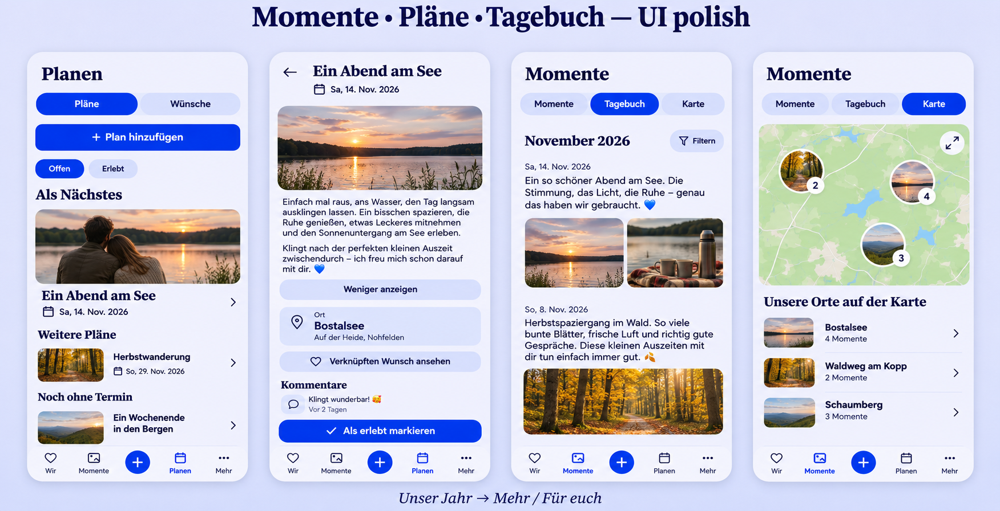

# Moments, Plans and Diary follow-up

## Preflight

Requested by the Product Owner on 2026-11-03. Baseline: main
`a7d443dea7070bf546ccfcaa48280420da4ef818` plus PR #1615 head
`79497532c78182d8472e9a888424086c96c74be8`. The implementation branch merges
that main into the dependency without changing its media/provider work. Before
final validation it also incorporated dependency head
`a1d0659481cc3cb07d82d1bc11141afad94a593c`; those changes affect provider
selection/native tests, not the reviewed destination compositions. The later
`e758c08d6f3a27013e44811c00e895f386f5bc4d` dependency update only adjusts
provider test selectors/documentation and is also merged; runtime fingerprints
remain unchanged.

Generated with the built-in image tool before UI implementation. The reference
represents the current local page headings, four-destination mobile navigation
and central create action, Plans/Wishes segmentation, next/later/undated plans,
plan gallery/read/complete/comment flow, Diary month/filter, and saved-memory map
with fullscreen and photo markers. It guides hierarchy rather than replacing
the existing navigation glyphs or prescribing new content. Actual runtime
captures and journeys will be recorded separately.

## Mobile Interaction Contract

- Human outcome: find the next shared experience or a completed one; read a plan
  and recognize its place and linked Wish; browse the Diary/map without moving
  navigation; retain annual shared history under More.
- References: Product Reference v1 R2, R3 and R5; Story Timeline, Discovery,
  Plan Hub and Detail templates. Existing personal content remains the focal
  point. No added romance banner, invented content, table or administration UI.
- Compact: preserve root heading and the three peer Story tabs at one position
  across routes. Reuse PageHeader and StoryViewTabs, with one spacing contract.
  Remove the redundant Diary browse strip; More exposes the existing years
  route. Existing Photos and Chapters destinations also move to More so removing
  the strip does not orphan those capabilities. Milestones remain in the type
  filter. Existing review capabilities and access policy remain intact.
- Plans: reuse the Wishes status-scope pattern for Open/Experienced; Open
  includes ideas, upcoming and past uncompleted plans. Experienced includes
  only completed plans. Preserve grouping, scoped return, selection and scroll.
  The selected scope is visible; changing scope requires no typing or keyboard.
- Detail: reuse tonal secondary button/link semantics for the existing Wish
  actions and place destination. Keep the real place name and optional address
  readable. Completion stays the dominant action. One person can read, link
  or complete within existing capabilities; no bilateral participation added.
- Description: retain shared authored-text rendering, link previews and local
  disclosure identity. Use a normal padded secondary action for More/Less.
- Discovery: remove the redundant invitation/daily-copy block; keep deliberate
  renewal after the last discovery item with existing pending, failure and
  new-day feedback. No timer or automatic reordering.
- States: retain loading/error/retry and authorized cached reads. Each Plan
  scope needs an accurate empty result; refresh failure never becomes empty.
  No new write, cache, storage or offline promise. Success remains canonical
  content; return restores the chosen scope. Failed writes retain current
  recovery and capability contracts.
- Interaction: native links for destinations, buttons for state/action, existing
  filter and linking sheets, standard Back/focus restoration. Controls remain
  at least 44 CSS px, wrap long labels and retain visible keyboard focus.
- Motion: existing press/filter/disclosure feedback and reduced-motion rules;
  no new animation lifecycle or blocking transition.
- Expanded: same task/order with bounded readable content; no added management
  pane. Narrow widths, 200% text, both themes and reduced motion will be checked.

## Reuse, commercial and cross-cutting review

Reuse the existing PageHeader, StoryViewTabs, Wishes scope, task-origin metadata,
PlanWishLink, ExpandableDescription, AuthoredText, More destination row, semantic
colors/spacing/radii/typography and existing route contracts. No new dependency,
external provider or commodity infrastructure; alternative custom controls and
new routes are unnecessary.

No business/freemium impact: Plans, Wishes and ordinary shared-history browsing
remain Free/Core; the existing map and annual-review capability boundaries,
retained-data access and Cloud/Self-Hosted behavior remain unchanged. No quota,
provider, managed compute, storage, export or downgrade changes.

Authorization and tenant boundaries stay server-enforced. No new data exposure,
telemetry, persistence, API/schema/migration, provider or native capability.
Localized labels, semantic controls, Back/focus, keyboard, reflow, stale cached
reads and in-session return ownership are the relevant quality boundaries.
Validation will cover actual open/filter/detail/return, More/year navigation,
map/header geometry and description expansion, plus existing regression suites.

## Delivery evidence

[Actual runtime captures and behavioral results](evidence/README.md) record the
implemented result independently of the generated composition guide.
