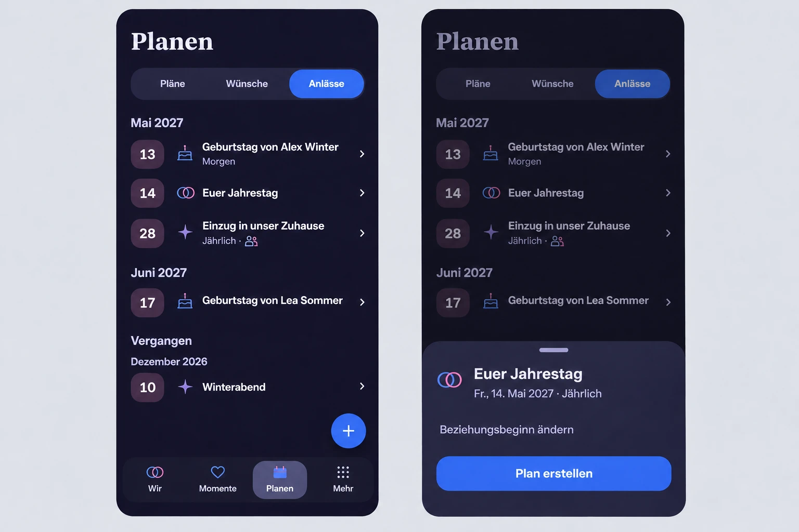

# Occasion agenda and detail reference

Reviewed main `6e51e7c0de170c214ea5755f7e12f01618498409` after #1753.
The baseline includes the Plans, Wishes and Occasions segments, the contextual
add action, month groups and type symbols, the short task reader, the existing
occasion editor, People/profile birthdays, the shared relationship setting,
and the focused Plan composer. Earlier decisions are recorded in #1683,
#1712, #1733 and #1741.

The built-in ImageGen reference uses repository screenshots with synthetic
records. The product tokens and live UI define the final styling and date
labels. The image illustrates hierarchy, density and placement.

## Mobile interaction contract

- Plan Hub (Product Reference v1 R3) uses a chronological agenda so partners can
  scan people, occasions and dates. The first month starts close to the tabs.
  Month headings supply context for day-only date marks. Today and tomorrow get
  quiet text. Past one-time occasions remain readable and editable in a dated
  group below the upcoming entries.
- Detail View uses the existing Short Task Sheet and its drag handle, Back,
  focus and reduced-motion behavior. The personal title and type symbol lead.
  The displayed calendar date is the one used in the agenda, with a weekday,
  year and annual repetition where applicable. The anniversary exposes its
  source setting. Profile birthdays identify their source, and People profiles
  remain directly reachable. The authored-date editor keeps its existing entry.
- Plan creation opens the standard focused composer with the displayed day as
  an editable date-only default. It keeps explicit Save, dirty-draft and
  confirmed-result behavior. The default is carried through the account- and
  Space-scoped task origin. Return restores the Occasions segment, row and
  position. Private occasions retain their privacy and editing controls.
- The named contextual add action stays available in the agenda. The title and
  familiar occasion symbols provide the personal tone. Detail has one primary
  action and source actions use quiet text. Existing loading, empty, partial
  source error, retry and offline feedback continue to apply. Save feedback and
  the confirmed Plan result use the existing flows.
- Compact keeps one column with full-width rows, text wrapping, safe-area
  clearance and reachable targets. Expanded uses the same agenda and the
  centered short-task dialog. Validate both themes, narrow/large text, actual
  Back and focus return, occurrence rollover, private-date isolation and the
  Plan save/result/return journey. Capture Compact and Expanded runtime evidence.

ImageGen prompts

> Use case: ui-mockup. Create one high-fidelity product design reference for eimir., the existing German private partner app, for the full Compact smartphone screen Planen > Anlässe. Show two front-on 390px-wide phone viewports side by side on a plain neutral matte, left the scannable list, right the same screen with the selected anniversary bottom sheet open. The provided app screenshots are composition, typography and icon references only. They show the light theme. Render the current dark theme, with deep midnight-indigo background, white-lavender type, raised slate-indigo sheet, cool blue selected segment and primary action, muted plum date marks, and the small existing two-tone line icons. Match the existing large serif Planen heading, compact Instrument Sans rows, three-segment pill, unboxed list and small chevrons. Use synthetic text only.
> Left screen: exact tabs “Pläne”, “Wünsche”, “Anlässe”, with Anlässe selected. Place “Mai 2027” close below the tabs. The rounded date marks show day numbers only. Row “13” with cake icon and “Geburtstag von Alex Winter”, a quiet second line “Morgen”. Row “14” with two outlined overlapping blue and pink rings and “Euer Jahrestag”. Row “28” with small sparkle and “Einzug in unser Zuhause”, and a small second line with annual repetition and shared icon. The group “Juni 2027” includes “17” and “Geburtstag von Lea Sommer”. Below upcoming events “Vergangen” heads the previous dates. Keep the existing floating circular blue plus above the docked four icon-label destinations “Wir”, “Momente”, “Planen”, “Mehr”, Planen selected. Keep comfortable touch height and the usual inset.
> Right screen: show the same full phone screen visibly dimmed behind the modal. The selected anniversary opens an existing full-width raised bottom sheet with rounded upper corners and a centered short drag handle. At top left inside the sheet use the paired ring icon and title “Euer Jahrestag”, then compact secondary text “Fr., 14. Mai 2027 · Jährlich”. Show the low-emphasis text action “Beziehungsbeginn ändern”. The single blue primary button below says “Plan erstellen”. Fit in the lower third with bottom inset. Realistic shippable UI, readable labels and modest spacing. No device chrome, exterior headlines, photos, extra sections, badges, borders around rows, or illustrations.

> Use case: ui-mockup. Edit image 1, the two dark eimir. Anlässe smartphone views. Use image 2 solely as the reference for the current four-destination navigation. Keep the phone framing, colors, arrangement, type, row contents, date line, and all bottom sheet elements. Correct the lower area of the left viewport. The dock contains exactly four equally spaced icon/label destinations “Wir”, “Momente”, “Planen”, “Mehr”. Planen is selected. The blue circular plus is separate, floating at the lower right immediately above the dock with an 18px gap and 18px right inset. Remove the central dock plus. Under “Vergangen”, place one subordinate “Dezember 2026” group label and one row with number “10”, sparkle icon, title “Winterabend”, and chevron. Leave the right viewport and the bottom sheet visually identical.

