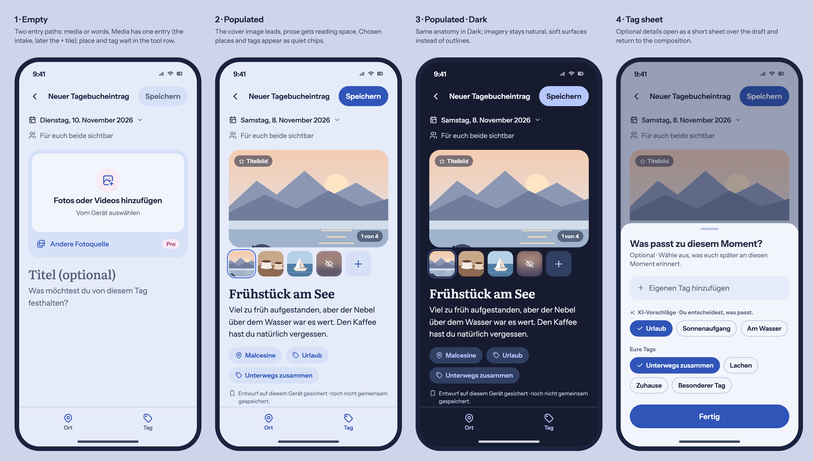
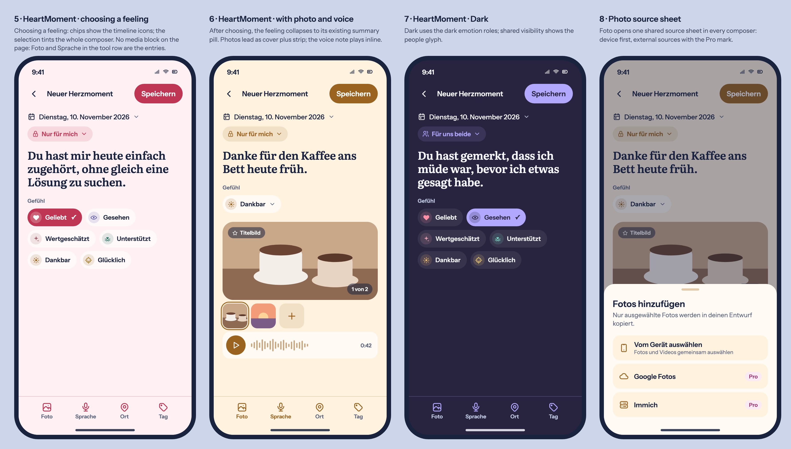
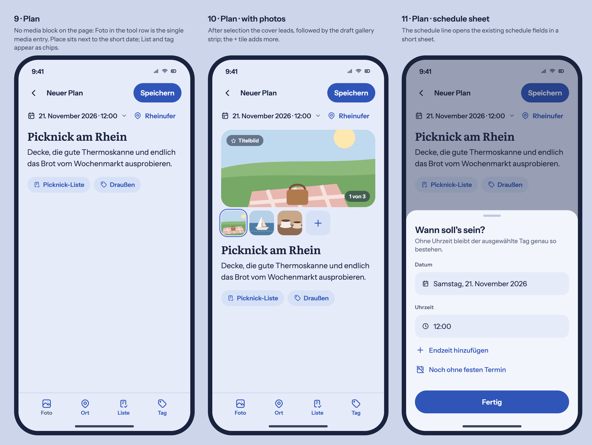
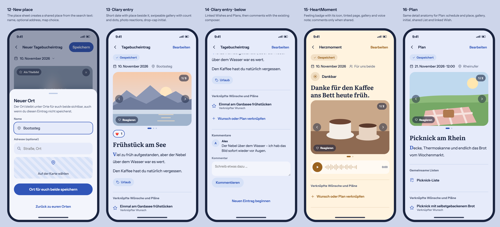

# Page-as-composer reference (Diary, Memory, HeartMoment, Plan)

## Product Owner request and baseline

On 2026-11-10 the Product Owner reported that the Diary create screen, as
delivered by the soft-composer direction of #1726 / PR #1727, still reads as an
overloaded form and asked for a calmer, warmer composition that keeps every
existing capability. Reviewed main: `f334067cff7b2c7638571a3fd50db52ddcaf8633`.
The PO-supplied screenshot of the PR #1727 runtime was reviewed as the current
visual state.

This reference refines #1726 for the Diary composer. It keeps the approved
compact Back/title/submit header, the date task and the borderless writing
surface, and changes the composition around them:

- the page itself is the composer; the wrapping surface around title, prose and
  the nested media group is removed (Product Reference v1 R1: no form card
  around an upload card);
- media intake becomes one prominent device action plus one quiet external-source
  row with the Pro mark, inside a single soft surface; file-format copy moves to
  validation feedback (`memory.photoFormats` is no longer idle helper text);
- the selected cover image becomes the focal content, followed by a thumbnail
  strip with cover, sensitivity, reorder and add affordances;
- the title uses the Literata display role; prose stays Instrument Sans with
  reading line length;
- place and tag entry move from two filled pill buttons into a labeled bottom
  tool row (place, tag); chosen tags appear as quiet chips
  below the prose and reopen their existing editors;
- the date is shown short (no weekday) with the chosen place beside it; the
  Diary/Memory and Plan composers show no audience line (PO refinement below), and the existing draft status stays as a small status line.

## Product Owner refinements (2026-11-10)

After reviewing the click demo, the PO decided: no "visible to both" line in the
Diary/Memory and Plan composers (supersedes R1 row 6 for these composers); a
short date without weekday with the place directly beside it; drag and drop for
media; creating a new place from the place sheet; feeling chips stay visible
without delayed collapse; the detail screens keep the swipeable gallery with
photo count, photo reactions, comments, the drop-cap initial, the place beside
the date and the linked Wishes and Plans. Frames 12–16 show these.

A second review the same day added: linking Wishes/Plans only in the composer
(detail shows them read-only; HeartMoment detail has no linked section); Plan
Lists open their list composer (frame 17); no drop-cap initial for Plans, and
long descriptions collapse with "show more"; Plan descriptions keep a soft note
box; no "start new" action on detail screens; Plans keep the existing short
schedule format. Tapping a place on a detail screen opens the in-app memory map (existing
`photoPlaceMapUrl` route and Pro boundary). Saved photos must open in the existing fullscreen viewer
again; the PO reported this as currently broken.

## Generated visual preflight

The second and third boards apply the same anatomy to HeartMoment (choosing a
feeling with timeline icons and full-page tint, a populated entry with photo and
voice note, Dark, and the shared photo source sheet) and Plan (without photos,
with photos, schedule sheet). Each screen has exactly one visible media entry:
the on-page intake in Diary/Memory, the Photo tool in HeartMoment and Plan.
Memory edit and Plan edit use the same anatomy as their create screens.

Implementation brief for the implementing agent:
[IMPLEMENTATION-PROMPT.md](IMPLEMENTATION-PROMPT.md).

Individual 390 px Diary frames: [empty](empty-390.png), [populated](filled-390.png),
[populated dark](dark-390.png), [tag sheet](sheet-390.png).

Generated before UI implementation by rendering [`reference.html`](reference.html)
with Playwright Chromium at 390 × 844 CSS px, device scale factor 2, using the
semantic light/dark values from `design/tokens.json` and the display/UI font
roles. Tabler outline icons substitute for `EimirIcon`. The photos are flat
illustrative placeholders, not personal or stock imagery. Product copy
in the frames is the current German locale text; header wording stays
`memory.heading` and is not changed by this reference.

Reviewed owners on the baseline: `MemoryCreatePage`, `ComposerHeader`,
`ComposerDateContext` (single day and range), `AttachmentDraftPicker`,
`DeviceMediaPicker`, `PhotoSourcePicker`, `PhotoDraftGallery`,
`OrderedMomentPlacesField`, `MemoryTagChoices` / `ContextTagEditor` (own tags and
AI proposals), sensitive-media marking (#1477) and the Diary draft status; for the
composer family also `MemoryProductPage`, `HeartMomentProductPage`
(`HeartEmotionPicker`, visibility choice, `VoiceNoteEditor`,
`HeartMomentLocationField`, `MomentPlaceField`, `HeartMomentTagChoices`),
`PlanningCreatePage`, `PlanProductPage` (`PlanScheduleFields`, `PlanPhotosEditor`,
`PlaceChoicePicker`, `CollectionChoicePicker`). Wish, Milestone, Chapter and
couple-experience question flows are out of scope.

## Mobile Interaction Contract

- Header: task Back, localized title, header submit as the only filled action;
  it reads as quiet until there is saveable content, but stays operable and
  reports the existing validation instead of being disabled.
- Context: short date (no weekday) opens the existing date/range control; the
  chosen place sits beside it. Diary/Memory and Plan show no audience line.
- Media: one full-width device action (localized photo/video hint from actual
  video eligibility) and one external-source row with existing availability and
  Pro boundary. After selection, the cover image leads; the strip keeps cover
  choice, sensitivity, reorder, removal, retry, progress, swipe/fullscreen/zoom.
- Writing: native labeled title and prose fields; no autofocus; tapping prose
  starts typing. Text-only entries collapse the media surface to the compact
  intake, never a photo-shaped gap.
- HeartMoment: every feeling choice shows its timeline icon (`EmotionIcon`) in
  its own emotion accent; the selected feeling tints the whole composer (page,
  header, tool row, system bar) through the existing emotion surface/accent roles; feeling choices keep radio-group semantics; visibility is
  a selectable pill opening the existing choice. Plan: the schedule summary opens
  `PlanScheduleFields`; the unscheduled state uses its existing string.
- Enrichment: the tool row (Diary/Memory: place, tag; HeartMoment: photo,
  voice, place, tag; Plan: photo, place, List, tag; 48 px+ targets, labeled) stays
  above the keyboard/safe area. Place and tag open the existing bounded sheets;
  Done/grab handle/Back return focus to the invoking control. Chosen values are
  chips that reopen the same editor. Only one media entry is visible per state:
  where the tool row has Photo, no intake block is shown on the page.
- 320/360 px: context lines and chips wrap; tool labels stay visible. 430 px and
  Expanded gain image width, not extra fields or columns. 200 % text keeps the
  focused field and submit reachable.
- States: loading/uploading/failed/partial/offline/uncertain/recovery notices
  keep their current owners and copy; draft status remains a polite status line.
- Motion: media insert cross-fades from intake to cover, chips enter with the
  existing short motion tokens, sheets use the shared sheet motion; reduced motion
  removes translation/scale and keeps every state visible.

## Reuse, business and quality

Reuse the shared composer header, writing surface, media intake/gallery owners,
place/tag editors, `ShortTaskSheet`, `ProMark` and semantic surface, radius,
spacing, typography and motion tokens. The bottom tool row is the only new
composition primitive; it hosts existing entry points and must be evaluated for
all four composers together, not per screen.

No business/freemium impact: device media and authoring remain Free/Core,
external sources remain Premium with the existing mark, and video keeps its
current entitlement boundary. No new quota, cost, retention, ownership, privacy,
API or Cloud/Self-Hosted difference. i18n, accessibility, reflow, focus return,
draft continuity and reduced motion are relevant for implementation.
