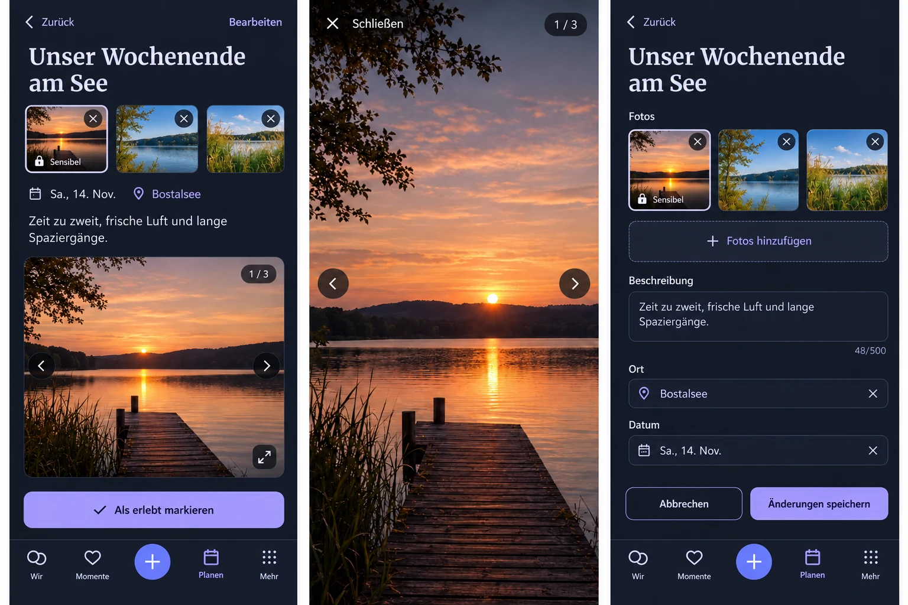

# Multiple photos on Plans — product preflight

PO request, 2026-10-30: multiple Plan photos with the same opening, slideshow/swipe and full-screen interaction as Memories. The PO explicitly authorizes implementation, merge after required checks and a new test release from the latest main.

Baseline main: `66cd05fd17a43bd09cff290d877f32bcb6be016e`. Reviewed the actual Plan reading/create/staged-edit routes, PlanCover, MemoryPhotoGallery/MediaGallery, AttachmentDraftPicker/useAttachmentDrafts, Plan media binding, attachment retention/authorization and transfer, existing cover-fit evidence, Product Reference v1 R3 and the Detail/Create-Edit templates. The current mobile shell has no global header and retains the fixed four-destination dock plus central creation action.

Generated with the built-in Imagegen tool before UI implementation. The prompt and its correction are retained in `prompt.txt`. This is composition guidance, not a pixel lock or a runtime screenshot. Generated editing controls on the left reading panel are NOT approved: reading uses only the existing gallery; removal, reordering and sensitivity classification belong exclusively in the staged editor. The actual shared gallery, original uncropped photo geometry, navigation glyphs, date/place/notes hierarchy, completion date sheet and existing form controls remain authoritative. No new per-photo audience selector, reaction service, character limit, thumbnail duplication or modal root navigation is introduced. All Plan photos remain shared with the couple; sensitivity is a per-photo conceal/reveal presentation.

## Mobile Interaction Contract

- Human outcome: anticipate a shared experience with several meaningful photographs, then revisit the same photo safely in full screen.
- Reading: Plan title/contextual Edit, existing Memory-style photo carousel, actual schedule/place/notes and the current deliberate completion action. Tapping an ordinary photo opens the established viewer. Swipe, previous/next, count, keyboard, Close/Escape/system Back and focus return use MediaGallery. Sensitive images retain the same direct reveal/expand rules as Memories.
- Editing: one existing staged editor; add several files through the existing native-compatible file input, show selected previews, change their order, remove and classify each independently. One Save binds the complete ordered set atomically with other Plan changes. Cancel/dirty exit leaves saved content untouched. Upload progress, failures/retry and version conflicts retain the draft. A successful upload alone is not a saved Plan.
- Data: preserve existing cover images as the designated leading photo. Add ordered supplemental bindings, without duplicating that leading attachment. Both roles use the same central exclusive-binding, validation, authorized reads, deletion and transfer contract. Legacy cover-only clients keep their existing fields; removing/replacing their cover must not discard supplemental photos.
- Limits and performance: reuse the existing Memory collection safety limit (20 images / 500 MiB total) and Cloud byte quota; bounded previews and active-photo/neighbour original loading. No new provider or persistent browser-media cache.
- States: reuse loading, empty/no-photo, unavailable/retry, offline read, pending/failed upload, version conflict and confirmed success. Do not invent metadata, counts or offline writes. Auth/Space changes clear the upload task and conceal sensitive previews.
- Compact first: 320/360/390/430 px, large text and keyboard/touch targets. Expanded adapts the same composition and viewer. Reuse semantic spacing/radius/typography/motion roles, contain image geometry, and preserve reduced-motion behavior.

## Reuse and business consistency

Reuse review relevant: compare the existing Memory MediaGallery and attachment-draft primitive with a new carousel/upload flow or external gallery dependency. Select the existing primitives; native file input, CSS scroll-snap and established modal lifecycle already implement the requested mechanics. No new SDK/provider/license/account, service, telemetry or user configuration is needed. Custom domain work is limited to ordered Plan binding and its compatibility adapter.

Business/freemium impact reviewed: ordinary Plans and image upload remain Free/Core in Cloud and Self-Hosted, per the Wish & Plan lifecycle and attachment matrix rows. Existing Space ownership, media byte quota, portability and non-destructive downgrade remain unchanged. Update the versioned clarification from a single cover to the complete Plan gallery; no new paywall.

## Cross-cutting and acceptance

Keep READY/image validation, parent/account/Space isolation, exclusive binding and global attachment lock ordering. Versioned whole-Plan updates and create idempotency include the exact ordered media intent; validate all items before mutation. Add an additive supplemental-binding migration and preserve old covers/bundles. Retention, deletion, return-to-wish, export/import and quotas must include every photo. No personal media or credentials enter evidence.

Acceptance: create with several photos → upload/validate → save once → reopen → swipe → full screen/keyboard/Back → return at the same context → reorder/remove/add/classify → cancel and verify unchanged → save and reload. Cover partial upload failure/retry, conflicting Plan versions, partner edits, unauthorized/cross-Space/duplicate/non-image/expired media, all-photo deletion and transfer. Capture representative Compact/Expanded, Light/Dark, 200% text and reduced motion. Ordinary Web UI is normative; only the existing tested Capacitor package and protected test publisher are used for the requested release.
