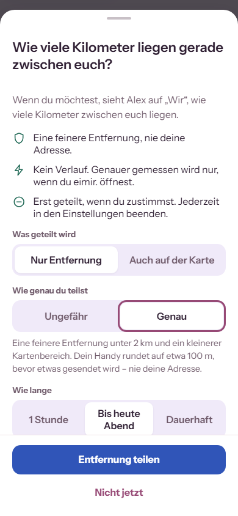
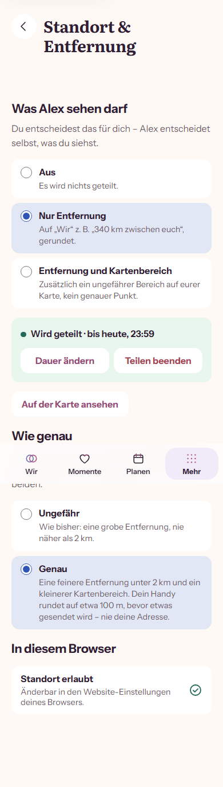
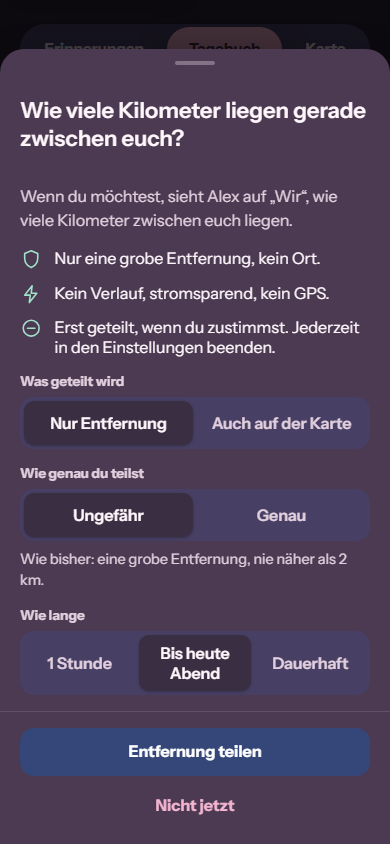
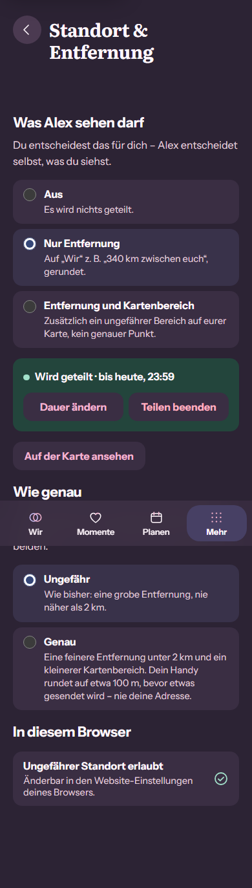
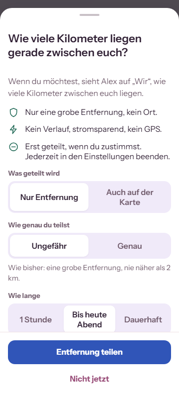
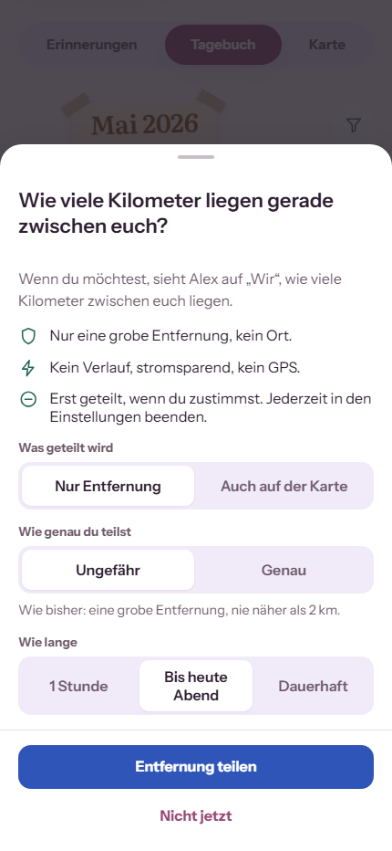
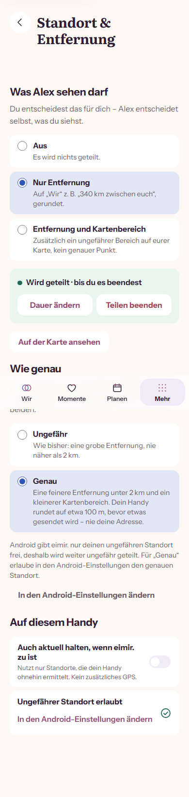

# Precise or approximate partner location (#1792)

Product Owner request (2026-11-17): a person can choose to share **precise**
instead of approximate location, asked at the start and changeable later in
Settings. Decisions were taken in chat before building and are recorded here.

## Baseline and reviewed screens

Baseline: `main` at `e3a1fd236`. Reviewed in place: the one-time start sheet
`PartnerLocationOnboarding` (push prompt first, then the question about the
distance between the partners), Settings › Relationship › Location & distance with the
level choice, status and Stop, the device section with the Android background
switch and permission row, the Wir distance line, and the where-we-are
map (`partnerLocation.mapTitle`). All existing functions stay as they are; the start sheet keeps its order
and primary action, and the new choice joins the existing segmented controls.

## Reference

No separate generated mock-up image exists for this change. The composition was
agreed with the Product Owner in chat (one more segmented choice, approximate or
precise, with a one-line explanation under the level choice, and one new
Settings section `partnerLocation.precisionTitle` using the existing level cards) and the shipped
Chromium captures in [evidence](evidence) serve as the reference. This is a
deviation from the generated-reference rule and is called out in the pull
request.

## Design

- **Focal point and action:** unchanged. The start sheet keeps its single primary
  share action (`partnerLocation.onboardingShare`) and its quiet "not now" action.
  Choosing is optional: approximate (today's behaviour) is preselected.
- **Start sheet:** a segmented `partnerLocation.precisionLegend` choice between the
  level and the duration choice, plus a one-line explanation of the selected
  option. The two disclosure points change with it, so the sheet never claims
  "no GPS" for a precise choice. The Android permission dialog still appears only
  after the share action; a precise choice requests the precise grant together with
  the approximate one, so Android 12+ shows its Precise/Approximate switch.
- **Settings:** a section `partnerLocation.precisionTitle` below the level choice, using the same
  tinted radio cards, only where sharing can be chosen (Pro and a partner). The
  choice is saved even while nothing is shared. If Android keeps the grant
  approximate, only the owner sees a quiet note with a link to Android's
  settings; sharing continues approximately and the partner sees no reason.
- **Wir and map:** with both partners precise, Wir shows a finer value (under
  300 m, 300 m to 1 km, 1 to 2 km) instead of the generic nearby text, and the
  map area is small. Otherwise nothing changes.
- **States:** loading, error, offline and Pro-less states of the existing pages
  are unchanged; the new section is simply absent without Pro. Browser: the
  choice exists too (the browser requests high accuracy); Android: the choice and
  the system dialog. Reduced motion: no new motion.
- **Compact and Expanded:** the controls reuse the existing responsive sheet and
  settings column.

## Business and privacy

Part of the Premium `presence.location` capability, no new row (matrix 1.31).
Precise location is requested only after the person's own choice, rounded on the
device to about 100 m, never requested in the background and never revealed to the
partner. Contract: [PARTNER-LOCATION.md](../../../../m9/PARTNER-LOCATION.md).

## Evidence

Chromium captures of the implemented screens with reduced motion; `partner-location-settings.spec.ts`
also runs the axe scan and checks horizontal overflow at 360, 390, 430 and 1280 px,
in Light and Dark and at 200 % text size.

| 390 px light, start sheet with the precise choice | 390 px light, precision section in Settings |
| --- | --- |
|  |  |

| 390 px dark, start sheet | 390 px dark, Settings |
| --- | --- |
|  |  |

| 360 px light, start sheet | 430 px light, start sheet |
| --- | --- |
|  |  |

Android kept the grant approximate (owner-only note):

Not verified here: the real Android permission dialog, the real fix quality and
battery use. Only a physical Pixel can confirm them.
