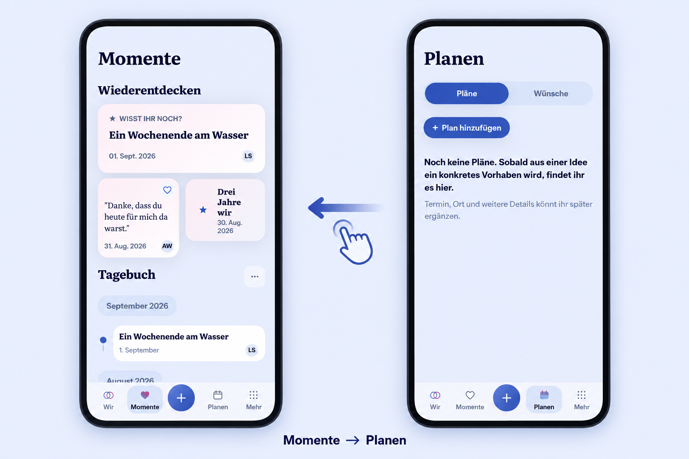

# Primary tab swipe — product preflight

Owner request, 2026-10-30: switch the bottom navigation destinations by swiping
like RWN Messenger, then merge and publish the next Android test release.
Current main baseline: `e9f6646065440c24baf4dfe02477704adaee57b7`.
The current real root screens and their routes were inspected before generation.

## Generated reference before implementation

Generated with the built-in ImageGen tool from the actual 390 px Momente and
Planen renders beside this file. The exact prompt is in [prompt.txt](prompt.txt).
The generated reference preserves the existing content hierarchy, typography,
pale blue surfaces, labeled four-destination bottom bar and separate central plus.
The gesture mark/caption are explanatory annotations, not new runtime UI.
Actual baseline renders: [Momente](baseline-momente-390-light.png),
[Planen](baseline-planen-390-light.png). They use synthetic fixtures.

## Applicable product contract

Product Reference v1 interaction DNA and R2/R3/R4/R5, the existing App Shell,
PageHeader, primary route registry, TaskOriginProvider and motion guideline apply.
The user-requested RWN comparison is behavioral: adjacent main pages, settled
selection, direct touch feedback, preserved context and local gesture ownership.
No RWN code or assets are copied into eimir. The canonical React UI remains the
only product UI, including inside Capacitor.

## Mobile Interaction Contract

| Area | Decision |
| --- | --- |
| Human outcome | Move comfortably between the four main areas without reaching down for every switch. |
| Relationship value | Keep browsing personal content fluid; add no new relationship copy, scores or decorative content. |
| Compact state | Existing root pages `/today`, `/story`, `/plan`, `/more`; the plus remains an action. |
| Dominant action | One deliberate horizontal page-body swipe selects exactly one adjacent destination. |
| Hierarchy | Existing authored content, heading and contextual action hierarchy remain. |
| Disclosure | All four labeled navigation links stay visible and usable; no hidden-only action or new setup. |
| Pattern | Axis-locked single-touch paging in Wir → Momente → Planen → Mehr order, both directions, no wrap. |
| Loading | The normal target page owns its loading state; no navigation/network wait for animation. |
| Empty | The same empty root remains navigable; no filler content or fabricated count. |
| Error | Existing error/retry content and normal links remain operable. |
| Offline | Use the normal route/cache/offline contract; gestures create no write or synchronization promise. |
| Success | URL, visible page and active navigation item agree after one committed swipe. |
| Privacy/state | Only root browsing pages; no private/detail/editor swiping or offscreen preloading of other pages. |
| Large text | Preserve existing font/reflow; gestures remain optional. Pinch/zoom panning keeps browser ownership. |
| Motion | Content follows horizontal touch; a short drag returns. Settling uses standard duration/easing tokens. Reduced motion removes spatial movement and keeps the same navigation result. |
| Expanded | Existing header navigation and content composition remain. Touch input uses the same root order; mouse/keyboard keep normal controls. |
| Lists | Existing diary/plan browsing lists remain; no new table or management surface. |
| Familiar behavior | Native-style page swiping, local carousel/filter ownership and ordinary Back. Existing route/scroll ownership stays authoritative. |
| Input burden | No keyboard activation, typing, preference or account setup. |
| Generated preflight | Image above, reviewed against the exact main baseline and actual complete surfaces before UI code. |
| Visual acceptance | Real touch journeys and screenshots around 320/360/390/430 px, Light/Dark, short height, 200% text, 400% reflow, reduced motion and representative Expanded. |

## Gesture boundaries and continuity

- Accept intentional horizontal travel or a short decisive flick, never a tap,
  vertical scroll/pull-to-refresh, diagonal ambiguity, multitouch or cancelled touch.
- Leave the outer screen edges to platform/browser Back gestures.
- Local tab/filter rows, horizontal scrollers even at their edges or without
  overflow, media/gallery viewers, maps, sliders, buttons, form fields and
  editable content keep their gestures.
- Disable while a modal/menu, selected text, focused editor or shared unsaved-work
  guard owns interaction. Recheck at release and before any deferred navigation.
- Do not swipe from detail/editor/settings/private/game routes or task anchors.
  Root queries such as Timeline filters stay with their existing owner.
- Reuse `captureOrigin` and `primaryDestination`, including filter, loaded range,
  scroll and Plans/Wishes restoration. Use the existing native root replacement
  and Web history behavior. Do not introduce another persistence/history model.
- A navigation click, Back, account/Space/origin change, visibility loss or resize
  cancels pending drag/settling. Late callbacks cannot overwrite newer selection.
- Prevent the compatibility click only after claiming a horizontal drag; ordinary
  links, keyboard operation and taps keep their normal behavior.
- Use only temporary compositor feedback. Do not keep inactive pages mounted,
  duplicate live content, preload private pages or persist screenshots.
- Browser viewport transitions may enhance safe fresh root changes. Restored
  contexts and unsupported/reduced-motion cases retain immediate authoritative
  route handoff. No artificial delay or query completion is an animation clock.

## Reuse review

Reviewed standard Touch Events, CSS overflow/scroll snap, Web Animations/View
Transitions, existing React Router navigation and the native AndroidX pager
behavior behind the owner's RWN reference. Reuse browser primitives and the
existing eimir route/origin/motion owners. A full CSS scroll-snap page container
would replace document scroll ownership; a parallel Compose pager would split the
single product UI. The small custom part is eimir-specific gesture arbitration,
owner fencing and routing. No new package, provider, SDK, license obligation or
operator setup is introduced.

Primary platform references:
- https://developer.mozilla.org/en-US/docs/Web/API/TouchEvent
- https://developer.mozilla.org/en-US/docs/Web/API/Document/startViewTransition
- https://developer.mozilla.org/en-US/docs/Web/API/Element/animate
- https://reactrouter.com/api/hooks/useNavigate

## Business and cross-cutting review

No business/freemium impact: root navigation remains Free/Core and accessibility
non-paywallable. Cloud and Self-Hosted share this UI. No entitlement, Account/Space
ownership, managed provider/cost, quota, cache retention, downgrade, export or
feature-matrix change. Existing capability checks and API authorization remain.
No new server/API/schema/configuration, telemetry, sensitive logs or data storage.

Review focus is gesture conflict, draft safety, focus/Back, reduced motion, reflow,
rapid/late navigation and owner teardown. Test the full open → swipe → inspect
target → interact/save through existing task → return journey. Cover cancellation,
boundaries, local gallery/filter gestures, dirty/focused forms, modal interruption,
multitouch, root query/scroll restoration, native history mode, rapid tap/Back,
owner changes and unavailable browser animation APIs. Existing product-reflow,
gallery, task-origin and pull-to-refresh assertions stay intact.

## Release

After required current-head checks, merge the ordinary feature PR. Integrate that
accepted main into the existing isolated Android test branch; never merge draft
#1443 into main. Freeze the source/notes, pass all 32 exact-source named release
checks, then select the next unused monotonic test version through the existing
protected publisher. Keep package, original signer, regular persistent API origin,
four immutable assets and marker-last publication. Verify the actual public
release and anonymous asset proof before reporting completion.
