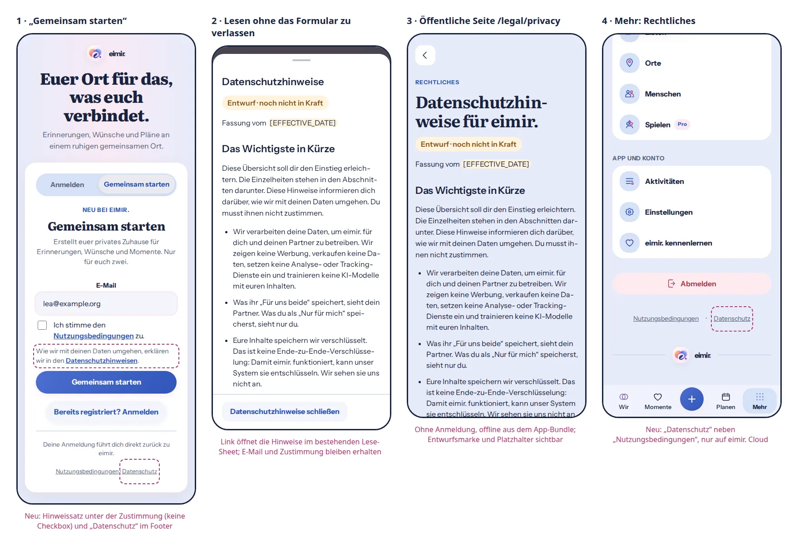

# Privacy policy: public reading and signup notice

Issue: [#1677](https://github.com/baerenmarke90/eimir/issues/1677) (follow-up to #1657).
Status: implementation preflight, recorded before UI code.
Baseline: `main` at `e98202bff3aefe33c46724fa0ad7b5e2ac6f6e1c` (includes the
terms-of-use slice #1658).

## Current destination and generated reference

Inspected on the baseline: `IdentityEntry` with its mode switch (Anmelden /
Gemeinsam starten), the Cloud signup form with the required terms checkbox
(`TermsAcceptanceField`), the Cloud invitation entry and the redemption step
(`legal.pendingTitle`) that render the same field, the entry footer (`login-assurance`
plus the Cloud-only terms link), the terms reading sheet (`ShortTaskSheet`),
the public `/legal/terms` page (`LegalTermsPage`, `LegalDocumentView`) and the
More footer (`more-legal` navigation next to sign-out and the brand
signature). There is no privacy notice, privacy link or privacy route today;
the terms of use still contain the `[[PRIVACY_URL]]` placeholder in § 7.

No image-generation tool was available in this session. The reference was
generated from the real baseline screens: a Playwright script rendered current
`main` at 390 px with the existing mocked Cloud API and injected the planned
elements into the live DOM (dashed outlines mark the additions), using the
actual draft text from `legal/de/privacy-policy.md`. It is a composition guide,
not a pixel lock.

1. The signup form keeps every element and order. One quiet informational
   sentence (`legal.privacyNotice`) follows the acceptance row. It has no
   checkbox and is not part of the checkbox label. The entry footer shows the
   terms and privacy links (`legal.termsLink`, `legal.privacyLink`). The same
   sentence appears wherever the acceptance row appears (Cloud invitation
   entry, redemption step).
2. The link opens the privacy notice in the existing reading sheet, so the typed
   address and the checkbox state stay untouched. A modified click opens the
   real route.
3. `/legal/privacy` is a public, login-free reading page with the same anatomy
   as `/legal/terms`: Back, eyebrow, title, draft marker, summary, sections.
4. The More footer shows the privacy link next to the terms link, only on
   eimir. Cloud.

## Authority and reuse

- Product Reference v1 principles 2–6 and 9; the Authentication and Invitation
  template (value and privacy context before input, one focused flow); R5 More
  for the quiet footer links; Detail View for the reading page. Nested sheets
  follow the Interaction DNA rule that a nested sheet closes before the
  underlying task exits.
- Reuse the existing legal pipeline unchanged in kind: canonical Markdown in
  `legal/`, the strict build-time reader, the generated typed module and its
  drift check, `LegalDocumentView` (draft badge, language notice),
  `ShortTaskSheet`, `TaskBackButton`, `Trans`, the `muted` supporting-copy role,
  the `login-legal` and `more-legal` footers and semantic tokens. The terms page
  and sheet become instances of one generic legal page and reading sheet instead
  of a second copy.
- No new dependency, provider, service, tracking or user configuration.

## Mobile Interaction Contract

- Human task: understand how eimir. handles personal data at the moment an
  email address is collected, and find the notice again later without an
  account.
- Hierarchy on signup: value text → email → required terms acceptance → quiet
  privacy sentence → one primary action. The sentence uses supporting copy and
  never competes with the primary action. The privacy notice is informational:
  it is never accepted, never required and never blocks submission.
- Accessibility: the sentence is a sibling of the acceptance label, so it is not
  part of the checkbox's accessible name; its link is an ordinary link with a
  44 px target in the footers. Footer links are separated by an `aria-hidden`
  middle dot.
- Reading: plain link activation opens a named `ShortTaskSheet` (footer close
  action, keyboard-scrollable body, Escape/Back, focus restoration). Internal
  cross-references inside a reading sheet, such as the terms' reference to the
  privacy notice, open the target document in a nested reading sheet instead of
  navigating away, so the underlying form keeps its input. On the public pages
  the same references are ordinary in-app navigation.
- Public page: bounded reading column, real headings and lists, no sticky
  chrome, works offline from the app bundle; large text reflows without
  horizontal scroll at 320/360 px. Back returns to the previous route or the
  entry.
- States: the text is bundled, so there is no loading, empty or network error
  state. Offline behaves like online. A Self-Hosted instance shows no Cloud
  privacy notice or link.
- Other UI languages: the page and sheet keep the German text with
  `lang="de-DE"` and show the existing localized notice that names German as
  the binding language (`docs/I18N.md`); all surrounding controls are localized.
- Motion: none added. Existing sheet motion and reduced-motion rules apply.
- Light and Dark use the existing tokens only.

## Business, privacy and cross-cutting review

- Free/Core part of the „Account identity & registration“ row (matrix 1.12),
  never paywalled; reading the privacy notice needs no account and no
  entitlement. Cloud-only, like the terms; Self-Hosted operators provide their
  own notice.
- No new data flow: the page is static bundled text, records nothing and loads
  no third-party resource.
- The terms' `[[PRIVACY_URL]]` becomes an in-app link to `/legal/privacy`; the
  terms text therefore gets a new draft version.
- The content of the draft and its open legal decisions are documented in
  `legal/privacy-policy-review.md`.

## Implementation evidence

Captured from the implementation (Playwright on the bundled e2e build, mocked
Cloud API, reduced motion) on branch `feat/privacy-policy`. Compact is the
primary reference; Expanded keeps the narrow entry card, the bounded sheet and
the reading column.

| State | Light | Dark |
| --- | --- | --- |
| Signup form, 360 px | [webp](../../evidence/privacy-policy/signup-form-360-light.webp) | [webp](../../evidence/privacy-policy/signup-form-360-dark.webp) |
| Signup form, 390 px | [webp](../../evidence/privacy-policy/signup-form-390-light.webp) | [webp](../../evidence/privacy-policy/signup-form-390-dark.webp) |
| Signup form, 430 px | [webp](../../evidence/privacy-policy/signup-form-430-light.webp) | [webp](../../evidence/privacy-policy/signup-form-430-dark.webp) |
| Signup form, 1280 px | [webp](../../evidence/privacy-policy/signup-form-1280-light.webp) | [webp](../../evidence/privacy-policy/signup-form-1280-dark.webp) |
| Privacy reading sheet, 390 px | [webp](../../evidence/privacy-policy/privacy-sheet-390-light.webp) | [webp](../../evidence/privacy-policy/privacy-sheet-390-dark.webp) |
| Nested sheet from the terms, 390 px | [webp](../../evidence/privacy-policy/nested-sheet-390-light.webp) | [webp](../../evidence/privacy-policy/nested-sheet-390-dark.webp) |
| Public page, 360 px | [webp](../../evidence/privacy-policy/privacy-page-360-light.webp) | [webp](../../evidence/privacy-policy/privacy-page-360-dark.webp) |
| Public page, 1280 px | [webp](../../evidence/privacy-policy/privacy-page-1280-light.webp) | [webp](../../evidence/privacy-policy/privacy-page-1280-dark.webp) |
| More footer, 390 px | [webp](../../evidence/privacy-policy/more-footer-390-light.webp) | [webp](../../evidence/privacy-policy/more-footer-390-dark.webp) |
| More footer, 1280 px | [webp](../../evidence/privacy-policy/more-footer-1280-light.webp) | [webp](../../evidence/privacy-policy/more-footer-1280-dark.webp) |

`cloud-onboarding-entry.spec.ts` covers the behavior: open the signup form →
one required checkbox and an informational sentence outside its label → read
the notice in the sheet → close and return focus with address and choice
intact → submit only the terms version; the terms' cross-reference opening the
notice in a nested sheet whose Escape closes only that sheet; the login-free
`/legal/privacy` page with Back; More → privacy page at its focused title with
the scroll position reset, and Back to More; the English UI keeping the German
text with the binding-language notice. Axe WCAG 2.2 AA runs in Light and Dark;
there is no horizontal overflow at 320/360/430 px.

Found and fixed during implementation: Escape in a nested `ShortTaskSheet`
closed the parent as well, because the native `cancel` event of the inner
dialog reached the outer handler through the React portal tree; a sheet now
handles only its own `cancel`. Public legal pages are rendered outside the app
shell's route handoff, so an in-app entry (for example from the More footer)
kept the previous scroll offset; the page now starts at its title on in-app
entry and leaves Back/Forward restoration to the browser.
