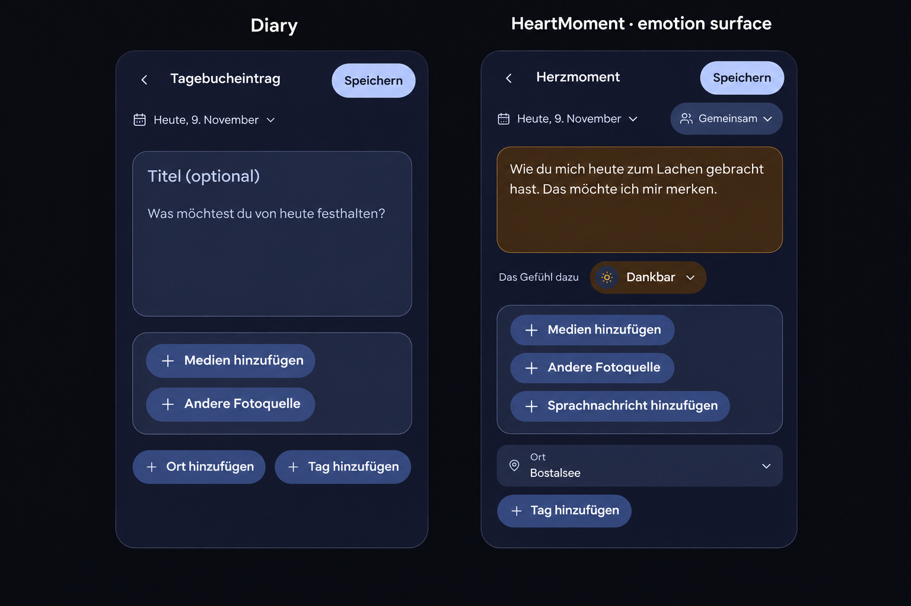

# Quiet mobile composers

## Product Owner decision and baseline

On 2026-11-09 the Product Owner approved the quiet mobile composition for Diary,
Memory, HeartMoment and Plan, then requested a full feeling-colored HeartMoment
card. The subsequent instruction authorizes implementation in a new merge-ready
pull request, without merging it.

Reviewed main: `3008a6c3c240615ebf8ca3bc9dad734823376c55` (merged #1716).
This decision refines the authored-field exception recorded for #1715. It does
not replace Product Reference v1, native form semantics, privacy, accessibility,
business-model or domain contracts.

## Visual preflight

The generated image is an implementation reference derived from the approved
interactive prototype, not a production screenshot. Its input references were
the approved [Diary](approved-diary-prototype.png) and
[HeartMoment](approved-heart-prototype.png) compositions. The approved
[Plan example](approved-plan-prototype.png) retains the note before shared Lists.
Actual runtime evidence is recorded separately after implementation.

The image was generated with the built-in image-generation tool. The prompt
required faithful reproduction of the approved navy/pale-blue mobile headers,
grouped writing surfaces, compact date context, canonical filled Add actions,
shared media frame and full amber HeartMoment writing surface for Dankbar. It
explicitly excluded new features, decorations, palettes, and changed controls.

## Composition contract

- One compact header contains the existing safe Back owner, localized task name
  and one dominant native submit action. Pending, partial/retry and permission
  states retain their current labels and disabled rules.
- A quiet date/period or Plan schedule trigger opens the existing short-task
  lifecycle with native date/time inputs. A selected range is readable in the
  trigger. Period addition/removal remains available inside the date task.
- Title and prose share one bounded writing surface but remain distinct,
  labeled native fields with their existing names, constraints and handlers.
  Title and prose precede media. The Plan note precedes linked Lists.
- Media intake retains one shared frame, including HeartMoment voice intake.
  Canonical blue plus-label Add actions remain visible. Populated media retain
  their original pixels, source owners and complete interaction behavior.
- Empty tag entry is disclosed by the canonical Add action. Selected removable
  chips remain visible. The opened input uses the full available width; Enter,
  suggestions, normalization, duplicates, limits and pending drafts remain owned
  by ContextTagEditor.
- HeartMoment writing and reading cards use the complete existing semantic
  feeling surface, including the existing LOVED default. Selection, reset and
  saved values drive the same color mapping. Page chrome and photographs are
  unaffected; original color is never the sole emotion label.

## Mobile Interaction Contract

| Concern | Contract |
| --- | --- |
| Entry and exit | Preserve current routes, task Back/Close guards, source return and draft recovery. Exactly one task Back control. |
| Primary action | Native submit associated with its owning form, including external header placement. Preserve browser constraints, FormData, Enter and tag-blur handling. |
| Typing | Separate accessible fields; no automatic keyboard opening or text loss. Existing length and required rules remain. |
| Dates | Existing native inputs inside ShortTaskSheet; named backing values stay in the main form when a portal is used. Invalid submission reveals and focuses the actual field. |
| Media gestures | Existing swipe, fullscreen, pinch/pan, double tap, direct sorting and accessible order alternatives. Existing cover/reset/fallback and fixed sensitivity target. |
| Touch and reflow | At least the existing 44px Web/48dp wrapper targets; readable at 320/360/390/430px and 200% text, with safe insets and no horizontal clipping. |
| States | Keep loading, empty, failed media, offline, retained drafts, partial/uncertain saves and deliberate retry. No extra network/resource owner. |
| Motion | Reuse semantic motion and existing task/gallery lifecycles; feeling changes remain clear with reduced motion. |
| Privacy | Keep shared/private audience and permissions at the existing decision point. No private content in evidence. |
| Expanded | Same composition within the existing reading width; no management/table adaptation. |

## Reuse and cross-cutting review

Reuse Story form shells, PageHeader, task Back registration, ShortTaskSheet,
NativeDateField/Input, PlanningScheduleFields, ContextTagEditor, AddAction,
MediaActionGroup, AttachmentDraftPicker, PhotoDraftGallery and HeartEmotionVisual
tokens. Extend these owners rather than introduce another editor, schedule,
gallery, gesture or upload controller. No dependency or external provider is
needed.

No business/freemium impact: the existing Core/Free/Premium/Mixed capabilities,
source permissions, couple/private boundaries, Cloud/Self-Hosted behavior,
quotas, storage, retention, costs and existing-data rights are unchanged. This
is a presentation change, not a new intake or paid capability.

Native form ownership, localization, focus, contrast and reflow are relevant.
API/DTO/schema, backend, resource storage, tenant/authentication and deployment
contracts remain with their current owners. Evidence uses synthetic fixtures.

## Acceptance

Validate open → write/select → save → confirmed result → edit → return, including
tag drafts, ranges/schedules, voice and photo state, media correction, failures,
interruption/recovery and permission boundaries. Check Compact/Expanded,
Light/Dark, all six feelings, large text and reduced motion. Update existing
browser journeys to open newly disclosed fields without removing assertions.
Applicable checks must pass on the final published revision before merge-ready
status is reported.
