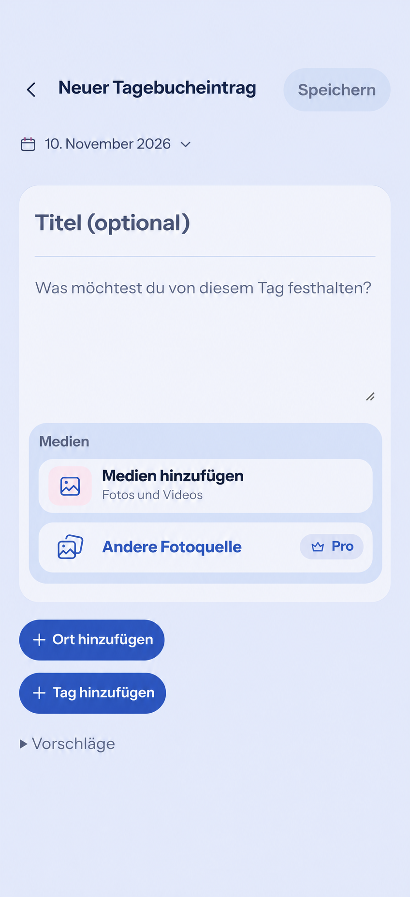

# Soft composer and integrated media intake (#1726)

The later [approved unified-intake refinement](unified-intake/README.md)
supersedes the separate in-composer source rows, nested media surface and idle
format hints below. It retains the same domain owners and adds one combined
entry with source choices in the existing sheet.

## Product Owner decision and baseline

On 2026-11-10 the Product Owner requested one writing/media composition and
borderless filled controls, using the supplied second Diary screenshot as the
source-row reference. Reviewed main: `f334067cff7b2c7638571a3fd50db52ddcaf8633`.
This refines the quiet composer for Diary, Memory, HeartMoment and Plan create
and edit; it does not restore the legacy large header or bottom action stack.

Product Reference v1 R1/D3 and R3, Screen Template 9 and the existing quiet
composer contract apply. This explicit later decision supersedes the canonical
blue AddAction pill requirement only for grouped device/external media intake.
Other create/add entry points retain their existing shared contract.

## Generated visual preflight

Generated before UI implementation with the built-in image-generation tool,
using the two supplied screenshots. The prompt required the current compact
Back/title/submit header and date task, one borderless title/prose/media surface,
the subtle title/body divider, a pale-blue media group with broad near-white
source rows, contextual photo/library icons, an external-source Pro badge, and
existing place/tag actions below. It excluded the legacy heading/actions/footer,
new features, palette changes and navigation inside the focused task. The empty
state reference guides hierarchy; actual text, icons and accessibility remain
owned by runtime components and tokens.

Reviewed owners: MemoryCreatePage, MemoryProductPage, HeartMomentProductPage,
PlanningCreatePage, PlanProductPage, FreeComposer, AttachmentDraftPicker,
PlanPhotosEditor, DeviceMediaPicker and PhotoSourcePicker. Existing date/range,
audience/feeling, tags, Places, shared Lists and voice capabilities remain.

## Mobile Interaction Contract

- Native labeled title/body fields retain their form, names, validation,
  persistence and safe Back/Close owner. Save remains the completion action.
- One writing/media composition; both source choices are full-width, rounded,
  borderless filled buttons with contextual icons. Device media eligibility
  determines its localized photo/video hint. Pro and availability rules remain.
- Existing media preview, swipe/fullscreen/zoom, sorting, cover, sensitivity,
  removal, retry, upload state and voice remain owned by their current components.
- Comfortable targets and wrapping at 320/360/390/430px, 200% text and Expanded;
  idle outlines are removed, keyboard focus and forced-colors affordances remain.
- HeartMoment uses its selected semantic feeling surface. No new resource,
  upload, persistence, privacy or audience lifecycle is introduced.
- Loading, empty, failed/partial/offline and success/recovery states retain their
  current owners and existing reduced-motion feedback. No automatic keyboard.
- Expanded keeps the same bounded content-first composition, without extra form
  columns, cards, helper prose or new typing requirements.

## Reuse, business and quality

Extend existing shared media controls rather than override AddAction CSS or add
another file/source/gallery owner. Reuse EimirIcon, ProMark, native buttons and
existing semantic surface, radius, spacing, typography, focus and motion roles.
No dependency or provider change is needed. No business/freemium impact: local
photos remain Core, external integrations Premium and video retains its existing
boundary. No new quota, cost, retention, ownership or deployment behavior.

Validate targeted field/source/gallery/voice regressions and complete browser
journeys (open, write/select, save, observe, edit, return), then record runtime
Light/Dark Compact/Expanded, populated-media, large-text and reduced-motion
captures under `evidence/`. This generated image is not implementation evidence.

## Runtime acceptance evidence

[Reviewed runtime captures and behavioral validation](evidence/README.md)
record the implemented composition, source revision, Light/Dark and
Compact/Expanded coverage, large-text behavior and complete retained journeys.
