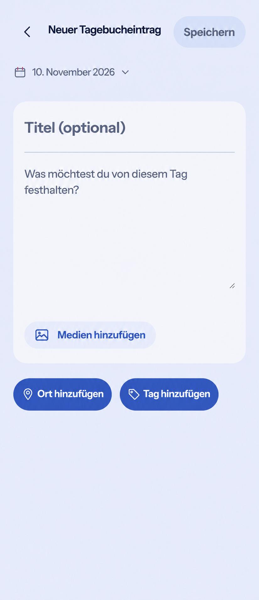
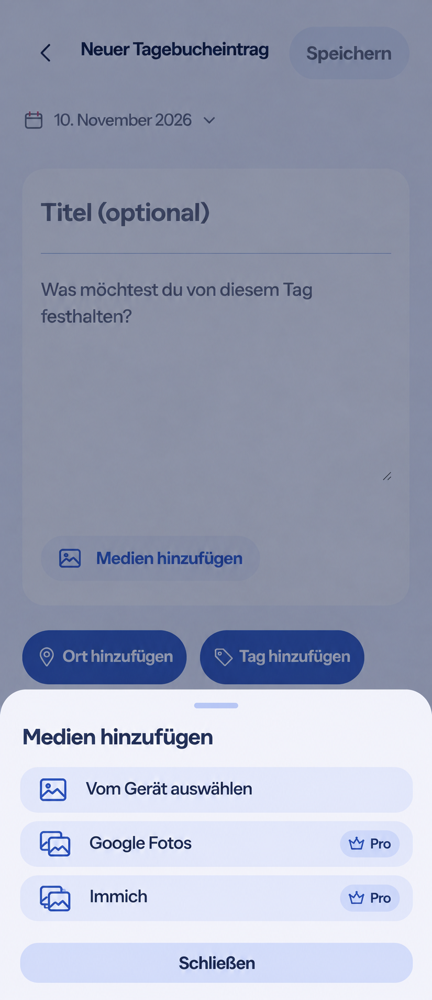
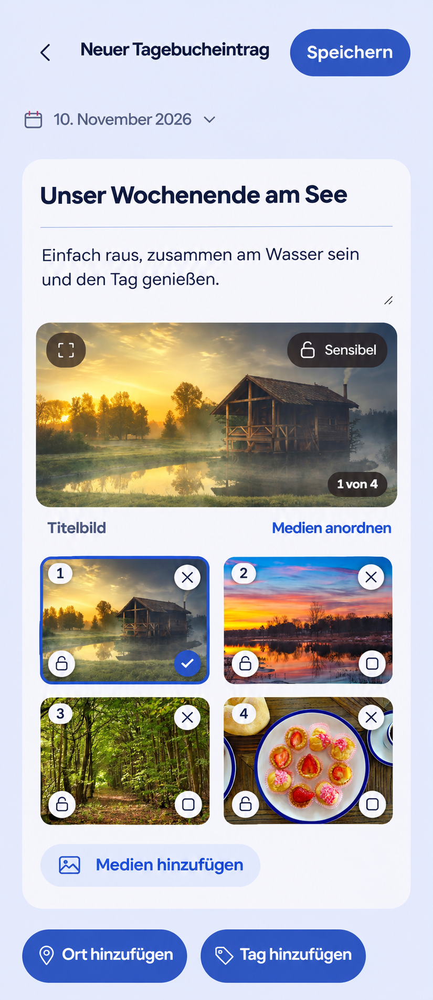

# Unified composer media intake — PO refinement

The implemented result and final behavioral checks are recorded in
[runtime evidence](evidence/README.md).

The Product Owner reviewed these generated images in chat on 2026-11-10 and
requested their implementation and merge in #1727. Reviewed main remains
`f334067cff7b2c7638571a3fd50db52ddcaf8633`; implementation starts from #1727
head `400c5a61e655f53ee36f2beb0ca611128aa76cb5`.

## Refinement and interaction contract

- One soft, labeled `Medien hinzufügen` action inside the existing composer.
  Remove the nested media surface, its heading and idle file-format hints.
- The action opens the existing ShortTaskSheet. Choose from the device or the
  available Google Photos/Immich integrations. Pro belongs to external source
  choices, not the combined Core entry. Existing availability, entitlement,
  consent and integration setup rules continue to govern actual choices.
- Reuse the existing native file input and its video allowlist, upload/draft
  controllers, source-selection cancellation, gallery and ShortTaskSheet owners.
  No new picker, request, upload or modal lifecycle. Native file cancellation
  preserves the source sheet and the draft; closing restores the entry's focus.
- Photos join the writing composition directly. Preserve preview, fullscreen,
  cover, sensitivity, reorder, removal, retry and the six-thumbnail disclosure.
  The images illustrate four selections; no new gallery model is introduced.
- Keep native names, form ownership, pending/disabled states, 48px actions,
  keyboard traversal, forced-colors boundaries, large-text wrapping and existing
  reduced-motion feedback. Expanded uses the same bounded composition.
- Preserve voice, date/schedule, audience/feeling, Places, tags, shared Lists,
  save/result/return and recovery. Provider privacy explanations remain visible
  where required, even where the simplified mockup omits them.

Product Reference v1 R1/D3, R3 and Create/Edit template 9 still apply. The later
page-as-composer surface/tool-row work remains separately owned by #1730; this
refinement does not implement or close that broader issue. The single intake
entry and source sheet are reusable by that follow-up.

No business/freemium impact: device authoring remains Core, external sync
Premium and video retains its existing boundary. No dependency, provider,
quota, cost, storage, retention, ownership, downgrade or deployment change.
Validate native device selection/cancellation, source import/cancellation,
keyboard/focus, save/recovery and gallery journeys in Light/Dark at
320/360/390/430/1280, including 200% text and reduced motion.
