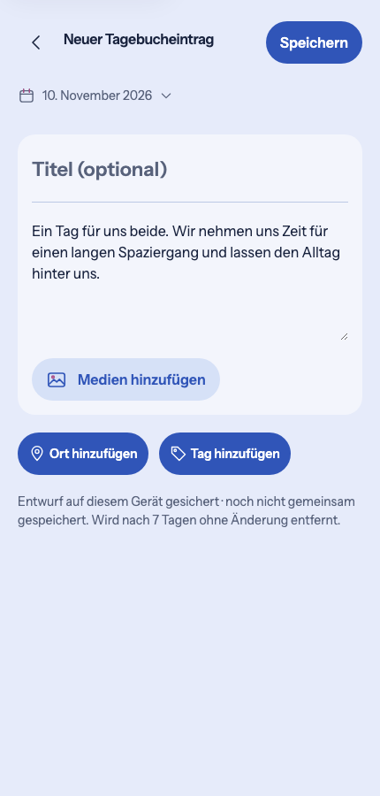
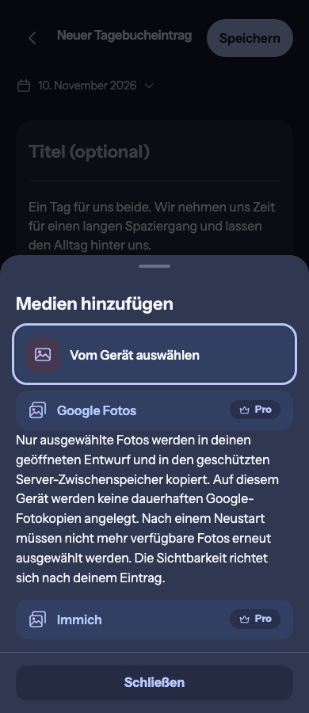
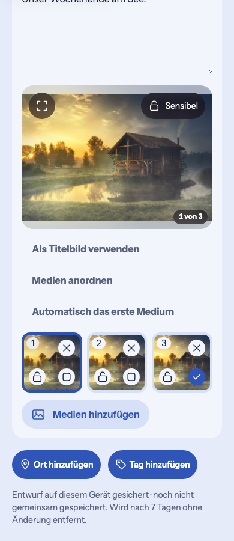

# Unified media intake — runtime evidence

These 19 browser captures implement the Product Owner's approved
[generated refinement](../README.md). They supersede the previous separate
media rows for the final #1727 composition; the generated images remain design
references, not screenshots of the application.

Production source: `02398cab5d71f45d4e7747b5dec50ead3c266172`, based on main
`f334067cff7b2c7638571a3fd50db52ddcaf8633`. Validation head
`610ba86aaa2256f2ed2573721e3fd296e178843a` changes two browser tests only.
The following evidence commit adds no application code. Synthetic repository
fixtures are used throughout. [manifest.json](manifest.json) records hashes
and originating journeys.

## Reviewed composition

One soft `Medien hinzufügen` entry follows the writing area. Its existing
ShortTaskSheet contains the device choice and eligible external integrations;
only external choices carry Pro. No nested media frame, media heading or idle
file-format description remains. Google privacy copy is retained where the
approved simplified mockup omitted it. The existing gallery joins the writing
composition directly and retains fullscreen, cover, sensitivity, ordering,
removal, retry and the six-thumbnail disclosure.

The reviewed set covers the diary and source sheet at 360/390/430/1280 and
320px with 200% root text; HeartMoment in Light/Dark, Plan create/edit,
Memory edit, populated two-/three-photo galleries and a 20-photo selection.
The large-text sheet body scrolls while its Close action stays available.
Full-page captures also include background navigation/focus states from the
recorded journeys. Broader page-as-composer/tool-row work remains #1730.

## Behavioral validation

All **152 cases across nine complete affected browser specs** passed against
the final production bytes, with no skipped cases or configured retries:
`create-surface-visual-checks`, `heart-moment-create-product-reference`,
`hidden-file-inputs`, `media-planning-corrections`, `memory-create-defaults`,
`memory-experiences`, `mobile-diary-planning-media`,
`polish-people-photo-sources` and `video-attachments`.

The initial run passed 150/152. The video-policy assertion still expected its
feedback outside the new chooser; it now opens the real sheet, retries there,
closes and checks restored focus. A mouse drag after the quick native swipe
measured targets while momentum scrolling continued; the journey now waits
for the browser's `scrollend` before resizing and measuring its next drag.
Both complete affected specs then passed all 25 cases. The other seven complete
specs passed all 127 cases directly. Assertions and timeouts were retained;
no product gesture controller or hosted rerun was changed.

The journeys cover real file chooser activation with Enter/Space, cancellation,
the same mounted/named native input, source import/cancellation and privacy,
video-policy loading/error/retry and Pro explanation, save/read/return,
draft/reload/recovery, failed saves, cover/sensitivity/reorder and photo zoom.
Five integrated viewport/theme cases also pass axe, forced-colors boundaries,
reduced motion, modal traversal/restored focus and large-text wrapping.

The 113 focused unit/component/layout cases passed. Production build,
application/fixture typechecks, token/legal/i18n/PWA checks, formatting, lint,
Capacitor foundation, inventory and 38 browser-planning regressions passed.
Existing lint warnings remain. Final published-head CI and merge status are
recorded in #1727. Physical-device keyboard/gesture acceptance is separate;
this change adds no native capability, provider, dependency or data lifecycle.
