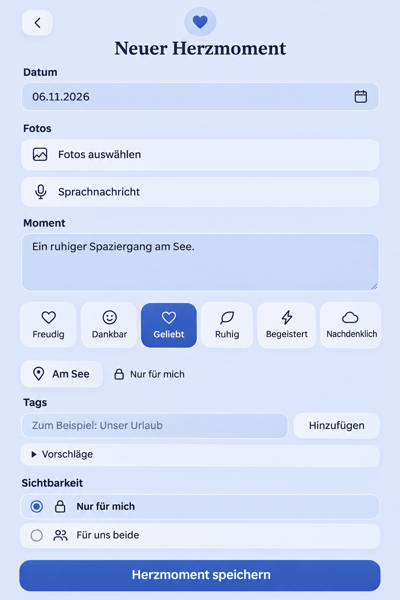

# Primary roots, subscribed feature marks, private locations and capture tags

## Baseline and scope

Preflight recorded before implementation on current main `be9b5ec3c`, with
contextual creation #1681 at `f0305e747`. The concurrent People redesign has no
published implementation branch yet; integrate its completed revision before PR
creation and merge, as explicitly requested by the Product Owner.

Reviewed the actual AppShell/usePrimaryNavigation/taskOrigin flow, Moments local
capture and filtered return, More destinations and every ProMark consumer,
HeartMoment create/edit/read/API/protected payload and shared Place relations,
MomentPlaceField/PlaceChoicePicker/PlaceMapPicker, and the common tag editor in
Memory, HeartMoment, Plan and Wish capture. The PO tag screenshot specifies the
input/add row and initially collapsed suggestions; it supersedes verbose legacy
capture descriptions. Existing shared Place relations cannot carry PRIVATE data.

Generated with the built-in Imagegen tool, against the reviewed whole composer.
It guides composition only: retain the exact existing six HeartEmotion choices,
their icons, current order, media/voice controls, and native task lifecycle. The
image's invented emotion captions are not product decisions. No new visual theme,
photo requirement, persistent prose or native capability is introduced.

## Acceptance criteria

- Selecting another primary tab by link or swipe opens its canonical default view
  at the top; no remembered filter, peer mode or scroll is resumed. Selecting the
  current tab also returns to its default root. Back from a content/detail/editor
  still restores that task's authorized originating context and draft guards.
- Pro feature badges disappear once the effective current Space tier is PREMIUM,
  including either partner's grant. Free retains upgrade discovery. Keep actual
  subscription/account status and all backend capability enforcement unchanged.
- PRIVATE HeartMoments support adding, changing, removing and reading a location.
  Its name/address/coordinates are protected parent content, never a shared Place
  or relation. Create, retry, update, visibility changes and transfer preserve it;
  partner/foreign lists, detail, Story, search and exports cannot reveal it.
- Capture tag editors use the common Tags legend, input plus Add on one row,
  followed by initially collapsed Suggestions. Selected removable tags, Enter,
  validation, dirty protection and save-time draft commitment remain supported.

## Mobile Interaction Contract

Product Reference v1 R1/R2/R4/R5, Create/Edit, Detail and Settings templates apply.
The authored moment remains the human focal point; Save is the dominant action.
Location is optional, revealed with the existing picker and chosen deliberately;
no automatic location permission/request. Use existing PlaceMapPicker, native
input/disclosure, ShortTaskSheet, semantic spacing/color/radius/motion tokens,
parent task lifecycle and query identity. Keep privacy visible at the audience
choice; a private location is not inserted into the couple's Place catalogue.
One person can complete all four flows; no partner participation is required.

Compact 360/390/430 and 320px/200% text retain readable fields and 44px targets;
the tag row gives the input remaining width without moving Add below it.
Expanded uses the same bounded capture, existing dialogs and top navigation.
Do not autofocus optional input. Picker cancellation retains the draft; success
opens the canonical saved result and Back restores the capture origin. Invalid
input/save/network/conflict failures retain work; offline remains read-only and
makes no queued-write promise. Loading grants never assert an upgrade need;
query errors cannot grant capabilities. Existing theme and reduced-motion
feedback applies, with instant tab positioning and non-blocking shell motion.

## Reuse and business/freemium review

Reuse existing browser/router history and scrolling, React context plus scoped
TanStack Query for presentation, the existing map picker and protected parent
payload. A shared Place relation is rejected for private data; a new private
Place domain is unnecessary for one optional parent location. No dependency,
provider, credentials, telemetry, background sync or device configuration is added.
Existing provider calls remain explicit and use the established backend adapters.

Business/freemium impact reviewed: Memory/HeartMoment/location/tags remain
Free/Core; feature marks express upgrade eligibility only. Pro grant remains
Space-scoped and authoritative server-side. Cloud and Self-Hosted share behavior;
no quota, count limit, storage tier, pricing, retention, operating-cost package,
non-destructive downgrade, restore or export reclassification. Update the matrix
only to clarify parent-private location semantics, not to change tier boundaries.

## Cross-cutting quality and validation plan

Location must survive encrypted parent payload and authorized transfer. Add
bounded names/addresses and finite paired coordinates, backward-compatible null
fields, optimistic version checks, idempotency fingerprint coverage, owner/partner
and cross-tenant HTTP negatives, and regenerated OpenAPI/TypeScript contracts.
No location content in events/logs or shared projections. Query scopes include
instance/account/Space and disposal prevents stale presentation crossing owners.

Run focused component and real-browser tab/default/detail-return, badge Free/Pro,
private create/edit/read and tag-row journeys, plus theme/reflow/keyboard/axe
checks. Capture actual Compact and Expanded screenshots. Apply the existing
browser impact planner and applicable backend/contract/governance checks; record
exact final integration revision, failed/unperformed checks and remaining limits
before publishing the authorized PR. Merge only after required final-head checks.
