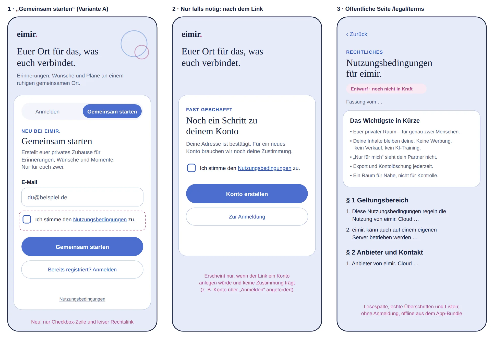

# Terms of use: acceptance at signup and public reading

Issue: [#1657](https://github.com/baerenmarke90/eimir/issues/1657).
Status: implementation preflight, recorded before UI code.
Baseline: `main` at `426f6ef4f23aee9e633cbfaaf336c4fe31f5f1fb`.
Product Owner choice (2026-11-05): acceptance in the signup form (variant A).

## Current destination and generated reference

Inspected on the baseline: `IdentityEntry` with its mode switch (Anmelden /
Gemeinsam starten), the Cloud signup form (eyebrow, title, value text, email,
primary submit, `identity.alreadyRegistered`), the Cloud invitation entry,
the neutral mail result, the signup-link redemption states, the brand intro
column and the More footer. The Cloud „Anmelden“ form requests the same mailed
proof as signup, so it can also create an Account. There is no legal page,
legal link or acceptance anywhere in the product today.

No image-generation tool was available in this session, so the reference is a
generated schematic SVG composition, as accepted for #601 Slice D. It uses the
current strings, the `original` identity palette and the existing card, field,
button and `choice-row` geometry. It is a composition guide, not a pixel lock.

1. The existing signup form keeps every element and order. One labelled
   checkbox row is inserted between email and submit. The same row appears in
   the Cloud invitation entry, which can also create an Account.
2. Only when an opened link would create an Account without a current
   acceptance, the redemption pauses on one short acceptance step instead of
   failing. Existing Accounts never see it.
3. `/legal/terms` is a public, login-free reading page: Back, eyebrow, title,
   draft marker while the text is a draft, the summary and the sections.

## Authority and reuse

- Product Reference v1 principles 2–6 and 9; Authentication and Invitation
  template (one focused flow, value and privacy context before input); R5
  More for the quiet footer link; Detail View for the reading page.
- Reuse `choice-row` (44 px target), native `required` validation, existing
  field, button, eyebrow, `UiState`/`ProblemState`, `BackToSignIn`, the login
  card and the semantic typography, spacing, surface and focus tokens.
- The canonical text stays `legal/de/terms-of-use.md`. A build-time generator
  converts its deliberately small Markdown subset into a typed module; it fails
  on any other construct. A general Markdown library plus sanitizer would add a
  dependency for constructs (raw HTML, images, tables) a legal text must not
  contain, and runtime parsing would add bundle cost without benefit.
- No new dependency, provider, service, tracking or user configuration.

## Mobile Interaction Contract

- Human task: create an account knowingly, without extra steps.
- Hierarchy: value text → email → acceptance → one primary action. The link
  in the acceptance label opens the terms in the existing `ShortTaskSheet`
  (footer action closes it; the body is keyboard-scrollable), so the typed
  address and the checkbox state stay untouched. A modified click still opens
  the real `/legal/terms` route.
- Submit without the checkbox: native required validation on the checkbox,
  focus moves there, no request is sent. Pending, rate-limit, maintenance and
  network states stay the existing ones.
- Redemption fallback: shown in place of the loading state, same card. One
  checkbox, the `legal.createAccount` action and the existing return to
  sign-in. The proof is never in the URL; it stays in memory as today.
- Outdated text (version mismatch after a deployment): a calm problem state
  asking to reload; nothing is recorded.
- Reading page: bounded reading column, real headings and lists, no sticky
  chrome. Works offline from the app bundle. Large text reflows; no
  horizontal scroll at 360 px.
- Motion: none added. The existing card transitions and reduced-motion rules
  apply unchanged.
- Light and Dark use the existing tokens only.

## Business, privacy and cross-cutting review

- Free/Core part of the „Account identity & registration“ row (matrix 1.12); non-paywallable. Only
  eimir. Cloud requires the acceptance; Self-Hosted exposes no terms version
  and keeps its operator-controlled invitation path.
- Stored per accepted version: Account, version, time and origin. No IP,
  device or address data. Deleted with the Account.
- Anti-enumeration is preserved: the request validates the version
  independently of Account state and still answers the same empty `202`.
- Server-authoritative: no Cloud Account is created without a current
  acceptance, including the legacy sign-in path and OIDC onboarding.
- Re-acceptance for later versions, operator legal links for Self-Hosted, the
  DSA notice channel and the Pro purchase obligations are separate follow-ups.

## Implementation evidence

Captured from the implementation (Playwright, mocked Cloud API, reduced
motion) on the implementation before integrating `main` at `88004f81`; the browser
journeys were re-run on the integrated head. Compact is the
primary reference; Expanded keeps the narrow form column and reading width.

| State | Light | Dark |
| --- | --- | --- |
| Signup form, 360 px | [png](../../evidence/terms-of-use-acceptance/signup-form-360-light.webp) | [png](../../evidence/terms-of-use-acceptance/signup-form-360-dark.webp) |
| Signup form, 390 px | [png](../../evidence/terms-of-use-acceptance/signup-form-390-light.webp) | [png](../../evidence/terms-of-use-acceptance/signup-form-390-dark.webp) |
| Signup form, 430 px | [png](../../evidence/terms-of-use-acceptance/signup-form-430-light.webp) | [png](../../evidence/terms-of-use-acceptance/signup-form-430-dark.webp) |
| Signup form, 1280 px | [png](../../evidence/terms-of-use-acceptance/signup-form-1280-light.webp) | [png](../../evidence/terms-of-use-acceptance/signup-form-1280-dark.webp) |
| Reading sheet, 390 px | [png](../../evidence/terms-of-use-acceptance/terms-sheet-390-light.webp) | [png](../../evidence/terms-of-use-acceptance/terms-sheet-390-dark.webp) |
| Redemption fallback, 390 px | [png](../../evidence/terms-of-use-acceptance/redemption-acceptance-390-light.webp) | [png](../../evidence/terms-of-use-acceptance/redemption-acceptance-390-dark.webp) |
| Public page, 390 px | [png](../../evidence/terms-of-use-acceptance/terms-page-390-light.webp) | [png](../../evidence/terms-of-use-acceptance/terms-page-390-dark.webp) |
| Public page, 1280 px | [png](../../evidence/terms-of-use-acceptance/terms-page-1280-light.webp) | [png](../../evidence/terms-of-use-acceptance/terms-page-1280-dark.webp) |

The browser journeys in `cloud-onboarding-entry.spec.ts` cover Open → submit
without acceptance → read in the sheet → return with input intact → accept →
neutral result, the login-free page with Back, and the redemption fallback,
with Axe WCAG 2.2 AA in Light and Dark and no horizontal overflow at 360,
390 and 430 px. Axe found two defects during implementation that are fixed
here: the draft badge contrast and the non-focusable scrolling sheet body.
