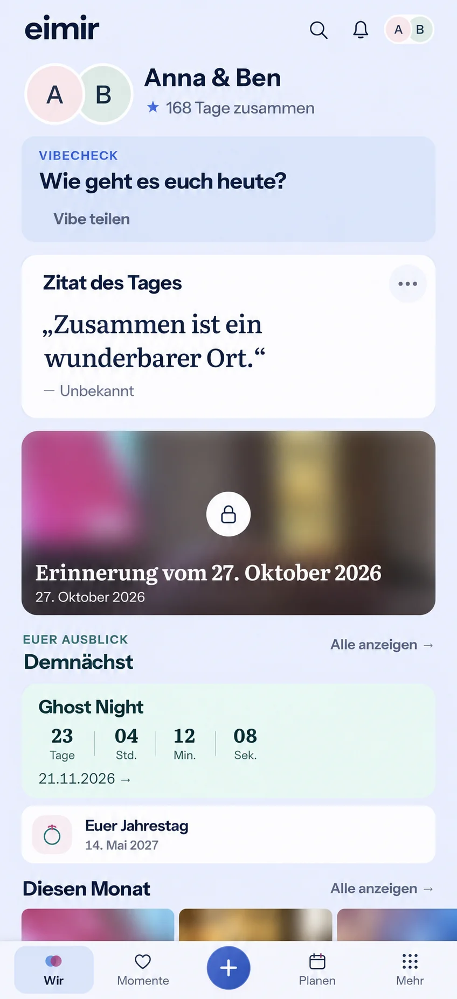

# Today clarity and docked navigation

## Preflight — before UI implementation

Main baseline: `9ee7e1444a20e2e013a065bda80fa4d8810b2ef3`.
Integration parent: PR #1499, `4a872527867d118c66f9468d684a530013cd58da`.

The Product Owner requested: meaningful upcoming occasions with years, a live
countdown instead of the anticipation kicker, one date for generated Memory
titles, bottom navigation flush with the viewport, and a quieter Daily Quote.
The supplied other-app screenshot is geometry guidance only. No other app code,
assets or composition are used.

Inspected current TodayPage, AnticipationCard, DailyQuoteCard, Memory creation
and detail title conventions, dashboard anniversary selection, shell navigation,
date formatters, design tokens and existing browser journeys before implementation.

Generated using the built-in Imagegen tool before UI code. Prompt: preserve the
existing Today composition, functions and cool identity; simplify Daily Quote
to one heading, quote and attribution; present an actual timed countdown;
name the next anniversary with its year; show a Memory date once; dock the
existing four labeled destinations and central plus to the bottom edge.
Use initials and abstract blurred imagery rather than generated people.
The image illustrates hierarchy, not exact pixels or production data. Its
duplicated Memory date is a generation error and explicitly rejected: the
implementation must show generated-title dates only once. Preserve the actual
existing section headings and content rather than omissions in the mockup.

### Authority and Mobile Interaction Contract

Product Reference v1 R4 Today, R2 story and R5 utility, with the Today/Story
templates. This later PO instruction supersedes floating-bar geometry and the
former date-only countdown presentation restriction. Shared canonical routes,
ShortTaskSheet, formatting, query ownership, sensitive-media lifecycle and tokens
remain authoritative. No new dependency or external provider is needed; use the
platform clock/visibility APIs and existing CSS feedback tokens.

Compact navigation spans the viewport and fills the bottom safe area. Keep all
four destination labels, central create, 44px+ targets, focus and task boundaries.
Reserve its measured height above content and transient feedback. Expanded keeps
its existing shell. Quote content and required attribution lead with only
the localized Daily Quote heading; preferences stay behind the existing explicit Save/Cancel
sheet. Name the anniversary and show the actual next occurrence including year.
Generated Memory titles are recognized using the same localization/date rule as
Memory detail; authored titles retain their separate dates.

Timed countdowns use the actual Plan instant, never a date interpreted as a
timezone-independent midnight. Clamp at zero; refresh from the wall clock after
backgrounding; dispose of timers. Date-only Plans retain calendar-day precision.
Updates use brief opacity feedback with no motion under reduced motion, no
per-second screen-reader announcements and no extra polling.

### Business/freemium and cross-cutting review

No business/freemium impact: #504 countdown stays Free/Core and Daily Quote stays
Pro (`daily.quote`), with quiet Free discovery and retained personal preferences.
Removing the card badge changes presentation only. Cloud/Self-Hosted parity,
cost, quotas, export, downgrade, storage and retention remain unchanged. Clarify
the matrix wording to reflect the explicitly requested timer presentation.

No new data source, request, persistence, logging or authorization boundary. An
additive nullable dashboard instant preserves date-only/backward compatibility.
Use localization for labels and date/number formatting. Preserve unknown/private
media concealment, canonical links, loading, empty, offline and failure states.
Review timers, focus, reduced motion, reflow, safe areas, Light/Dark, Expanded
and generated versus authored titles with focused component/browser evidence.

## Implemented result and verification

### PO layout refinement, 2026-10-29

The subsequent corner correction removes resting and hover shadows from the
existing agenda card. Its border and surface define the rounded shape without
a shadow being clipped by the Compact horizontal scroller. Hover keeps border
feedback without lifting the card into the scroller boundary. This is a narrow
presentation correction; existing content, targets and focus semantics remain.
The complete Today browser matrix (Light/Dark, Compact/Expanded, large text and
safe areas with axe) passed again, and its screenshots were refreshed.

Before this small follow-up: retain only the localized upcoming heading, group
the special Plan date tightly with its title above the timer, and use the existing
heart icon for the anniversary row. The PO correction supersedes the earlier
generated reference's footer date and double upcoming heading. This is a bounded
text/icon/alignment refinement of the existing composition, with no new feature,
interaction, data, capability or design-system primitive. Reuse the semantic
spacing and supporting-copy roles, a calendar `time` element, the existing heart
icon and the same card destination. Long titles and dates must continue to wrap
at 320px/200% text; the timer, reduced motion and dock behavior stay unchanged.

The date is now a semantic calendar date directly below the Plan title in one
tightly spaced header, with the destination arrow at its trailing edge. The
countdown follows as a separate reading group. Only the upcoming heading remains;
the anniversary row reuses the existing outlined heart. Updated 320/360/390/430px,
Light/Dark, 200% text/safe-area and Expanded browser evidence is retained below.
The follow-up passed 94 focused component tests, the existing browser matrix with
axe, changed-runtime lint, TypeScript and production build. One obsolete test
expectation for the removed double heading was updated to the explicit PO choice.

The bar now fills the bottom edge and safe area; a ResizeObserver keeps content,
snackbars and the existing create sheet above its actual height. Large-text labels
and agenda titles wrap instead of losing their meaning to ellipses. Expanded
keeps the existing header navigation.

An untitled anniversary uses its localized occasion name and full next-occurrence
date. Upcoming calendar dates retain UTC carrier semantics; actual scheduled
instants use the viewer's local time. Generated Memory titles reuse the exact
creation/detail recognition rule and become a single date; authored titles keep
their separate date. The underlying Memory content is unchanged.

`eventAt` is an additive nullable dashboard field projected from the selected
Plan's actual scheduled start. Older/date-only responses retain the existing day
counter. Timed values use local wall-clock elapsed seconds, pause while hidden,
refresh on visibility return, clamp at zero and dispose their timer. Only changed
digits receive fast opacity feedback; reduced motion removes it. The timer uses
`aria-live="off"` and does not generate repeated announcements.

### Actual browser evidence

- [390px viewport: single date, timed countdown, next anniversary and dock](today-clarity-docked-390-viewport.webp).
- Full composition in [390px Light](today-clarity-390-light.webp) and [Dark](today-clarity-390-dark.webp).
- [320px with 200% text and a 34px bottom safe area](today-clarity-320-large-text-safe-area.webp).
- Expanded [Light](today-clarity-1280-light.webp) and [Dark](today-clarity-1280-dark.webp).
- [Authored title with a separate date](today-clarity-authored-title-390-light.webp).

Additional 320/360/430px Light/Dark images are retained here. Full-page captures
include a fixed element at its viewport position inside the taller scroll image;
the separate 390px viewport image shows the actual flush bottom geometry.
Images use synthetic account/quote fixtures and an existing repository demo photo.

The [SHA-256 manifest](source-sha256.json) binds runtime and affected test sources
to this evidence. Verification:

- 154 focused component/unit tests passed, including generated/authored titles,
  the actual-instant minute boundary, zero clamp, visibility recovery, cleanup,
  quote settings and existing Today return journeys. The 141 tests touching the
  final timer/shell changes were rerun successfully after those adjustments.
- 13 PostgreSQL/HTTP and OpenAPI unit tests passed in an isolated temporary
  database, including nullable date-only and exact timed-instant projection.
- 20 browser journeys passed: the new countdown/date/dock/photo-title matrix and
  19 existing quote/navigation journeys (preferences Save/Cancel, Free/downgrade,
  caller isolation, retries, create, focus restoration and large-text navigation).
  The new matrix passed again after completing its authenticated photo fixture.
- TypeScript, production build, token/PWA checks, full Web formatting, changed
  runtime lint, backend Ruff, generated-client drift, English engineering and
  documentation audits, and whitespace checks passed. Existing bundle-size and
  dependency `use client` warnings remain; existing Memory detail fragment lint
  information is unchanged.

No native wrapper capability changed; physical-device acceptance is not claimed.
CI and public issue/PR publication remain pending. This preflight was prepared
locally before implementation; publication requires Product Owner authorization.
