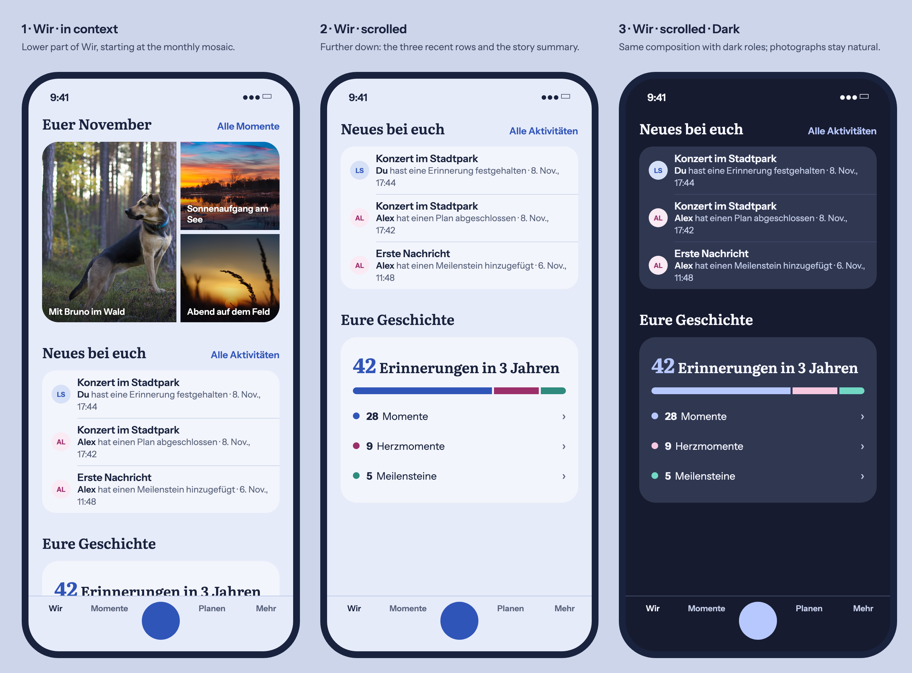
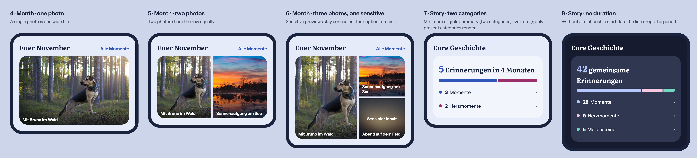

# Wir: monthly photo mosaic and story summary reference

## Product Owner request and baseline

On 2026-11-10 the Product Owner reviewed a click demo of the Wir (Today) page
and asked for two of its modules to be implemented exactly as shown: the
monthly photo presentation ("Euer November") and the redesigned story summary
("Eure Geschichte"). Reviewed main: `d258eb83372f12ef1c62b4827dcf4419bbde7b27`.

Reviewed owners on the baseline: `TodayPage` (`TodayMonthlyStrip`, the
`today-monthly-notes` text highlights, module ordering/visibility),
`client/todayComposition.ts` (`MONTHLY_STRIP_MAX_ITEMS = 3`, photo selection),
`SharedStorySummary` (`sharedStorySummaryIsEligible`, three category links into
the filtered timeline, settings preview via `showEmpty`), `MemoryPreview`
(sensitive concealment), and the `m5s5.dashboard.*` / `today.monthly.*` copy.

Today the month module is a horizontal swipe strip of up to three photos with
caption and date below each photo, titled "Euer Monat". The story summary is a
row of three equal number tiles titled "Eure Geschichte in Zahlen". Both stay in
their current position, ordering and visibility settings; only their
presentation changes.

## Generated visual preflight

Rendered from [`reference.html`](reference.html) with Playwright Chromium at
390 px, device scale factor 2, using the semantic light/dark values from
`design/tokens.json` and the CC0 demo photos in `backend/demo_assets/images`.
The recent-activity rows in frames 1–3 only provide context and are not part of
this change.

## Mobile Interaction Contract

### Monthly photo mosaic

- Title: localized "Euer {{month}}" with the long month name of the selected
  month via `Intl` (for example "Euer November"); the header action reads
  "Alle Momente" and keeps the existing destination and accessible name.
- Selection is unchanged: up to `MONTHLY_STRIP_MAX_ITEMS` (3) real shared photos
  of the month, same ordering and de-duplication.
- Layout replaces the swipe strip with a mosaic inside the page gutter, outer
  radius `radius.sheet`, 6 px gaps (`spacing` role), no swipe:
  - 1 photo: one full-width tile, 220 px high;
  - 2 photos: two equal tiles in one row, 200 px high;
  - 3 photos: left tile spans two rows (column ratio 1.35 : 1), two stacked
    tiles on the right, each row 130 px.
- Each tile is one link to its memory. The title sits on the photo
  (bottom-left, white, 13 px semibold) over a bottom gradient for legibility;
  the date is not shown visually but remains in the accessible name.
- Sensitive previews stay concealed through `MemoryPreview` with its existing
  label; the title remains visible.
- Text highlights (`today-monthly-notes`) keep their current owner and appear
  below the mosaic.
- Motion: subtle image scale on hover/press (about 1.04, existing duration
  tokens); none with reduced motion.

### Story summary

- Title "Eure Geschichte" (replaces "Eure Geschichte in Zahlen" on Wir; the
  settings entry may keep its current label).
- One soft surface card (`surface`/`surfaceRaised`, `radius.sheet`, 18 px
  padding), no tiles.
- Lead line in the display role: the total count of the rendered categories in
  the accent color (about 30 px), followed by "Erinnerungen in 3 Jahren" (about
  21 px). The period comes from the existing relationship duration: years when
  at least one year, otherwise months, otherwise days, with correct German
  dative plural/singular ("in einem Jahr", "in 4 Monaten"). Without a duration
  the line reads "{{count}} gemeinsame Erinnerungen".
- Below: a 10 px pill bar split into segments proportional to each rendered
  category (3 px gaps, each segment at least about 6 % wide), decorative and
  `aria-hidden`.
- Then one row per rendered category (Momente, Herzmomente, Meilensteine, in
  this order): colored dot, bold count, label, chevron; whole row is the
  existing link into the filtered timeline with the existing plural
  accessible name; min height 44 px.
- Eligibility (`sharedStorySummaryIsEligible`: at least two non-zero categories
  and at least five items) and the settings preview are unchanged. Only
  non-zero categories render, except in the settings preview.
- Category colors use new semantic tokens (for example
  `color.semantic.storyMemory`, `storyHeartMoment`, `storyMilestone` in Light and
  Dark), derived from the existing interactive, partner/brand and mint roles.

### States, accessibility and quality

- Loading/error/offline keep the existing Today module behavior; the mosaic
  keeps stable tile sizes while previews load.
- Counts use `Intl.NumberFormat`; all new copy is localized in de and en.
- 320/360 px: mosaic keeps its structure with smaller tiles; story rows wrap
  without horizontal scrolling. 200 % text keeps the rows readable.
- Expanded keeps the same composition within the bounded reading width.

## Reuse, business and quality

Reuse `TodayModuleSection`, `TodayDestinationLink`, `MemoryPreview`,
`SharedStorySummary` data and routes, the existing duration source, and semantic
tokens. No new dependency, API or persistence.

No business/freemium impact: both modules stay Free/Core with identical
Cloud/Self-Hosted behavior; no quota, cost, retention, entitlement or downgrade
change.
