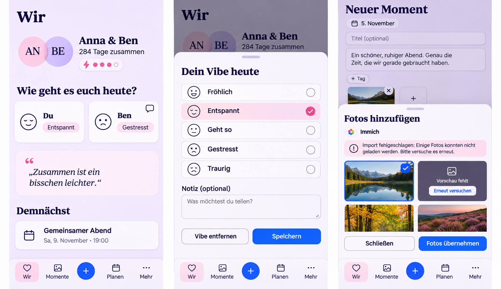

# Daily Vibe and Immich clarity — preflight

Main baseline: `88004f8147fa2cf6d65364d06443805859011fc3`.
Dependency: #1656, reviewed at `86b1e0ae4574dcee91e697ee9612090bc2f2f7cf`;
its final CI corrections are included at `2c8fc132fcabe355591f623a8787c2b900d3e477`.
The new PR owns this preflight and the requested follow-up.

The built-in image generator produced this synthetic reference before UI work.
The [exact prompt](reference-prompt.txt) records the destination review. No user
attachment pixels or personal media were published. Preserve actual font roles,
navigation, date/prose-first capture and hidden root navigation in modal tasks
where the generated illustration differs. The illustration is composition
guidance, not a pixel lock or provider logo specification.

## Mobile Interaction Contract

Product Reference v1 R4 and R1, Today and Create/Edit templates apply. Reviewed
TodayPage, CouplePresence, DailyVibeCheckIn/Icon, ShortTaskSheet, PhotoSourcePicker,
draft gallery, account/Space ownership and semantic tokens on current main and
the dependency. The existing avatars, Energy, quote, next Plan and capture
capabilities keep their place.

Share one recognizable feeling quickly; notice and read an authorized note;
deliberately import an owned photo into an existing draft. Offer five short
feelings using stable Vibe values, without a new dimension or a data migration.
Keep legacy needs values readable and preserve an unchanged current value.
Wishes for closeness or quiet can use the optional authored note.

Compact uses roomy full-width choices: emotion icon, label and a separate check.
Keep one Save, optional note, Remove, Back/Escape and focus restoration. Add a
note icon for nonblank own/visible partner notes; never signal hidden note
existence. The partner card opens the existing note sheet. No note preview or
permanent helper paragraph. One person can finish their check-in or capture
alone; dimension-specific mutual reveal and voluntary participation stay intact.

The photo task retains deliberate selection and transfers originals only after
Import. Loading, empty, unavailable, offline, failed, partial and saved states
stay distinct. Failed transfers retain selection and authored draft. Recovery
must fit at full sheet width with product-sized targets at large text.

Expanded adapts the same bounded tasks. Reuse semantic surfaces, type, space,
targets and existing sheet/selection motion; reduced motion preserves every
state and action. Existing personal content and feeling faces supply warmth;
routine selection needs no additional relationship prose or celebration.

## Reuse, commercial model and cross-cutting review

Review official Immich 3.3.6 API/release documentation, platform Blob/Fetch/
AbortController/IntersectionObserver and the existing private HTTPS adapter,
bounded thumbnail queue, object URLs and normal upload/validation pipeline.
Repair these rather than adding an SDK/provider or independent image parser.
No new dependency, license, service, setup burden or background synchronization.
Keep TLS/public-DNS pinning, fixed endpoints, no redirects, owner verification
and resource limits. See the existing #1444 delivery/security contract.

No business/freemium impact: Vibe and accessible/privacy-safe recovery remain
Core; external photo import keeps its existing Pro integration capability on
Cloud and Self-Hosted. Existing copies remain readable/exportable after
downgrade/disconnect. No pricing, quota, retention or ownership change.

Preserve current-day/reveal privacy, selection Account/Space/device ownership,
stale completion cancellation and authored data on failures. Localize concise
copy and safe fixed errors; no upstream body, personal URL/key or media enters
diagnostics. Keep API compatibility, normal image validation and no additional
managed resources. Inspect workflows and body/design/language gates before push.

Validation plan: meaningful backend binary-transport/authorization regressions,
component retry/note/legacy-value cases and complete affected browser journeys.
Cover 360/390/430, Expanded, Light/Dark, 320px/200% text, reduced motion, focus,
axe and open → select → save/import → observe → return. Final head CI must pass.
Synthetic evidence cannot certify a personal live library or physical device.

The implementation uses the shared lined-note icon rather than the generated
speech bubble, preserving the established icon grammar and the note meaning.
See [runtime evidence and acceptance](evidence/README.md).
