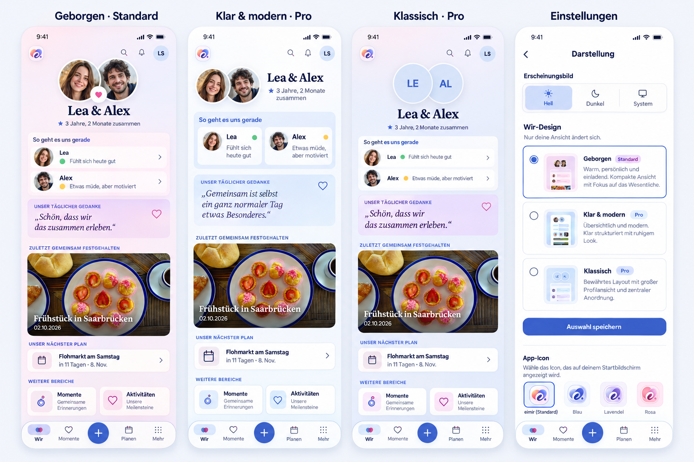

# Personal Wir designs — #1494

## Pre-implementation baseline

`main@413d93465429d4e901d0a168a81aad19a12638be` was inspected before runtime implementation. The current `/today` page and Appearance settings were reviewed, including `TodayPage`, `CouplePresence`, Vibe/Energy check-ins, `DailyQuoteCard`, shared content selection, module ordering/visibility, `ProfileAppearancePanel`, app-icon selection and its owner/capability/concurrency boundaries.

The existing browser journey `today-living-home.spec.ts` / `renders the real #452 Polaroid` passed on this baseline. Its actual full-page screenshots are under [baseline](baseline/); they show the current UI and synthetic/demo content. The current implementation, rather than an approximate generated rendering, defines **Klassisch**.

## Selected compositions

The built-in image-generation tool generated this reference before UI code. It is composition guidance for three designs and the selector. It is not a new content contract: illustrative people/quotes are synthetic, the generated extra shortcut tiles do not authorize new modules, and the application must continue to use real server-selected content. The generated board's approximate Klassisch header/quote styling does not replace the current implementation.

- **Geborgen / `warm`:** default Free/Core design. Compact personal identity, editorial names, a gently unified vertical Vibe group and a restrained quote treatment. Actual shared focal content and the upcoming horizon continue below.
- **Klar & modern / `modern`:** optional Pro selection. Horizontal identity where space permits, sans-serif titles, paired Vibe presentation and quiet blue emphasis. Narrow/large-text identity wraps instead of clipping.
- **Klassisch / `classic`:** optional Pro selection retaining the current large centered portrait/names composition and all current module styling.

All designs use the same authorized content, personal module order/visibility, existing optional-module decisions, routes, active shell and direct actions. Theme mode remains independent and Free. Layout changes must not add requests per module, change feature entitlements or infer hidden partner state.

## Mobile interaction contract

Owning references: Product Reference v1 R4 and R5; Today and Settings/Privacy templates. This is a personal presentation choice, not shared relationship content.

1. Enter More → Settings → Appearance. The named **Wir design** section displays the current saved value and a recognizable visual summary.
2. Open the existing `ShortTaskSheet` pattern; select one of three native radio previews. No keyboard/typing is needed. Selection stays a draft until explicit Save. Closing without saving keeps the active design.
3. A single pending request blocks duplicate submission and sheet dismissal. Only confirmed server success updates the owner-scoped query and the visible saved summary. Return to Wir and reload show the saved design.
4. Read loading/error exposes status/retry and blocks saving without an authoritative ETag. Known same-owner data may remain visible. Offline writes fail honestly; errors retain the draft. Conflict recovery reloads the authoritative snapshot and requires another deliberate save.
5. New alternate selections require the existing Space-level `theme.bespoke_packs` capability, granted to both partners while Pro is active. Unknown/error capability never permits a paid save. Server membership and entitlement checks remain authoritative. Returning to `warm` is always Free. Previously saved designs remain effective after expiry.
6. Preferences are Account+Space scoped, use existing If-Match concurrency semantics, are personal-export metadata and are removed by account cleanup. Untrusted import never activates a paid choice. Account/Space switches isolate queries and pending callbacks.
7. Native radios, clear names, visible focus and minimum 44 CSS px touch targets. Validate 320px reflow, 360/390/430px, large text and Light/Dark. Sheet footer/focus restoration use the existing primitive. Reduced motion retains every state and action.
8. Expanded keeps the same bounded task/save model; it does not add a settings grid or reorder actual Today content. Wrapper/system navigation is outside this Web-only slice.

Loading, Empty, Error, Offline, Pending and Success continue to follow the existing domain components in every design. A missing partner, missing photo or disabled module never produces invented content. Optional energy and gesture overlays stay operable above surrounding content.

## Reuse and business/freemium review

Reuse the appearance domain, ETag/If-Match pattern, Space entitlement, generated API client, Query identity guards, `ShortTaskSheet`, existing design tokens, icon primitives and Today components. No new provider, runtime dependency, data projection or native capability. Domain authorization and privacy are unchanged.

**Business/freemium impact reviewed:** default `warm` is Free/Core; new `modern`/`classic` choices are Pro presentation under the existing capability. Saved choices survive downgrade. Both operating models behave identically. No new managed cost, storage/media quota, billing operation or content restriction. See the versioned feature matrix and #1494.

## Generated reference prompt

Built-in image generation, `ui-mockup`, using the actual baseline 390px screenshot as the reference: four whole Compact screens showing **Geborgen · Standard**, **Klar & modern · Pro**, **Klassisch · Pro**, and **Einstellungen**. Preserve the actual shell, personal identity, Vibe/Energy/gesture entry points, existing quote, real shared breakfast focal item, next plan and supported continuation. Warm editorial versus horizontal modern versus current centered identity; Appearance has independent theme mode and a three-radio visual selector with explicit Save and current app icons below. Existing blue/navy/pink/lavender roles and Literata/Instrument Sans direction; no new question domain, fake metrics or generic dashboard. Synthetic illustrative content is not runtime data.

## Implementation evidence

The final checks and screenshots are recorded here once the complete save → return → reload journey is verified.
