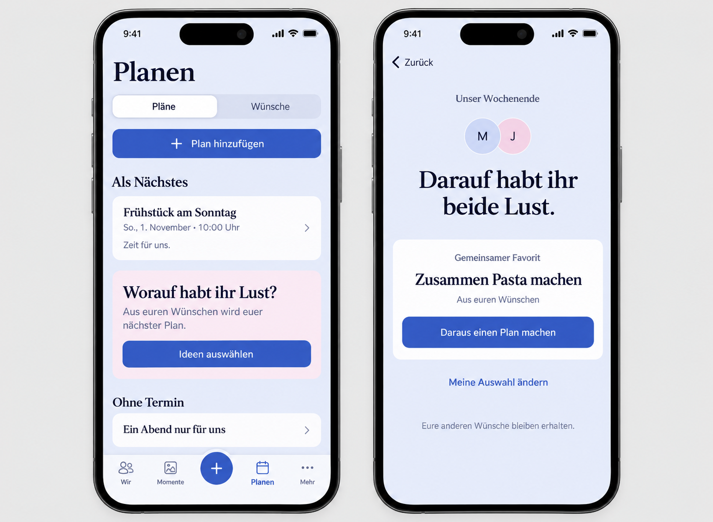

# Shared wish selection

Owning issue: [#1535](https://github.com/baerenmarke90/eimir/issues/1535).

## Product decision and repository-aware preflight

The Product Owner approved the mobile concept in this chat on 2026-10-30 and
requested its implementation and a pull request. This includes the proposed
Free/Core classification. Baseline main: `daf8783fde32c53ff72a03bf02e2ebad6ef92417`.
The existing `/plan` hub, Pläne/Wünsche tabs, local create actions, nearest/later/
undated/history groups, PlanCover, WishProductPage, canonical Wish-to-Plan
transition, focused task navigation and semantic tokens were reviewed before
generating the implementation reference and before runtime implementation.

The built-in Imagegen reference preserves the existing Plan hub and incorporates
the approved invitation and result task. It is composition guidance: its large
filled add button and alternate navigation glyphs are not implementation
requirements. Keep the real local add action and existing shell. The depicted
Plans deliberately have no photos; actual selected Plan imagery and galleries
remain intact. The exact prompt is retained alongside the image.

Authority: Product Reference v1, R3 Planning, Plan Hub / focused Create-Edit /
Detail templates, the participation contract, component selection/feedback/task
contracts and the normative motion guideline.

## Mobile Interaction Contract

- Outcome: choose an actual next experience from two to five shared Wishes.
  One person can assemble the round and prepare a Plan from their own favorites.
  Optional bilateral sharing reveals common favorites, not a comparison chart.
- Placement: one invitation after the nearest Plan, before later/undated content;
  a named entry also exists in Wishes. Preserve all existing hub capabilities.
  Focused selection tasks use local Back and the existing origin/return system.
- Steps: choose candidate Wishes and an optional occasion; mark personal
  favorites; deliberately share; read common favorites; prepare the canonical
  Plan with optional scheduling; save; observe the actual Plan; return.
- Input: native checkbox lists make bounded simultaneous comparison appropriate.
  No mandatory typing, premature keyboard, hidden swipe, score, random ranking,
  deadline, reminder pressure, comparative contribution indicator or game gate.
- Drafts: personal checkbox edits remain in the account/Space-scoped task until
  explicit sharing. Failed writes retain input. Dirty/pending exits follow the
  existing task guard. Editing a published selection deliberately withdraws it;
  the common result disappears until it is shared again. Cancellation does not
  silently republish it. Draft state never enters URLs, logs or durable browser
  storage. Account/Space changes invalidate late callbacks and local state.
- Candidates: starting a replacement round is explicit and explains that both
  selections reset. Cancel keeps the existing round. New ideas use normal Wish
  creation. Removed/converted candidates are revalidated; existing resulting
  Plans open rather than being duplicated. A deleted source never leaks a title.
- Privacy: the server returns only the caller's selection and an authorized
  intersection after both current members publish. Never return partner decision
  arrays, draft timestamps, per-person counts or a rejected-idea list. Intersection
  results can logically reveal some preferences; do not promise that every
  individual choice remains secret after sharing. No E2EE claim.
- States: initial/loading is distinct from no round and insufficient Wishes.
  Waiting, no common favorites and one/multiple common favorites have distinct
  compositions and meaningful next actions. A single active member can continue
  alone. Error/refetch failure preserves valid content; failed publication never
  claims success. Offline writes are explicitly unsaved, not queued.
- Result: Wish title supplies the Plan title; date/time are optional, with the
  existing date-only/timed/cross-day semantics. Saving uses the authoritative
  idempotent Wish-to-Plan operation, then opens the actual canonical Plan detail.
  One person's proposal is labeled as such and never implies mutual agreement.
- Compact: 320 px reflow and 360/390/430 px, 200% text, safe areas, native
  controls, at least 44 px targets, visible focus and meaningful labels. Expanded
  retains bounded reading width and the same sequence without extra columns.
- Motion: existing tokenized press/selection feedback and scoped confirmed-result
  arrival; no delayed writes, looping delight or confetti. Reduced motion retains
  all copy, state and focus. Warmth comes from actual Wish titles and anticipation.
- Acceptance: test Open -> select -> share -> result -> prepare/save -> actual
  Plan -> return, including dirty cancellation, failures, stale responses,
  independent participants, zero matches, source deletion/conversion, offline,
  keyboard, narrow/large text, Light/Dark and reduced motion. No native wrapper
  capability changes; the Capacitor app delivers the same canonical Web UI.

## Persistence, authorization and lifecycle

One current bounded round per Space, normalized Same-Space candidate relations,
and separate OWNER_ONLY selections. Titles and favorite-ID sets use existing
ProtectedPayload encryption-at-rest boundaries. No raw choices in events or logs.
Round changes use opaque round identity/version tokens; owner-selection writes carry both round
and own-selection identity so a stale old-round submission cannot become consent
in a replacement round. Partner writes do not overwrite the caller's choices.

Serialize round creation/reset with the existing Membership -> Space lifecycle
barrier. Bind each round to the current active Membership context, and remove
the temporary round on membership changes or explicit closure. Source Wish
relations use composite Same-Space keys and deletion cascades. Publishing and
reading revalidate current candidates and source Plan references. Plan conversion
retains the existing Wish -> Plan locking and unique source-Wish constraint.

Only current-round state is retained; there is no history of rejected choices.
Closing/replacing a round removes its selections while preserving original
Wishes and Plans. Account/Space deletion and owner-only cleanup include the new
tables. Personal machine-readable export includes only the caller's selection;
shared export includes only the authorized round/intersection. These temporary
decision snapshots are export-only and never reactivated as consent on import.

## Reuse review

This is application-specific selection/authorization logic, not new commodity
infrastructure. Reuse SQLAlchemy/PostgreSQL transactions and constraints,
ProtectedPayloadJSON, existing privacy/membership guards, FastAPI/Pydantic and
If-Match, generated TypeScript clients, React Router task origins, TanStack Query,
native controls, PlanScheduleFields and the canonical Wish-to-Plan transition.
Reuse the existing frozen OpenAPI generator instead of introducing a manual
transport. No third-party service, dependency, model, polling platform, queue,
calendar, image processing or infrastructure configuration is added. A bounded
visible-task refetch/manual refresh uses existing query primitives; it is not
presence tracking. New provider/license/cost review is therefore not applicable.

## Business/freemium impact reviewed

The approved addition extends the Free/Core Wish & Plan lifecycle. Update the
authoritative feature matrix to record this new capability. Both partners share
the feature with no entitlement, count paywall, resource upsell or downgrade
change. Two-to-five candidates and one current round express a short decision,
not a tier quota. Ordinary Wishes/Plans remain unlimited. Cloud and Self-Hosted
share behavior; small database rows use existing operations and encryption.
Essential export, deletion, privacy and accessibility remain non-paywallable.

## Cross-cutting review

Security/privacy: tenant and owner SQL predicates, current Membership binding,
no partner arrays, ProtectedPayload, no sensitive logging, cross-tenant/malformed
ID negatives, source withdrawal and deletion lifecycle. Concurrency: serialized
replacement/publication, round+owner tokens, exact candidate subsets, stale
consent rejection and existing idempotent Plan conversion. Resilience: pending
locks, retained drafts/errors, no offline write/outbox claim, account/Space late
completion rejection. i18n/accessibility: all copy through localization, native
labels, focus/Back, 44 px targets, 200%/320 px, contrast and reduced motion.
Performance: at most five candidate sources/two selections per current round,
bounded projections and no per-card requests. Contracts: additive migration,
OpenAPI and generated client; export-only snapshot cannot restore consent.
Operations: no new service/configuration, same supported backup/restore and
Cloud/Self-Hosted semantics. Test DB/API boundaries, encryption registry,
ownership, source/lifecycle races and full product journeys before PR review.

## Delivery and evidence

Delivered the focused `/plan/choose` task and its invitations in both Planning
segments. Canonical Wishes, Plan imagery/galleries and the existing hub remain
available. Native disclosure keeps reset/closure utilities below the main result.
No new dependency, provider, entitlement, configuration or native capability.

[Runtime images, behavioral coverage and provenance](references/shared-wish-selection/evidence/README.md)
record the final source revision. This includes the complete save/result/return
journey, 360/390/430/Expanded Light/Dark and 320 px at 200% text with reduced
motion. Preflight and runtime evidence remain separate.

Backend acceptance includes HTTP/real PostgreSQL tenant isolation, protected
payloads, partner-list withholding, source changes, exports, membership cleanup,
parallel writes and closed/recreated-round conflicts. Personal and round writes
both bind to round identity, so resetting numeric versions cannot revive stale
consent. The client rejects late account responses and retains failed drafts. Background
source changes retain the current task and personal edits while offering an
explicit reload with draft confirmation.

Local validation uses Node 22.23.2 and supported Python 3.13.5; CI's pinned
Python 3.14.8 remains authoritative. The additive migration follows the now-merged
0093 recap migration. Fresh installation, Alembic schema check and an empty
0094 -> 0093 -> 0094 round trip pass. Downgrade deliberately refuses active
rounds; closing/exporting temporary state preserves original Wishes and Plans.

Business/freemium and cross-cutting decisions above were rechecked after delivery
and remain unchanged. The authoritative matrix is version 1.9. CI results and
exact test totals are recorded in the pull request; no deployment or physical
native-device acceptance is claimed.
