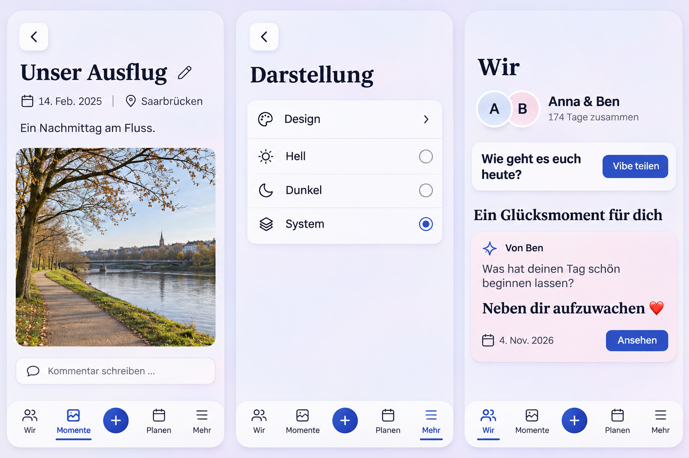

# Unified subpage navigation and moment context

## Baseline and acceptance scope

Reviewed main `9003e45debd1e4531f4adaae80320d7da9ee48ce` and Chapter PR
[#1636](https://github.com/baerenmarke90/eimir/pull/1636) at
`113f389e38af59099c53b92ef4bc1b8bd5206e04`. The integration has the exact
Chapter source tree; other working copies and their unpublished edits are preserved.

The three Product Owner requests are cumulative:

1. Every current and future authenticated secondary page has one rounded,
   icon-only left-chevron button at the upper left. Root destinations have none.
   Keep existing task-specific close, pending, dirty-exit and contextual return
   ownership; deep links have a canonical parent fallback.
2. Memory and HeartMoment detail dates use a calendar icon, with linked Places
   beside them in one wrapping metadata row, above the photo. Preserve every
   Place, order, map/address/attribution access, authorization and retry state.
   Reuse the same calendar date treatment in existing moment previews.
3. Incoming happiness and time-travel answers on Wir include their original
   prompt, author and date with the answer, and retain canonical opening and
   consume-on-open behavior. No invented question, answer or relationship state.

## Generated visual preflight

Generated with built-in Imagegen before UI implementation after inspecting
AppShell, TaskBackButton, PageHeader, Memory/HeartMoment readers, MomentPlaces,
SharedExperienceReveal, Today orchestration, the dashboard projection, routes
and task-origin/editor lifecycle. [Exact prompt](prompt.txt).

The image guides composition only. Use the actual Eimir icons, normal UI section
headings, existing appearance controls and shell. The generated settings choices,
portrait shape, decorative outlines and navigation icons are illustrative;
no new settings, card borders, avatar layout or tab meanings are introduced.

## Mobile Interaction Contract

Product Reference v1 R1/R2/R4/R5; Screen Templates 4/8/9/11. The human goal is
recognizable navigation and understandable personal context. Existing photos,
authored prompts and answers remain focal. A secondary page has one familiar
Back action; each reader retains its existing contextual actions.

Compact uses the established safe-area gutters, one vertical reading flow,
44px minimum Back/Place targets and a naturally wrapping date/location row.
The shell supplies secondary navigation by default, with explicit page-owned
task actions taking precedence without duplicated controls. Reading, loading,
empty, unavailable, error, offline and permission states retain usable Back.

Keep native/browser Back, focused editors, ShortTaskSheet modality,
dirty/pending guards, retained originating scope/pages/focus/scroll, and canonical
deep-link fallbacks. Utility navigation needs no typing or early keyboard.
Optional Place details use a short contextual disclosure; no map provider runs
until an explicit link. No extra row per Place below media.

Incoming experience content reads original prompt -> authored answer -> author,
date and existing open action. Sparse or legacy responses use honest localized
type context without fabricating a prompt. Refresh does not animate repeatedly.
Use existing press/route/sheet feedback and reduced-motion semantics.

Expanded preserves the same order, bounded reading width and upper-left Back.
Long text, multiple Places and 320px/200% text reflow without horizontal scrolling.
No private content, entitlement, relationship-state or source-access boundary changes.

## Reuse and business model

Reuse React Router, React portals/context, TaskBackButton, task-origin/editor
lifecycle, ShortTaskSheet, MomentPlaces, Eimir calendar/pin icons, Intl dates and
semantic tokens. Extending these owned primitives avoids a second navigation,
Place-query or provider layer. No new dependency, provider or native capability.

**No business/freemium impact:** basic navigation and existing Memory/HeartMoment
metadata retain Free/Core and non-paywallable accessibility. Existing happiness/
time-travel entitlement remains. Cloud and Self-Hosted behavior, resource limits,
data retention, export, downgrade and ongoing costs are unchanged.

## Cross-cutting and validation plan

Preserve scoped authorization and late-result admission, Place privacy and
shared-only projection, no private data in navigation state, locale-driven text,
date-only UTC semantics, named icon controls, keyboard/focus and large text.
The dashboard adds only the already authorized original prompt, with no schema
migration, new query or notification side effect. Regenerate OpenAPI and its
client from their sources.

Validate component regressions, production build/typecheck/lint/format/tokens,
dashboard/API projection and contract generation. Exercise real browser
navigation -> edit -> dirty/pending Back -> save -> read -> return; unknown
future subpages, deep links, privacy/denial and multi-Place metadata. Review
Compact 360/390/430, Expanded Light/Dark, 320px large text and reduced motion.
Shared shell changes conservatively select the full retained hosted browser suite.
