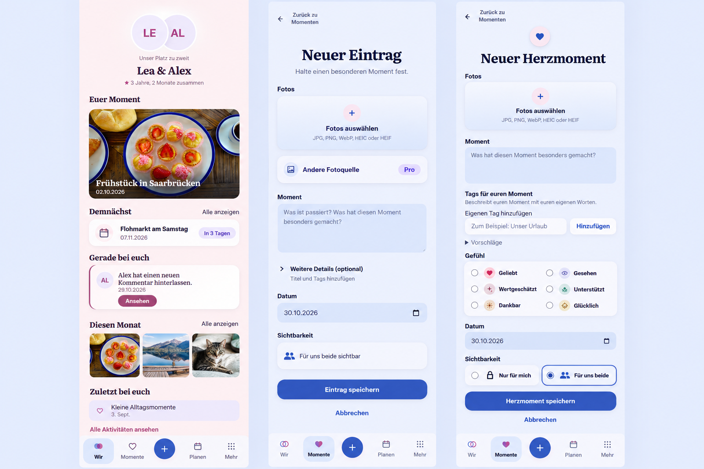

# Today and composer clarity

## Preflight before UI implementation

Product Owner request: remove the duplicate upcoming announcement from Today,
retain one coherent upcoming destination and countdown, remove redundant partner
gesture success toasts and the activity-link arrow, separate Memory photo-source
controls, and simplify HeartMoment creation chrome and audience selection.
The Product Owner authorized a pull request. This slice does not authorize a
deployment or merge.

Owning issue: [#1530](https://github.com/baerenmarke90/eimir/issues/1530). The
reference and contract were committed and linked there before UI implementation.

Baseline: `cc0e23b7d6f4d950f0012660f051be46dd2da3af` (`main`, including #1523 and
#1526). Inspected the actual `/today`, `/story/memories/new` and
`/story/heart-moments/new` implementations before generating the reference:
`TodayPage`, `usePartnerGesture`, `MemoryCreatePage`, `PhotoSourcePicker`,
`AttachmentDraftPicker`, `HeartMomentProductPage`, `HeartEmotionPicker` and their
styles. Baseline browser captures verify the populated Today composition and
HeartMoment creation on a 390 px phone. Existing parallel checkouts contain
unrelated work, so this slice uses a separate checkout based on current main.

Authority: Product Reference v1, R4 Today and R1 capture, Today and Create/Edit
screen templates, the partner-app standard, selection/visibility/feedback
component contracts, and the current semantic token adapter.

Generated with the built-in Imagegen tool before UI changes. The complete prompt
is retained in [the reference prompt](references/wir-composer-clarity/prompt.txt).
Unmodified generated PNG SHA-256:
`ffa029b8ffdf7f353556c90ce1c0488cafd1250607847345d5058e08d6dcfd9a`.
This image guides hierarchy, not exact typography or geometry. Its Memory panel
reorders existing content, omits the existing top date and misrepresents the
focused-task shell; implementation preserves the actual date → narrative →
photos order and focused task behavior. Its emotion heading remains outside the
surface; the requested implementation places the semantic group heading inside
the padded surface. No new photograph, content, countdown calculation or
capability is introduced from the generated image.

## Mobile Interaction Contract

- Human outcome: recognize the next shared experience once, send one intentional
  partner gesture with one contextual confirmation, and capture content without
  overlapping controls or repetitive instructions.
- Today: people and relationship duration → focal keepsake → the existing
  upcoming module with its countdown/agenda → eligible supporting modules. Keep
  personal module visibility, ordering and 1–3 upcoming-item preferences. The
  hero no longer echoes the upcoming destination. Existing countdown selection
  and canonical plan links remain authoritative.
- Memory: preserve the existing sustained-writing task, native photo input,
  optional external-source sheet and attachment lifecycle. Put source selection
  after the file picker in a real grid flow with semantic spacing. Do not change
  source consent, entitlement, quota or upload behavior.
- HeartMoment: retain Back, heart/title, optional photo, thought, tags, the six
  existing emotion choices, date, audience and save/cancel. Remove the redundant
  wordmark and visibility-help sentences. Audience remains two real labeled
  radio choices with visibility glyphs; selected state is native and keyboard
  accessible. Keep both choices in one row; text may wrap within a choice under
  large text. Each choice remains at least 44 px high.
- Emotion group: retain fieldset/legend semantics, but let its visible label
  occupy normal flow inside the padded surface rather than cutting its border.
- Dominant actions: open real content on Today; save the actual result in each
  composer. No early keyboard activation or new input requirements.
- Loading/empty: keep existing section eligibility, skeletons and source
  availability. An absent upcoming item has no fabricated replacement.
- Error/offline: retain inline gesture failures, cooldown/module errors,
  attachment errors, draft safety, explicit unsaved states and safe retries.
  Remove only redundant confirmed-success snackbars.
- Success/return: gesture sheet/avatar feedback still follows server success;
  creation opens the saved resource and preserves origin/Back behavior. Keep
  duplicate-send protection and visibility request values.
- Privacy: the selected audience remains explicit next to completion; private
  content still follows existing authorization, projection and cache rules.
- Narrow/large text: validate 360/390/430 px, 320 px reflow and enlarged text,
  including containment, distinct photo controls, focus and touch targets.
- Motion: reuse existing gesture acknowledgment and selection feedback. Reduced
  motion keeps result text and selected states without new animation.
- Expanded: the same hierarchy and bounded task width, without new columns or
  duplicate hero links. Validate 1280+ px and Light/Dark.
- Warmth comes from personal content and existing emotion colors. No additional
  microcopy, decorative quote/brand ornament, new widget or table is needed.
- Evidence plan: real-browser screenshots plus open → interact → save → result
  → return journeys, gesture no-toast confirmation, native audience keyboard
  behavior, axe/reflow, existing visibility/offline negatives and build checks.

## Reuse, business model and cross-cutting review

Reuse review not relevant to new infrastructure: this is bounded presentation
cleanup using existing React/native radio and file controls, `CouplePresence`,
`AnticipationCard`, `TodayAgendaRow`, `AttachmentDraftPicker`, `PhotoSourcePicker`,
`VisibilityGlyph` and semantic spacing/color/motion tokens. No dependency,
provider, upload or notification transport is added or replaced. A new picker,
custom audience interaction or external UI library would duplicate existing
behavior and is unnecessary.

No business/freemium impact: Memory and HeartMoment remain Free/Core; privacy and
accessibility remain non-paywallable. Existing Mixed/Premium partner gestures
and external photo-source entitlements are unchanged. No change to Space
ownership, Cloud/Self-Hosted parity, quotas, storage, costs, retention, downgrade,
restore or export; no feature-matrix update is required.

Security, authorization, idempotency and notification delivery are unchanged.
No API/schema/migration, logging or persistent-data change. The audience is
still explicit before submission. Localized copy stays in locale resources.
Geometry, native field semantics, keyboard/focus, theme contrast and reduced
motion are the relevant quality checks. Existing concurrency, stale-scope,
offline, failure and cooldown tests remain intact.

## Validation

Runtime implementation: `3b6f8d3f`; final scoped photo-sheet hover correction:
`a68f4bee`. Subsequent commits add evidence, import ordering and this record;
they do not alter runtime behavior.

- 139 targeted tests pass across `TodayPage`, `PartnerQuickActions`,
  `HeartMomentProductPage`, `HeartMomentVisibility` and `HeartEmotionVisual`.
- All 109 distinct relevant browser cases have a passing result across the
  broad run and targeted corrected runs. The initial broad run passed 107 and
  identified two real defects. Double-size text exposed the existing unbroken
  HeartMoment heading width; it now wraps without overflow. The photo-source
  sheet's generic hover translation oscillated by 1 px when it opened with the
  pointer on a button edge; scoped stable hover geometry fixes the actual
  interaction instead of bypassing browser actionability.
- The final HeartMoment Compact Light/Dark and 320 px/200% cases pass. The final
  photo-source journeys pass at 320/360/390/430/1280, including 200% photo-action
  reflow, separated targets, consent, import, draft retention and save. One
  430 px rerun encountered a transient blank development page during startup;
  the targeted repeat passed unchanged. No timeouts or assertions were relaxed.
- All three gestures retain pending/confirmed contextual feedback, reject
  duplicate sends and display no success snackbar. Error, uncertain retry,
  offline no-replay, cooldown and entitlement cases pass.
- Special-plan countdown opens the real plan and returns to Today; it appears
  once, respects hidden upcoming state and preserves the 1–3 preference.
  Populated/sparse Today, keyboard, 200% reflow, reduced motion, canonical
  destinations and Light/Dark/Expanded scenarios pass.
- Production build, token identity/PWA checks, TypeScript, Web lint/format,
  engineering-language audit, project-identity scan and whitespace checks pass.
  The first local build was interrupted when its formatter child stalled in
  the restricted process environment; the normal build passed with local
  process access. Existing unrelated lint/build warnings remain unchanged.
- No GitHub jobs were manually retried. CI remains a merge gate. No physical
  Android device was used; this slice changes the shared Web UI only.

Representative browser evidence uses repository-owned demo/fixture content,
not the Product Owner's personal photos. Full-page captures preserve actual
fixed navigation; detail captures show the affected controls without overlap.

| Scope | Evidence |
| --- | --- |
| Today composition | [390 Light](references/wir-composer-clarity/evidence/today-390-light.png), [390 Dark](references/wir-composer-clarity/evidence/today-390-dark.png), [Expanded](references/wir-composer-clarity/evidence/today-expanded.png) |
| Single upcoming/countdown area | [360 Light](references/wir-composer-clarity/evidence/countdown-360-light.png), [Expanded Dark](references/wir-composer-clarity/evidence/countdown-expanded-dark.png) |
| Confirmed gesture without a toast | [430 Dark](references/wir-composer-clarity/evidence/gesture-confirmed-no-toast.png) |
| Memory photo controls | [390 Light](references/wir-composer-clarity/evidence/memory-photo-actions-390-light.png), [360 Dark](references/wir-composer-clarity/evidence/memory-photo-actions-360-dark.png), [320 / 200%](references/wir-composer-clarity/evidence/memory-photo-actions-320-200-percent.png), [Expanded Dark](references/wir-composer-clarity/evidence/memory-photo-actions-expanded-dark.png) |
| HeartMoment creation | [390 Light](references/wir-composer-clarity/evidence/heart-create-390-light.png), [390 Dark](references/wir-composer-clarity/evidence/heart-create-390-dark.png), [Expanded](references/wir-composer-clarity/evidence/heart-create-expanded.png), [200%](references/wir-composer-clarity/evidence/heart-create-200-percent.png) |
| Emotion label and audience | [Emotion inside surface](references/wir-composer-clarity/evidence/heart-emotion-390-light.png), [Compact audience row](references/wir-composer-clarity/evidence/heart-audience-390-dark.png) |
